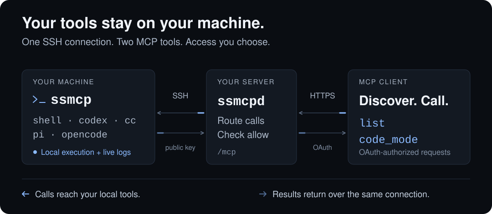
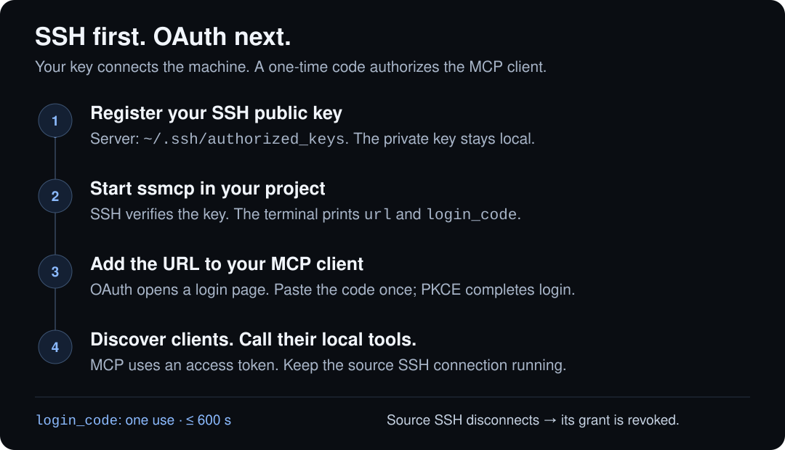

# ssmcp

**通过 SSH，把本机 Shell 和编码智能体接入 MCP。**

[](https://github.com/LIghtJUNction/ssmcp/actions/workflows/ci.yml)
[](rust-toolchain.toml)
[](.github/workflows/ci.yml)
[](LICENSE)

一条 SSH 连接，两个 MCP 工具。`list` 找到在线客户端，`code_mode` 调用它们的原生能力；命令、输出和智能体事件实时显示在本机终端。项目、模型配置和后端工具执行都留在本机。[工作原理](docs/backends.md)

本工具有意模仿ssh，尽可能保持功能简洁。



[**首页与逐步骤教程**](https://ssmcp.lmm.best) · [客户端配置](docs/configuration.md) · [服务器部署](docs/deployment.md) · [后端与工具接口](docs/backends.md) · [验收记录](docs/validation.md) · [真实操作视频](https://drive.google.com/file/d/1xAn67HJMXeEKS-rpBpaRXlE368ziIRVn/view?usp=drivesdk)


# 应用场景

1. ChatGPT chat模式 Pro模型控制你本地的codex（还支持别的）完成软件工程任务。
2. 使用我的AI订阅，远程控制朋友的电脑，帮朋友配置电脑环境，安装软件，安装ai工具。
3. 在多台电脑、多个项目目录启动客户端，用同一个 MCP 入口找到有权操作的环境。

# 安全警告⚠️

本工具安全边界如下：

1. 中转服务器可信任，😌作者我是可信任的，但我还是建议你自己部署。
2. 服务器通过已经登记的 SSH 公钥接受本机连接。启动时用 `--allow 用户名@github` 指定谁能操作这个客户端，然后把终端返回的完整 URL 添加到 ChatGPT 或其他 MCP 应用。
3. 0.4.0 支持 GitHub 浏览器登录：核对身份后，再明确同意当前 MCP 客户端连接。本机 CLI 无须登录 GitHub。省略 `--allow` 时保留一次性登录码流程；登录码和 OAuth 令牌都应妥善保管。当前第三方身份提供方为 GitHub，邮箱登录尚未提供。
4. 建议，最好还是私有化部署，不要用公共的，需要自备域名和服务器，源代码都开源。


## 公共服务连接教程

打开 [ssmcp.lmm.best](https://ssmcp.lmm.best)，按首页教程完成 GitHub 登录、公钥登记、本机连接和 ChatGPT 插件配置。自助账户使用 GitHub 账号编号绑定，SSH 用户名固定为 `gh-<ID>`；GitHub 改名后，更新 `--allow`，SSH 用户名和公钥归属保持不变。账户与公钥持久保存，网页登录会话在服务重启后失效。

在 [ChatGPT Plugins](https://chatgpt.com/plugins) 点击 **Add**，**Name** 填 `ssmcp`，**Connection** 填 `https://ssmcp.lmm.best/mcp`，勾选同意后点击 **Create**。再按提示使用 GitHub 登录，核对身份和当前 MCP 客户端，明确允许连接。首页登录不会自动授予插件访问权限。

自助公钥目前只接受单行 Ed25519 公钥，最多 20 把；只上传 `.pub`，私钥留在本机。服务器需先启用[门户与 SSH 同步](docs/deployment.md#account-portal)，变更通常在 15 秒内应用；删除公钥仅阻止后续 SSH 认证，已有连接须在本机退出。未启用门户时，首页会说明状态，原有 SSH 账户仍可使用。

## 快速开始

服务器已部署 0.4.0、配置 GitHub OAuth 并接受你的 SSH 公钥后，在本机项目目录启动客户端。已有 `~/.ssh/config` 可以直接复用：

```sshconfig
Host my-ssmcp
    HostName ssmcp.example.com
    User alice
    Port 22
    IdentityFile ~/.ssh/id_ed25519
    IdentitiesOnly yes
```

```sh
cd ~/projects/ssmcp
ssmcp --name ssmcp-project -t codex --allow octocat@github my-ssmcp
```

`my-ssmcp` 是 SSH 配置别名；用户名、地址、端口和密钥交给系统 OpenSSH 解析。也可使用 `ssmcp alice@ssmcp.example.com`，或 `-F ~/.ssh/work_config` 指定配置文件。0.3.1 起支持省略用户名；已安装的 0.3.0 若提示 `destination must be user@host`，可先用 `alice@my-ssmcp`，或[重新构建安装](#安装与升级)。[SSH 配置细节](docs/configuration.md)

**已经能用同一把公钥连接该服务器账号，就可以继续用它。** 自助账户在首页管理公钥；已有手工创建的账户仍由管理员通过 OpenSSH 管理，受限账号启用 `ForceCommand` 后，通过独立管理员账号或服务器控制台追加新公钥。完整教程包括首次配置、保留旧钥、验证新钥和撤销旧连接的步骤。[公钥配置与更新](docs/configuration.md#更新公钥)

把 `octocat` 换成获准访问这个客户端的 GitHub 用户名。`--allow` 使用 `用户名@提供方` 格式，目前支持 `@github`；可重复指定或用逗号分隔，最多 32 个不同用户，大小写不敏感：

```sh
ssmcp --allow alice@github,bob@github --allow carol@github my-ssmcp
```

启动成功后，终端会输出一次连接信息：

```json
{
  "url": "https://ssmcp.example.com/mcp",
  "auth": "github",
  "allow": ["octocat@github"],
  "client_id": "服务端分配的连接 ID",
  "name": "ssmcp-project",
  "type": "codex",
  "cwd": "/home/alice/projects/ssmcp",
  "hostname": "workstation"
}
```

将 `url` 添加到支持 OAuth 的 MCP 客户端，选择 GitHub 登录。返回 ssmcp 后，核对 GitHub 身份、MCP 客户端名称和回调来源，点击“允许连接”。随后调用 `list` 查看获准访问的在线客户端，再用 `list({client_id})` 读取原生工具及参数。**保持本机 ssmcp 进程运行，才能继续操作它的后端。** [逐步登录教程](docs/configuration.md#登录流程)

需要原有登录码方式时，省略 `--allow`。终端返回 `https://ssmcp.example.com/SSH用户名` 和一次性 `login_code`，在对应 OAuth 页面填写即可。该授权只覆盖同一 SSH 账号下未设置 `--allow` 的客户端。[两种授权方式](docs/configuration.md#authorization-modes)

## SSH 连接，OAuth 授权

SSH 用公钥确认本机可以接入服务器。`--allow` 决定哪些 GitHub 用户可以使用这条连接的后端；浏览器登录确认操作者身份，之后由用户单独同意当前 MCP 客户端连接。服务端在客户端接入时将用户名解析为 GitHub 稳定用户 ID，每次发现和调用都核对目标客户端的允许列表。[身份验证](src/identity.rs) · [授权实现](src/oauth.rs)



| 操作 | GitHub 身份授权 `/mcp` | 登录码授权 `/SSH用户名` |
| --- | --- | --- |
| 重新打开 MCP 应用 | 保存的授权有效时继续使用；支持刷新的客户端可自动续期 | 同左，并要求签发登录码的 SSH 连接仍在线 |
| 本机 ssmcp 断开后重连 | 旧客户端消失；新客户端的 `--allow` 仍包含该身份时，可用现有授权发现它 | 签发连接退出会撤销其授权，需要新码登录 |
| 新增一个项目客户端 | 只显示明确允许当前 GitHub 身份的客户端 | 只显示同一 SSH 账号下未设置 `--allow` 的客户端 |
| 当前没有获准访问的在线客户端 | 可以完成登录与同意，`list` 返回空列表 | 需要在线连接签发登录码 |
| 重启 `ssmcpd` | 内存中的连接、登记与授权清空，重新连接和登录 | 同左 |

ssmcp 自己签发的 access token 默认有效 **8 小时**。refresh token 每次成功刷新都会轮换，并把闲置期限向后延长 **30 天**，同一授权从首次登录起最长 **90 天**。客户端登记默认有效 **365 天**。原有登录码仍是 **30 分钟、使用一次**。GitHub 只用于核验身份；MCP 使用上述 ssmcp 令牌。[有效期与服务端配置](docs/deployment.md#oauth-lifetimes)

**访问令牌到期后，MCP 客户端可以用 refresh token 自动续期。** 新注册省略 `grant_types` 时，服务端默认提供刷新授权；客户端需保存每次返回的新 refresh token，并实现刷新请求。服务器返回到期提示与新令牌，自动发起刷新由 MCP 客户端负责。[静默续期流程](docs/configuration.md#silent-refresh)

## 五种后端，同一个入口

| 本机后端 | 启动方式 | 运行内容 |
| --- | --- | --- |
| Shell | `ssmcp --name terminal my-ssmcp` | 有状态的本机 Shell 与 PTY；默认模式 |
| Codex | `ssmcp -t codex --name coder my-ssmcp` | 已安装 Codex 的 App Server |
| Claude Code | `ssmcp -t cc --name claude my-ssmcp` | 已安装 Claude Code 的 MCP 工具 |
| Pi | `ssmcp -t pi --name pi my-ssmcp` | 已安装 Pi 的 JSONL RPC |
| OpenCode | `ssmcp -t opencode --name opencode my-ssmcp` | 已安装 OpenCode v2 的服务接口 |

每个进程提供一个后端，同一账号最多同时在线 128 个客户端。`--name` 是显示名称，调用始终按服务端分配的 ID 路由；`cwd` 记录启动目录。Agent 的安装、模型配置和原生权限在本机完成，支持范围以实际发现的 schema 为准。[后端要求与示例](docs/backends.md)

```sh
# 本机发现工具，无需 SSH，也不建立远程连接。
ssmcp -t codex --list-tools

# 使用另一份 SSH 配置或已有私钥。
ssmcp -F ~/.ssh/work_config -t codex my-ssmcp
ssmcp -i ~/.ssh/id_ed25519 -p 2222 alice@ssmcp.example.com

# 自定义后端路径；-- 后的参数交给本机后端。
ssmcp -t pi --backend /opt/pi/bin/pi my-ssmcp -- --no-session
```

## 两个工具就够了

| MCP 工具 | 用法 |
| --- | --- |
| `list({})` | 列出当前授权可访问的在线客户端：ID、名字、类型、主机和启动目录 |
| `list({client_id})` | 读取指定客户端的原生工具名称与参数 schema；用 `nextCursor` 分页 |
| `code_mode({code, timeout_ms})` | 用 JavaScript 调用原生工具，返回结果和日志 |

例如，对名为 `terminal` 的 Shell 客户端执行 `pwd`。将下面源码放入 `code_mode` 的 `code` 参数：

```javascript
const client = clients.find(c => c.name === "terminal" && c.type === "shell");
if (!client) throw new Error("terminal is offline");

const before = await call(client.id, "terminal.status", {});
if (before.isError) return before;
const sent = await call(client.id, "terminal.write", { data: "pwd\n" });
if (sent.isError) return sent;
return await call(client.id, "terminal.read", {
  cursor: before.structuredContent.next_cursor,
  wait_ms: 1000
});
```

单次读取可能只有部分输出，继续用返回的 `next_cursor` 读取。调用 Agent 时，先用 `list({client_id})` 或 `await tools(client.id)` 检查实际 schema。`call` 保留原生 `content`、`structuredContent`、`isError` 和审批数据；代码应检查原生错误与任务状态。[完整 JavaScript 接口](docs/backends.md#3-用-code_mode-编排调用)

代码由服务器的系统 Node.js 在 bubblewrap 隔离环境中执行，通过 SSH 将原生调用交给本机后端。每次编排独立运行；源码、内存、调用次数、输出和时长都有上限。代码超时后，已经发给后端的操作可能继续，重试前先检查执行状态。[资源与生命周期](docs/backends.md#传输与资源边界)

## 技能摘要、AGENTS.md 与文本原语

通过 code_mode 原生生成技能摘要、读取适用于目标路径的指令文件，并直接处理 UTF-8 文本：

~~~js
return await skills.view(clientId);
~~~

~~~js
return await agents.resolve(clientId, {path: "src/lib.rs"});
~~~

~~~js
return await fs.readText(clientId, {path: "README.md"});
~~~

skills.list/read/view 分别用于元数据索引、全文读取与 Markdown 摘要视图；agents.list/read/resolve 保留目录层级和文件来源。fs.writeText/editText 支持原子写入及 SHA-256 前置条件。它们由客户端直接执行，不需要启动模型。

默认以客户端启动目录为根；全局技能或上层规则可通过重复的 --context-root PATH 加入只读上下文视图。context.roots(clientId) 返回可选择的根 ID。普通文件写入范围独立于这些只读配置。

[完整接口与示例](docs/context.md) · [上下文能力验收记录](docs/validation-context-primitives.md)

## 文件同步、端口映射和动态资源

每个客户端同时提供受启动目录限制的文件能力。通过 `code_mode` 使用 `fs.list/stat/read/write/mkdir`，不需要为简单文件操作拼接命令。目录同步调用系统 rsync，端口转发在所选客户端的回环地址之间传送 TCP。

| 内置接口 | 用途 |
| --- | --- |
| `rsync(options)` / `sync(options)` | 两个客户端之间同步目录内容；默认预演，不删除目标多余文件 |
| `jobs.status/wait/cancel/list` | 观察和取消同步任务；任务在本次编排结束后继续 |
| `ports.open/list/close` | 指定监听端和服务端；交换客户端即可反向映射 |
| `resources.list/read/templates` | 读取指南、限制、在线客户端及原生工具参数 |

`code_mode` 在服务器运行。ChatGPT 沙箱需要在自己的环境中启动并注册客户端，才能作为文件或端口操作的一端。路径和端口始终属于显式指定的客户端，不能把服务器的目录当成调用方目录。

源目录和目标目录必须已存在。先预演，核对变更后将 `dry_run` 改为 `false`；两边同时修改同一文件时先处理冲突。

```js
return await rsync({
  source: { client_id: developmentId, path: "src/" },
  destination: { client_id: workspaceId, path: "src/" },
  dry_run: true,
  delete: false
});
```

服务器还提供标准 MCP 动态资源，可从 `ssmcp://guide` 开始读取。项目自带 [ssmcp skill](skills/ssmcp/SKILL.md)，也能从 `ssmcp://skill` 获取。

[工作区完整教程](docs/workspaces.md) · [验证记录与覆盖范围](docs/validation-workspace-bridge.md)

## 安装与升级

当前支持 Linux 5.3+，仓库固定构建工具链为 Rust 1.100.0。客户端需要 OpenSSH 和所选本机后端；服务端需要 OpenSSH Server、系统 Node.js 18+、bubblewrap 0.8+、util-linux 的 prlimit 及 HTTPS 反向代理。[完整部署教程](docs/deployment.md)

```sh
# 在仓库目录构建，并安装程序、运行脚本、man page 和文档。
cargo build --locked --release
sudo make install
```

服务端依赖通过系统包管理器安装：

```sh
# Debian / Ubuntu
sudo apt install openssh-server nodejs bubblewrap util-linux
# Arch Linux
sudo pacman -S openssh nodejs bubblewrap util-linux
# Fedora
sudo dnf install openssh-server nodejs bubblewrap util-linux
```

`ssmcpd serve` 发布 HTTPS 后面的 MCP 服务；SSH 登录后的 `ssmcpd attach` 转发连接数据。`make install-server` 另安装 systemd unit 和初始配置，具体账户、域名与反向代理设置见[服务器部署](docs/deployment.md)。只运行客户端时无需安装服务端的 Node.js、bubblewrap 和 prlimit。需要目录同步的客户端应另行安装系统 rsync。

0.4.0 继续使用私有桥接协议 v4，保留旧客户端的登录码方式。使用 `--allow` 需要更新两端，并在服务端配置 GitHub OAuth；遇到不支持该策略的旧服务器时，新客户端会拒绝继续启动后端。

服务端使用 TOML 配置，支持默认路径 `/etc/ssmcpd/ssmcpd.toml` 和 `--config`。GitHub callback 为公网 origin 后接 `/oauth/callback/github`。更新源码后还需安装新二进制并重启实际服务；重启后重新注册和登录。[TOML 与 GitHub 设置](docs/deployment.md#github-oauth) · [升级步骤](docs/deployment.md#upgrade-040)

## 验证与贡献

```sh
cargo fmt --all -- --check
cargo clippy --locked --all-targets -- -D warnings
cargo test --locked
cargo build --locked
# 需要系统允许 bubblewrap 创建隔离命名空间。
cargo test --locked --lib code_mode::tests -- --include-ignored
cargo test --locked --test two_tools -- --include-ignored
python3 scripts/e2e.py --bin-dir target/debug
python3 scripts/e2e_agents.py --bin-dir target/debug
```

CI 在 Linux x86_64 与 arm64 上运行检查。SSH 测试使用临时密钥、独立 sshd、临时 known_hosts 和 loopback 端口；五模式链路测试使用确定性 Agent 协议 fixture，不发起模型推理。默认测试中需要系统隔离或单独安装原生 CLI 的探针会明确标为 ignored。[测试结果与范围](docs/validation.md) · [CI 工作流](.github/workflows/ci.yml)

## 文档导航

| 你想做什么 | 从这里开始 |
| --- | --- |
| 复用 SSH 配置、首次登记公钥、更新密钥 | [配置教程](docs/configuration.md) |
| 登录 ChatGPT / MCP，恢复过期授权 | [登录与恢复](docs/configuration.md#登录流程) |
| 设置 `--allow`，了解哪些客户端会被看到 | [GitHub 身份与访问规则](docs/configuration.md#github-allow) |
| 安装服务端、配置 systemd / SSH / HTTPS | [Linux 部署](docs/deployment.md) |
| 编排 Shell 或 Agent 的原生能力 | [后端与代码模式](docs/backends.md) |
| 两端同步文件、映射端口、读取动态资源 | [工作区教程](docs/workspaces.md) |
| 为 AI 提供可复用使用指南 | [ssmcp skill](skills/ssmcp/SKILL.md) |
| 查看测试、架构与实际验收范围 | [验收记录](docs/validation.md) |
| 看真实终端操作 | [演示视频，英文说明](https://drive.google.com/file/d/1xAn67HJMXeEKS-rpBpaRXlE368ziIRVn/view?usp=drivesdk) |

[MIT License](LICENSE) · [OpenSSH](https://www.openssh.com/) · [MCP](https://modelcontextprotocol.io/)

### 客户端终端输出

连接凭据仍以单行 JSON 输出到 stdout；实时活动显示在 stderr，默认使用易读分块，区分助手文本、工具/命令、文件差异、错误、状态和 token usage。终端自动着色；设置 `NO_COLOR=1` 或重定向 stderr 时不输出 ANSI。JSON 字符串中的换行正常显示，源码中的字面 `\n` 保留。

Unified diff 的文件 header 加粗、hunk 青色、增加行绿色、删除行红色，并显示旧/新行号；流式分片会先拼成完整行，最后的未换行内容在事件结束或断开时刷新。普通长文本按终端宽度换行，diff 保持原行布局。

```sh
ssmcp -t codex my-server                    # 默认 pretty
NO_COLOR=1 ssmcp -t codex my-server         # 无颜色
ssmcp -t codex my-server 2> activity.log    # 可读日志，无 ANSI
ssmcp --raw -t codex my-server             # 原始事件序列化，每个事件一行
```

`--raw` 仅改变展示：直接输出传入 EventLog 的原始事件序列化（不添加标签或派生字段），不影响事件缓存、工具结果或 SSH/MCP 协议。
