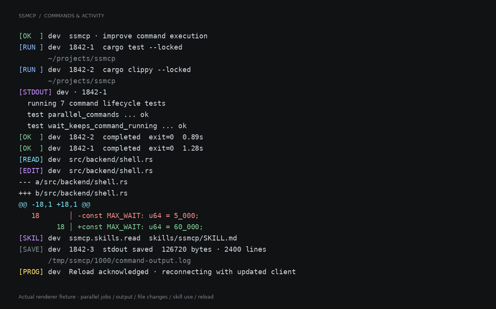

# ssmcp

用 GitHub 账号连接自己的设备。在终端进入远程 Shell，也可以让 MCP 客户端调用设备上的工具。

[](docs/assets/ssmcp-eclipse.mp4)

[播放《日蚀》 · 24 秒](docs/assets/ssmcp-eclipse.mp4)　 /　 [快速开始](#快速开始)　 /　 [安装与升级](#安装与升级)　 /　 [文档导航](#文档导航)

[](https://github.com/LIghtJUNction/ssmcp/actions/workflows/ci.yml)
[](rust-toolchain.toml)
[](docs/releases.md)
[](LICENSE)

## 新版连接体验

直接输入自定义用户名和服务器地址：

```sh
ssmcp alice@relay.example.com
```

首次连接会检查用户名并引导 GitHub 授权，确认后完成账号绑定并通过 HTTPS / WSS 连接。之后复用这台服务器的本机凭据，无须先运行登录命令；`ssmcp login` 仍作为兼容入口保留。连接建立后可用 `ssmcp -i` 选择和控制已授权设备。

## 从设备到会话

| 你想做什么 | 入口 |
| --- | --- |
| 进入另一台设备的终端 | 运行 `ssmcp -i`，选择已授权的在线设备 |
| 让模型使用设备上的工具 | 用 `list` 发现设备，再用 `code_mode` 调用原生能力 |
| 让多个 agent 配合工作 | 用 `collab` 在同一会话中发现彼此并发送消息 |

项目、模型配置和工具执行都留在设备上。客户端通过 HTTPS / WSS 接入可信服务器，也可用 `--ssh` 显式复用已有 SSH 配置。[了解工作原理](docs/backends.md)

本项目由 Astra Pro 在网页版 Chat 模式下使用 ssmcp 插件开发。

## 007 轻量值守模式

Linux 上可以保留一个独立的唤醒连接，需要工作时再启动完整会话：

```sh
ssmcp 007 install --cwd "$HOME/Documents/GITHUB" --client "$(command -v ssmcp)"
ssmcp 007 status
```

007 不加载终端和工具目录，空闲时只维持认证连接并回应服务器保活。断网后自动重连；正式会话使用独立 systemd 单位。普通客户端升级不替换 007 保存的恢复程序，启动失败时仍可唤醒已知可用版本。[使用说明与恢复流程](docs/007.md)。

## 快速开始

先[安装新版客户端](#安装与升级)，并使用已启用 GitHub OAuth、账号门户和客户端 API 的新版服务器。将示例域名换成你的服务地址：

~~~sh
# 在项目目录运行，首次连接会打开 GitHub 授权。
ssmcp alice@ssmcp.example.com --name device-a

# 没有图形浏览器时，打印链接和确认码供另一台设备打开。
ssmcp alice@ssmcp.example.com --no-browser
~~~

`alice` 是你在这台服务器选择的用户名，可以与 GitHub 用户名不同。客户端先检查名字规范，再自动引导 GitHub 登录；在浏览器确认后完成注册绑定并连接。已有账号直接复用该服务器的凭据，日常使用无须单独运行 `login`。保持终端打开即可提供当前目录的 Shell 和本机工具。

用户名不区分大小写，统一为小写；长度 3–32，首字符为 ASCII 字母，末字符为字母或数字，中间可用字母、数字、`_`、`-`。保留名和已属于其他账号的名字不能注册。每个 GitHub 账号在一台服务器绑定一个用户名，换服务器分别注册、分别保存凭据。[用户名与管理员配置](docs/named-accounts.md)

之后运行 `ssmcp --name device-a` 可使用配置指定的默认服务器，未配置时复用上次授权的服务器；`ssmcp whoami` 查看当前身份。前台连接遇到凭据过期会重新请求授权；服务不可用或账号被封禁时保留本地凭据并显示错误。HTTPS 接入不需要 SSH 公钥或设备入站端口；看门狗默认启用，`--no-watchdog` 可关闭。

在 A 的另一个终端查看或进入可控会话：

~~~sh
ssmcp list
ssmcp -i
~~~

`-i` 列出设备供选择，随后进入它的终端。Ctrl-C 交给远端 Shell；Ctrl-] 离开控制界面，远端会话继续运行。本地后台服务仍用 `ssmcp sessions list` 管理。

## 设置默认中转服务器

保存默认地址后，后续登录、邀请和连接都可以省略 `--server`：

~~~sh
ssmcp config set server https://relay.example.com
ssmcp config get server
ssmcp config path

# 只让这一次邀请使用另一台已登录的服务器。
ssmcp invite --server https://other.example.com
~~~

也可以编辑 `ssmcp config path` 输出的文件，默认是 `~/.config/ssmcp/config.toml`，添加或修改：

~~~toml
[client]
server = "https://relay.example.com"
~~~

地址优先级为 **`--server` → `[client].server` → 最后登录的服务器 → `https://ssmcp.lmm.best`**。命令设置会保留已有 UI 配置与注释。`ssmcp config unset server` 移除配置覆盖，`SSMCP_CLIENT_CONFIG` 可指定另一份绝对路径配置文件。首次使用另一台服务器时运行 `ssmcp alice@relay.example.com` 自动注册或登录；各服务器的账号令牌分别保存。[配置路径与完整说明](docs/client-server.md#设置默认服务器)

## 固定可信服务器的公钥

把管理员通过可信渠道提供的 **HTTPS 入口公钥**登记到本机：

~~~sh
ssmcp trust add --server https://relay.example.com --public-key ./server-public.pem
ssmcp trust path
ssmcp trust list
~~~

公钥记录保存在配置文件同目录的 **`trusted-servers.toml`**，默认是 `~/.config/ssmcp/trusted-servers.toml`，也可直接编辑其中的 `public_keys` 或 `pins`。这里使用 TLS 证书的 SPKI 公钥；由 Nginx、Caddy 或 CDN 提供 HTTPS 时，登记该入口的公钥。首次公钥应通过已核验的管理员渠道取得。

登记后，HTTPS API 与 WSS 会话在正常证书链、域名和有效期校验之外，还要求公钥匹配；不匹配时停止连接。这能抵御使用另一把密钥伪装服务器的连接。证书沿用原公钥续签时无需更新，换钥需先核验并登记新公钥。[信任文件格式、指纹与轮换](docs/client-server.md#信任公钥写到哪里)

## 临时控制 B 设备

在已登录的 A 上生成一条命令，复制到 B 的终端执行：

~~~sh
ssmcp invite

# B 使用 Windows PowerShell 时：
ssmcp invite --shell powershell
~~~

未固定服务器公钥时，默认命令只从所选服务器下载临时客户端，前台接入，并在退出后清理。B 无须安装 SSH 或登录 GitHub。邀请默认 **10 分钟内兑换一次**，兑换后的会话默认 **1 小时**有效；用 `--ttl` 与 `--session-ttl` 调整。A 再运行 `ssmcp list` 或 `ssmcp -i` 即可控制 B。B 按 Ctrl-C 结束会话，A 的 `logout` 会撤销该次登录派生的邀请与设备授权。

**已固定公钥的服务器会自动使用预安装客户端流程**：B 先从可信来源安装新版 ssmcp，邀请命令把 A 的可信指纹写入 B，再执行接入。这样在传送邀请令牌前就完成公钥校验。两种流程均支持 `invite --server URL` 选择服务器。

服务端须配置 `client_download_dir` 并准备 B 对应平台的客户端；缺少文件时返回明确的 503。B 已安装兼容版本时可使用 `ssmcp invite --no-bootstrap`。完整流程、期限、账号存储和服务器下载配置见[客户端账号与临时接入](docs/client-accounts.md)。

## 连接 ChatGPT 或其他 MCP 客户端

将实际服务器返回的 `https://你的服务器/mcp` 加入 MCP 客户端，用同一个 GitHub 账号完成 OAuth 授权，再调用 `list`。CLI 登录与 MCP 应用授权各自管理；登录 CLI 后仍需确认允许相应的 MCP 应用。公开实例是否已经支持新版客户端 API，以实际部署为准。

设备操作者决定开放哪个工作目录和系统用户权限；服务器按已验证的 GitHub 数字 ID 与会话规则检查每次调用。临时设备凭据不能查看或控制 A 的其他设备。中转服务器会处理连接和原生工具调用，应使用你信任的服务器。[授权实现](src/device.rs) · [会话访问检查](src/broker.rs)

[用户名与服务器管理](docs/named-accounts.md) · [默认服务器与公钥](docs/client-server.md) · [客户端账号教程](docs/client-accounts.md) · [账号门户与审计](docs/portal-console.md) · [配置与 SSH](docs/configuration.md) · [服务器部署](docs/deployment.md) · [命令接口](docs/commands.md)

## 使用已有 SSH 配置

服务器已配置 GitHub OAuth 并接受你的 SSH 公钥后，在本机项目目录启动客户端。使用新命令管理和重载能力时，先将两端更新到同一版本。已有 `~/.ssh/config` 可以直接复用：

```sshconfig
Host my-ssmcp
    HostName ssmcp.example.com
    User alice
    Port 22
    IdentityFile ~/.ssh/id_ed25519
    IdentitiesOnly yes
```

```sh
cd ~/projects/ssmcp
ssmcp --ssh --name ssmcp-project --title "改进项目与运行测试" --allow octocat@github my-ssmcp
```

`--ssh` 显式选择旧 SSH 路径，`my-ssmcp` 是 `~/.ssh/config` 中的 Host 别名；系统 OpenSSH 负责用户名、地址、端口和密钥。也可使用 `ssmcp --ssh alice@ssmcp.example.com`，或通过 `-F`、`--identity`、`-p` 显式选择 SSH 参数。直接运行 `ssmcp alice@ssmcp.example.com` 使用 HTTPS / WSS。[SSH 配置细节](docs/configuration.md)

**已经能用同一把公钥连接该服务器账号，就可以继续用它。** 自助账户在首页管理公钥；已有手工创建的账户仍由管理员通过 OpenSSH 管理，受限账号启用 `ForceCommand` 后，通过独立管理员账号或服务器控制台追加新公钥。完整教程包括首次配置、保留旧钥、验证新钥和撤销旧连接的步骤。[公钥配置与更新](docs/configuration.md#更新公钥)

把 `octocat` 换成获准访问这个客户端的 GitHub 用户名。`--allow` 使用 `用户名@提供方` 格式，目前支持 `@github`；可重复指定或用逗号分隔，最多 32 个不同用户，大小写不敏感：

```sh
ssmcp --ssh --allow alice@github,bob@github --allow carol@github my-ssmcp
```

前台启动成功后，交互终端显示清晰的地址与登录提示。重定向 stdout 或选择 JSONL 时，输出连接 JSON：

```json
{
  "url": "https://ssmcp.example.com/mcp",
  "auth": "github",
  "allow": ["octocat@github"],
  "client_id": "服务端分配的连接 ID",
  "name": "ssmcp-project",
  "title": "改进项目与运行测试",
  "type": "shell",
  "cwd": "/home/alice/projects/ssmcp",
  "hostname": "workstation"
}
```

将 `url` 添加到支持 OAuth 的 MCP 客户端，选择 GitHub 登录。返回 ssmcp 后，核对 GitHub 身份、MCP 客户端名称和回调来源，点击“允许连接”。随后调用 `list` 查看获准访问的在线客户端，再在 `code_mode` 中用 `tools.search(clientId,{query,include_schemas:true})` 查询所需原生工具及参数；旧服务端可继续用 `list({client_id})` 分页。**保持本机 ssmcp 进程运行，才能继续操作它的后端。** [逐步登录教程](docs/configuration.md#登录流程)

尚未登录 CLI 的旧 SSH 连接省略 `--allow` 时使用登录码方式。终端返回 `https://ssmcp.example.com/SSH用户名` 和一次性 `login_code`，在对应 OAuth 页面填写即可。该授权只覆盖同一 SSH 账号下未设置 `--allow` 的客户端。[两种授权方式](docs/configuration.md#authorization-modes)

需要在退出本机终端后继续运行客户端时，可创建后台会话；断线重连默认启用：

```sh
ssmcp --ssh --daemon --name workstation \
  --title "修复项目并执行测试" --allow octocat@github my-ssmcp
ssmcp sessions status workstation --json
ssmcp sessions logs workstation --lines 100
ssmcp sessions stop workstation
```

看门狗默认开启，每 5 秒重试连接；`--reconnect-delay SECONDS` 可指定 1–3600 秒。`--no-watchdog` 禁用自动重连，不能与重连间隔同时指定。显式停止或授权到期会结束恢复。

管理服务运行时，`--daemon` 创建由该服务托管的会话；管理服务按已安装的开机或登录启动配置运行，并恢复期望运行的会话。管理服务未运行时，`--daemon` 使用旧的逐会话原生后台管理方式，本身不配置开机或登录自启。

管理器已经运行不代表 Broker 已连通，以 `connection_state` 和 MCP `list` 为准。手动 stop 后不会自动复活；后台会话使用保存的二进制副本，升级需 remove 后重新创建。连接断开仍会清理它拥有的任务。[会话管理、平台差异与升级](docs/session-control.md#后台运行与延时重连)

## 常驻服务与具名会话

Linux 可以安装持久的客户端服务，再用标准 systemctl 启用并启动。安装时明确指定普通用户，服务及其工作会话使用该用户的项目和 SSH 配置：

```sh
sudo "$(command -v ssmcp)" service install --system --user "$(id -un)"
sudo systemctl enable --now ssmcp

ssmcp sessions create dev --ssh --allow octocat@github my-ssmcp
ssmcp attach
ssmcp attach dev
ssmcp sessions restart dev
ssmcp sessions close dev
```

裸 `ssmcp attach` 等于 `ssmcp attach list`；Ctrl-] 分离后会话继续运行。close 保存停止意图，服务重启后不会自动复活；start 可以显式恢复保留的配置。需要远程管理时，为专用管理连接设置 `--session-control`，即可发现 `ssmcp.session.list/status/create/restart/close` 原子能力。子会话继承原连接的 SSH 授权，工作目录限制在已授权工作区内。

macOS 提供 launchd 用户/系统 scope，Windows 提供用户登录任务与 SCM 服务入口。具体安装方式、桌面访问范围和验证边界见[常驻服务与 attach](docs/session-service.md)及[平台服务说明](docs/client-service-platforms.md)。

## SSH 接入与 MCP OAuth 授权

本节的 access token / refresh token 属于 MCP 应用授权；CLI 的 30 天登录凭据与临时设备授权见[客户端账号](docs/client-accounts.md)。

SSH 用公钥确认本机可以接入服务器。`--allow` 决定哪些 GitHub 用户可以使用这条连接的后端；浏览器登录确认操作者身份，之后由用户单独同意当前 MCP 客户端连接。服务端在客户端接入时将用户名解析为 GitHub 稳定用户 ID，每次发现和调用都核对目标客户端的允许列表。[身份验证](src/identity.rs) · [授权实现](src/oauth.rs)


| 操作 | GitHub 身份授权 `/mcp` | 登录码授权 `/SSH用户名` |
| --- | --- | --- |
| 重新打开 MCP 应用 | 保存的授权有效时继续使用；支持刷新的客户端可自动续期 | 同左，并要求签发登录码的 SSH 连接仍在线 |
| 本机 ssmcp 断开后重连 | 旧客户端消失；新客户端的 `--allow` 仍包含该身份时，可用现有授权发现它 | 签发连接退出会撤销其授权，需要新码登录 |
| 新增一个项目客户端 | 只显示明确允许当前 GitHub 身份的客户端 | 只显示同一 SSH 账号下未设置 `--allow` 的客户端 |
| 当前没有获准访问的在线客户端 | 可以完成登录与同意，`list` 返回空列表 | 需要在线连接签发登录码 |
| 重启 `ssmcpd` | 连接与授权清空；启用持久化的 DCR 登记保留，重新连接和登录 | 同左 |

ssmcp 自己签发的 access token 默认有效 **8 小时**。refresh token 每次成功刷新都会轮换，并把闲置期限向后延长 **30 天**，同一授权从首次登录起最长 **90 天**。客户端登记默认有效 **365 天**。原有登录码仍是 **30 分钟、使用一次**。GitHub 只用于核验身份；MCP 使用上述 ssmcp 令牌。[有效期与服务端配置](docs/deployment.md#oauth-lifetimes)

**访问令牌到期后，MCP 客户端可以用 refresh token 自动续期。** 新注册省略 `grant_types` 时，服务端默认提供刷新授权；客户端需保存每次返回的新 refresh token，并实现刷新请求。服务器返回到期提示与新令牌，自动发起刷新由 MCP 客户端负责。[静默续期流程](docs/configuration.md#silent-refresh)

## 一个客户端，自动发现本机工具

每条连接始终提供 Shell、独立命令任务、文件、上下文以及电脑和浏览器原生接口，具体桌面或浏览器能力由 `status` 报告。客户端后台并行检查外部提供者；Codex、Claude 等可选工具通过版本、安全启动、原生握手和目录检查后才会注册，未安装、拒绝访问或失效时记录诊断。所有能力通过同一注册表进入 `code_mode`，不会增加顶层 MCP 工具数量。[统一注册](src/backend/mod.rs)

| 本机能力 | 发现方式 | 运行内容 |
| --- | --- | --- |
| Shell | 始终提供 | 有状态的 PTY 与独立、可并行的命令任务 |
| 电脑控制 | 原生桌面会话与系统依赖探测 | `ssmcp.computer.*`：Linux / Windows / macOS 的截图、窗口、鼠标、键盘和滚轮 |
| Omarchy 系统 | 安装、命令接口与设备探测 | `ssmcp.omarchy.*`：21 个主题、音频、亮度、工作区、窗口、应用及状态原语 |
| 浏览器控制 | 原生 Chromium CDP | `ssmcp.browser.*`：只读发现、启动与附着、页面快照、标签页、点击填表和截图 |
| 现有 Chrome 扩展 | 已安装并通过握手的 Playwright MCP，固定 `--extension` 模式 | 实时枚举的 `playwright.*`；保留扩展自己的连接确认与原生审批 |
| Codex | 版本匹配的 App Server Schema 与原生握手 | `codex.*`，以及由 `mcpServerStatus/list` 动态发现并由 `mcpServer/tool/call` 调用的 MCP 工具 |
| Claude Code | `claude mcp serve` 的实际 MCP 目录 | `claude.*`，保留原生 Schema 和结果 |
| Pi | 显式连接已初始化的本机私有 Unix RPC socket | 四项 RPC 桥接操作；内部模型、插件和 MCP 工具 Schema 不可枚举 |
| OpenCode | 显式连接已运行的本机原生服务 | 从 `/api/info` 与 `/openapi.json` 握手和发现；自动发现不启动服务 |

`ssmcp.harnesses.list` 返回提供者状态、工具数量和诊断。调用始终按服务端分配的客户端 ID 路由；`--name` 是显示名称，`cwd` 是启动目录。同一账号最多同时在线 128 个客户端。Agent 的安装、登录、模型配置和原生权限在本机完成，支持范围以实际 schema 为准。[后端要求与示例](docs/backends.md)

```sh
# 本机启动工具并读取能力目录，无需 SSH 目标。
ssmcp --list-tools

# 复用另一份 SSH 配置或已有私钥。
ssmcp -F ~/.ssh/work_config my-ssmcp
ssmcp -i ~/.ssh/id_ed25519 -p 2222 alice@ssmcp.example.com
```

旧的 `-t`、`--type`、`--backend` 和后端透传参数已移除，传入会提示迁移。发现不安装运行时、依赖或 Harness，不提交模型请求；无法确认安全启动的提供者保持 unavailable。Pi 需要 `SSMCP_PI_RPC_SOCKET` 指向已初始化的本机私有 RPC 入口，OpenCode 需要 `SSMCP_OPENCODE_URL` 指向已有 loopback 服务。未配置时保留不可用诊断；具体限制见[原生接口与发现策略](docs/backends.md)。

## computer-use：原生电脑、浏览器与 Omarchy 操作

computer-use 内置于 ssmcp 客户端，沿已授权的客户端连接转发。Linux、Windows、macOS 分别通过本机桌面接口处理窗口、截图与鼠标键盘；浏览器由 Rust 直接连接 Chromium CDP。当前专用客户端与用户服务名称为 `ssmcp-computer-use`，原有 `ssmcp.computer.*`、`ssmcp.browser.*` API 名称保持稳定。

```javascript
const id = "CLIENT_ID_FROM_LIST";
const shot = await computer.screenshot(id, { max_width: 1600 });
if (shot.isError) throw new Error(JSON.stringify(shot));
image(shot);
return shot.structuredContent;
```

Linux 客户端可用 `computer.desktop_start` 按需创建独立桌面，再通过 `computer.app_launch` 启动应用；后续电脑输入默认发到该桌面。没有独立桌面时，修改鼠标、键盘或焦点必须明确传入 `desktop: "host"`。关闭或丢失独立桌面不会回退到用户桌面。浏览器新标签默认后台打开，`browser.wait_for` 在客户端等待页面条件。运行 `ssmcp setup browser --check --json` 检查环境，或用 `ssmcp setup browser --install` 配置 Playwright 扩展桥接；首次扩展连接仍由用户授权。详见[后台浏览器与独立桌面](docs/browser-desktop.md)。

截图返回 MCP 图片内容块和该张图片的坐标映射。Windows 使用物理桌面像素，Linux 与 macOS 使用逻辑桌面坐标；根据 `image_to_desktop` 转换后再发送鼠标操作。浏览器可以启动独立临时 profile，也可以附着已开启调试的本机浏览器，页面快照中的元素引用可用于点击和填表。

Omarchy 新增 `ssmcp.omarchy.*` 的 21 个系统原语，覆盖主题、背景、字体、音频、亮度、夜灯、保持唤醒、状态栏、动画、工作区、窗口、应用、菜单、电池与网络。设置采用明确的期望值并检查可观察状态；应用和菜单分别报告请求是否接受。先用 `omarchy.status` 检查本机命令与设备，再通过枚举结果选择对象。

先读取 `computer.status` 查看桌面会话、权限和逐项能力。三平台适配器已实现，实际可用性与验证证据按平台记录：Linux/Omarchy 可在当前开发机运行，Windows/macOS 的交叉编译结果不等于真机交互验收。完整接口与权限说明见 [computer-use 指南](docs/computer-use.md)，当前验证见[验收记录](docs/validation-computer-use.md)。`image()` 和 `computer/browser/omarchy` 便捷命名空间需要同步更新服务端。

用户要求操作现有 Chrome 时，先用 `ssmcp.browser.discover` 检查只读元数据，再用 `ssmcp.harnesses.list` 与 `tools.search` 确认可调用的原生能力。扩展安装不等于已连接；缺少 Playwright MCP server 时只报告不可用，发现阶段不下载依赖，也不会改用隔离 Chromium 会话。已有 CDP 端点可显式附着，详见[复用现有 Chrome](docs/browser-existing-session.md)。

## MCP 接口

| MCP 工具 | 用法 |
| --- | --- |
| `list({})` | 列出当前授权可访问的在线客户端：ID、名字、任务标题（若设置）、类型、主机和启动目录 |
| `list({client_id})` | 读取指定客户端的原生工具名称与参数 schema；用 `nextCursor` 分页 |
| `code_mode({code, timeout_ms, controller})` | 用 JavaScript 调用原生工具，返回结果和日志 |
| `collab({action, client_id, ...})` | 管理会话内 agent 身份、成员发现、私信、广播与收件确认 |

例如，对名为 `terminal` 的客户端查询 Git 状态。将下面源码放入 `code_mode` 的 `code` 参数：

```javascript
const matches = clients.filter(c => c.name === "terminal" && c.type === "shell");
if (matches.length !== 1) throw new Error("Select a unique client ID from list");
const client = matches[0];

return await exec.run(client.id, {
  command: ["git", "status", "--short"],
  wait_ms: 5000
});
```

返回值包含 `job_id`、`running`、`exit_code`、独立的 `stdout` / `stderr` 及输出游标。`running: true` 表示命令还在执行，用相同任务 ID 继续等待即可。参数是 argv 数组，管道或重定向需要显式调用本机 shell。交互式程序仍使用 `terminal.*` 的有状态 PTY。

多任务原语现在覆盖独立后台输入和多个交互式终端：`exec.start({stdin:"pipe"})` 配合 `exec.write` 写入进程；`terminal.open/list/select/close` 管理最多 16 个独立 shell，F7 切换画面和本机键盘目标。`exec.parallel` 的并发数按实际运行中的命令计算。`cua.*`、`cua.browser.*` 直接操作原生桌面和浏览器，截图通过 `image()` 返回。请求可携带 `controller:{name,model}`，侧栏显示活动与上次控制者，并标注模型信息来源。[完整使用示例](docs/terminal-control.md)


### 并行、后台任务与等待

```javascript
return await exec.parallel(client.id, [
  { command: ["git", "status", "--short"] },
  { command: ["git", "log", "-5", "--oneline"] }
], { concurrency: 2 });
```

各项按输入顺序返回 fulfilled/rejected；进程执行成功与否仍看 `exit_code`。并行度限制同时进行的启动、等待与读取流程；某项等待结束后仍在后台运行时，流程会继续处理下一项。客户端最多同时运行 32 个命令，容量检查发生在启动进程之前。

```javascript
// 启动一次，保存返回的 job_id。
return await exec.start(client.id, {
  command: ["cargo", "test", "--locked"],
  timeout_ms: 600000
});
```

下一次 `code_mode` 使用同一客户端 ID 和已保存的 `job_id`：

```javascript
return await exec.wait(clientId, jobId, { wait_ms: 5000 });
// 按需读取：exec.read(clientId, jobId, { stdout_cursor, stderr_cursor })
// 管理任务：exec.list(clientId)、exec.cancel(clientId, jobId)、exec.forget(clientId, jobId)
```

`wait_ms` 只控制这次等待；`timeout_ms` 才是命令的执行期限，默认没有期限。完成的任务不会被下一次启动立即删除，达到 128 条记录时才淘汰最早完成的记录。运行中的 stdout/stderr 各保留 64 KiB 内存尾部；流成功结束后释放重复尾部，小输出保留一份，较大输出通过已有归档按游标读取。归档遵循保留期与容量限制，不可用或缩短时返回错误；捕获失败仍保留尾部并标明错误。检查截断标记，也可通过 `outputs.read` 读取转储。[命令接口、边界和恢复方式](docs/commands.md) · [内存占用与验证边界](docs/client-memory.md)

调用 Harness 或 MCP 工具时，先用 `await tools.search(client.id,{query:'所需能力',limit:20})` 定位工具，再用 `include_schemas:true` 获取完整原生 Schema。`list({client_id})` 和 `await tools(client.id,cursor)` 继续提供完整目录分页。检索减少返回给模型的无关描述，不减少首次扫描的底层分页；`tools.search` 需要服务端更新。`call` 对短结果保留原生 `content`、`structuredContent`、`isError` 和审批状态；大结果使用 artifact 保存原生 MCP JSON，独立命令分别保存 stdout/stderr，PTY 保存会话合并流，OpenCode HTTP 正文使用 `body_artifact` 与 `body_format`。代码应检查错误、转储完整性和任务状态。[完整 JavaScript 接口](docs/backends.md#3-用-code_mode-编排调用)

代码由服务器的系统 Node.js 在 bubblewrap 隔离环境中执行，通过客户端连接将原生调用交给本机后端。每次编排独立运行；源码、内存、调用次数、输出和时长都有上限。代码超时后，已经发给后端的操作可能继续，重试前先检查执行状态。[资源与生命周期](docs/backends.md#传输与资源边界)

## 多个 agent 协作

同一在线客户端可以容纳多个 agent。每个 agent 通过 `collab.join` 获得独立 `agent_id` 和私密 `token`，用 `collab.list` 发现同伴；`send` 支持定向 JSON 消息和 `to: "*"` 广播，`receive` 读取自己的邮箱，处理完后 `ack` 释放容量。`update` 更新状态并续租，`leave` 主动退出。

```javascript
const clientId = "CLIENT_ID_FROM_LIST";
const joined = await collab.join(clientId, {
  name: "implementation",
  role: "developer",
  capabilities: ["rust", "tests"]
});
return { client_id: clientId, ...joined };
```

保存返回的 `client_id`、`agent_id` 和 `token`，后续请求显式传入；JavaScript 变量不会跨 `code_mode` 请求保留。长时间等消息时直接调用公开 `collab` 工具：`action: "receive"` 最长等待 30 秒，不占用 JavaScript 执行槽。代码模式中的 `collab.receive` 最长等 1 秒。

成员租约为 15 分钟，成功的成员调用续租。私信只进入目标邮箱；广播面向发送时的其他成员。消息在确认前可以重读，发送重试可用 `idempotency_key` 去重；邮箱满时明确返回背压错误。客户端连接断开后，其协作成员和内存消息结束。[完整接口、收件示例与恢复语义](docs/agent-collaboration.md)

## 会话标题、重载与长输出

启动时用 `--title` 说明任务，agent 通过 `list` 和 `clients` 就能看到标题：

```sh
ssmcp --ssh --name dev --title "完善客户端重载和输出转储" --allow octocat@github my-ssmcp
```

安装新版客户端后，在 `code_mode` 中使用 `return await reload(clientId)` 重新加载原启动入口。请求确认后旧连接关闭，连接拥有的后台命令与转发随之停止，Harness 桥接随之关闭；再调用 `list` 获取新客户端 ID。外部 Pi/OpenCode 服务继续由操作者管理。有效的 `--allow` GitHub 授权可继续使用，登录码模式需要重新完成 OAuth 登录。

输出超过 32 KiB 或 500 行时自动转储，返回路径、SHA-256、行数和完成状态。Linux 使用客户端的 `/tmp/ssmcp/<uid>/`；其他平台使用本机用户的私有输出目录，以实际返回的 `path` 为准。按需读取正文：

```javascript
return await outputs.read(clientId, { id: artifactId, offset: 0, max_bytes: 16384 });
```

转储默认保留 24 小时，已结束文件总量上限为 512 MiB，单文件上限为 256 MiB；超限或写入失败会明确标记不完整。输出 ID、任务与审计归属于原连接，另一连接不能因使用同一系统账户而读取它们。清理跳过活动文件，运行期间每 60 秒执行。`outputs.stat` 检查元数据，`outputs.cleanup` 可立即执行相同清理策略。带标题连接和重载原语需先升级两端。[完整接口、兼容性与输出范围](docs/session-control.md)

## 项目上下文：MCP 资源与 code_mode

客户端还负责提供能力清单、工具目录与资源内容；服务端按需转发，不保存另一份客户端文档缓存。`capabilities(clientId)`、`resources.forClient(clientId)` 和 `native(clientId)` 提供动态入口，新注册的原子工具可直接按名称调用。旧服务端仍可通过 `call(clientId, name, args)` 转发新客户端能力；新的 JavaScript 便捷入口与通用资源路由需要一次服务端更新。

MCP 资源直接提供项目 AGENTS.md 内容、技能摘要、技能全文和项目叠加全局的技能视图。每次读取都检查客户端当前文件，编辑、添加或删除后重新读取即可生效。

| 资源路径（位于 ssmcp://clients/{id} 下） | 内容 |
| --- | --- |
| /capabilities | 客户端版本、协议版本与注册表能力摘要 |
| /resources | 客户端资源目录，支持分页 |
| /resource-templates | 客户端资源 URI 模板 |
| /resource?uri=... | 转发任意已注册客户端资源的读取 |
| /agents | 当前目录适用的指令全文与来源 |
| /skills | 项目技能摘要，含全文 readUri |
| /skills?scope=effective | 项目覆盖同名全局技能后的有效摘要 |
| /skills/view | 可直接阅读的有效技能视图 |
| /skills/read?root=...&path=... | 指定技能的完整原文 |

宿主可直接调用标准 resources/read。code_mode 保留等价原语，并支持 UTF-8 文本读写：

~~~js
return await skills.view(clientId);
~~~

~~~js
return await agents.resolve(clientId, {path: "src/lib.rs"});
~~~

~~~js
return await fs.readText(clientId, {path: "README.md"});
~~~

`skills.list/read/view` 分别用于元数据索引、全文读取与 Markdown 摘要视图；`agents.list/read/resolve` 保留目录层级和来源。`fs.writeText/editText` 支持原子写入及 SHA-256 前置条件。这些操作由客户端直接执行，不启动模型。

成功读写产生文件审计事件；提交成功的可比较文本记录真实增删行数，小 Diff 保留全文，大 Diff 复用输出存储。缺失、可读文本和未知快照分别处理，敏感路径、二进制或不可读内容不会产生伪造的 Diff。技能的发现、读取与实际调用分开记录；读取 `SKILL.md` 不证明模型使用了技能。Harness 外部文件副作用保持 unknown，终端和 JSONL 日志使用脱敏副本。[审计范围与事件](docs/backends.md#文件与技能审计)

默认以客户端启动目录为项目根；全局技能或上层规则通过重复的 --context-root PATH 加入只读上下文视图。skills.view 默认合并这些已授予根，同名项目技能优先，结果标明来源和被覆盖条目。context.roots(clientId) 返回可选择的根 ID。资源不发送订阅通知，宿主通过重新读取获取当前内容。

[完整接口与示例](docs/context.md) · [上下文能力验收记录](docs/validation-context-primitives.md)

## RTK 命令输出压缩

code_mode 的 rtk 原语调用设备上已有的 RTK，并沿用独立命令任务、超时和输出读取能力：

~~~js
return await rtk.run(clientId, {
  command: ["git", "status"],
  cwd: ".",
  wait_ms: 5000
});
~~~

rtk.status(clientId) 返回安装可用性和版本；rtk.start 启动后台任务，随后使用 exec.read/wait/cancel。command 是不含 rtk 前缀的参数数组，参数按原样传递，结果保留退出码和 RTK 的原文恢复提示。命令输出压缩取决于 RTK 对相应子命令的支持。[完整用法](docs/rtk.md)

## 文件同步、端口映射和动态资源

每个客户端同时提供受启动目录限制的文件能力。通过 `code_mode` 使用 `fs.list/stat/read/write/mkdir`，不需要为简单文件操作拼接命令。Linux 客户端的目录同步调用系统 rsync；其他平台当前不提供该同步接口。端口转发在所选客户端的回环地址之间传送 TCP。

| 内置接口 | 用途 |
| --- | --- |
| `rsync(options)` / `sync(options)` | 两个客户端之间同步目录内容；默认预演，不删除目标多余文件 |
| `jobs.status/wait/cancel/list` | 观察和取消同步任务；任务在本次编排结束后继续 |
| `ports.open/list/close` | 指定监听端和服务端；交换客户端即可反向映射 |
| `resources.list/read/templates` | 读取指南、限制、在线客户端及原生工具参数 |

`code_mode` 在服务器运行。ChatGPT 沙箱需要在自己的环境中启动并注册客户端，才能作为文件或端口操作的一端。路径和端口始终属于显式指定的客户端，不能把服务器的目录当成调用方目录。

源目录和目标目录必须已存在。先预演，核对变更后将 `dry_run` 改为 `false`；两边同时修改同一文件时先处理冲突。

```js
return await rsync({
  source: { client_id: developmentId, path: "src/" },
  destination: { client_id: workspaceId, path: "src/" },
  dry_run: true,
  delete: false
});
```

服务器还提供标准 MCP 动态资源，可从 `ssmcp://guide` 开始读取。项目自带 [ssmcp skill](skills/ssmcp/SKILL.md)，也能从 `ssmcp://skill` 获取。

[工作区完整教程](docs/workspaces.md) · [验证记录与覆盖范围](docs/validation-workspace-bridge.md)

## 安装与升级

Release 提供 Linux、macOS、Windows 的 x86_64 与 ARM64 预编译客户端。Linux 包还包含服务端；`ssmcpd` 运行于 Linux。Linux 客户端需要内核 5.3+，GNU 包以 glibc 2.35 为构建基线。HTTPS / WSS 客户端无须 OpenSSH；使用 SSH 接入时才需要系统 OpenSSH，编码工具按需安装。

**Linux / macOS：**

```sh
curl -fsSL https://github.com/LIghtJUNction/ssmcp/releases/latest/download/install.sh | sh
```

**Windows PowerShell：**

```powershell
irm https://github.com/LIghtJUNction/ssmcp/releases/latest/download/install.ps1 | iex
```

安装器识别系统和 CPU，核验 SHA-256 与二进制版本后替换程序。重复运行即可升级；下载或验证失败保留旧版本。默认目录分别为 `~/.local/bin` 和 `%LOCALAPPDATA%\ssmcp\bin`。指定版本、自定义路径、发布资产和自动升级版本工作流见[安装与发布说明](docs/releases.md)。

源码构建使用仓库固定的 Rust 1.100.0；也可运行 `cargo install ssmcp --locked --bin ssmcp` 安装已发布的客户端版本。

```sh
# 在仓库目录构建，并安装程序、运行脚本、man page 和文档。
cargo build --locked --release
sudo make install
```

服务端依赖通过系统包管理器安装：

```sh
# Debian / Ubuntu
sudo apt install openssh-server nodejs bubblewrap util-linux
# Arch Linux
sudo pacman -S openssh nodejs bubblewrap util-linux
# Fedora
sudo dnf install openssh-server nodejs bubblewrap util-linux
```

`ssmcpd serve` 提供 HTTPS 后面的账号 API、WSS 接入与 MCP 服务；旧 SSH 路径由登录后的 `ssmcpd attach` 转发。`make install-server` 另安装 systemd unit 和初始配置，具体账户、域名与反向代理设置见[服务器部署](docs/deployment.md)。只运行客户端时无需安装服务端的 Node.js、bubblewrap 和 prlimit。需要目录同步的 Linux 客户端应另行安装系统 rsync。

客户端账号 API、WSS 接入与临时邀请需要同步升级服务端。原有 SSH 与登录码方式继续保留；显式 GitHub `--allow` 仍要求服务端支持相应身份策略。

服务端使用 TOML 配置，支持默认路径 `/etc/ssmcpd/ssmcpd.toml` 和 `--config`。GitHub callback 为公网 origin 后接 `/oauth/callback/github`。更新源码后还需安装新二进制并重启实际服务；重启后重新注册和登录。[TOML 与 GitHub 设置](docs/deployment.md#github-oauth) · [升级步骤](docs/deployment.md#upgrade-040)

## 验证与贡献

```sh
cargo fmt --all -- --check
cargo clippy --locked --all-targets -- -D warnings
cargo test --locked
cargo build --locked
# 需要系统允许 bubblewrap 创建隔离命名空间。
cargo test --locked --lib code_mode::tests -- --include-ignored
cargo test --locked --test two_tools -- --include-ignored
python3 scripts/e2e.py --bin-dir target/debug
python3 scripts/e2e_agents.py --bin-dir target/debug
```

以下说明测试工作流的范围；当次发布是否通过，以对应运行记录为准。日常验证在本机执行，CI 保留手动和发布复用入口。CI 在 Linux x86_64 / ARM64 上运行服务端、隔离环境和真实 SSH 链路测试，在 macOS 与 Windows 的两种架构上运行原生客户端检查和测试。SSH 测试使用临时密钥、独立 sshd、临时 known_hosts 和 loopback 端口；harness 链路使用确定性协议 fixture，不发起模型推理。默认测试中需要系统隔离或单独安装原生 CLI 的探针会明确标为 ignored。发布工作流复用 CI，再构建六个平台的安装包并验证安装和升级。[测试范围](docs/validation.md) · [CI 工作流](.github/workflows/ci.yml) · [发布工作流](.github/workflows/release.yml)

## 文档导航

| 你想做什么 | 从这里开始 |
| --- | --- |
| GitHub 登录、列出会话、临时接入 B | [客户端账号](docs/client-accounts.md) |
| 复用 SSH 配置、首次登记公钥、更新密钥 | [配置教程](docs/configuration.md) |
| 登录 ChatGPT / MCP，恢复过期授权 | [登录与恢复](docs/configuration.md#登录流程) |
| 设置 `--allow`，了解哪些客户端会被看到 | [GitHub 身份与访问规则](docs/configuration.md#github-allow) |
| 下载平台包、创建版本 tag、检查自动发布 | [发布与安装](docs/releases.md) |
| 安装服务端、配置 systemd / SSH / HTTPS | [Linux 部署](docs/deployment.md) |
| 编排 Shell 或 Agent 的原生能力 | [后端与代码模式](docs/backends.md) |
| 让多个 agent 发现同伴、私信和广播 | [会话内 Agent 协作](docs/agent-collaboration.md) |
| 设置标题、管理后台会话与重连、重载及读取长输出 | [会话与输出管理](docs/session-control.md) |
| 查看客户端内存占用、优化边界与复现数据 | [客户端内存报告](docs/client-memory.md) |
| 两端同步文件、映射端口、读取动态资源 | [工作区教程](docs/workspaces.md) |
| 为 AI 提供可复用使用指南 | [ssmcp skill](skills/ssmcp/SKILL.md) |
| 查看测试、架构与实际验收范围 | [验收记录](docs/validation.md) |
| 看真实终端操作 | [演示视频，英文说明](https://drive.google.com/file/d/1xAn67HJMXeEKS-rpBpaRXlE368ziIRVn/view?usp=drivesdk) |

[MIT License](LICENSE) · [OpenSSH](https://www.openssh.com/) · [MCP](https://modelcontextprotocol.io/)

### 客户端终端输出

默认日志先显示彩色摘要：请求、成功、错误、进度和 stdout/stderr 分开。缓冲输出自动折叠，保留开头与末尾；长命令自动换行。终端连接信息使用可读格式，重定向 stdout 时保留原有连接 JSON。



上图来自真实渲染器的固定测试事件，用于展示样式。完整说明见 [日志与主题配置](docs/logging.md)。

```sh
ssmcp --ssh --log-format pretty my-server          # 默认彩色摘要
ssmcp --ssh --log-format pretty-verbose my-server  # 展开输出和脱敏后的元数据
ssmcp --ssh --log-format jsonl my-server           # 每行一个脱敏事件
ssmcp --ssh --no-color my-server
ssmcp --ssh --theme nord --timestamps my-server
```

`--verbose`、`--raw-events`、原有 `--raw` 分别提供详细/JSONL 快捷方式。`~/.config/ssmcp/config.toml` 的 `[ui]` 支持主题、时间戳、请求 ID 和输出行数；`NO_COLOR` 和重定向 stderr 自动关闭颜色。日志脱敏不改写原生调用结果。真实终端的交互式 PTY 保留原始字节与控制序列，配色开关只影响日志颜色。后台输出实时显示；查询历史 `read/wait` 结果不会重复打印同一段正文。

## Command observer windows

Use `ssmcp --tty kitty username@ssmcp.lmm.best` (or `--tty ztty`) to watch commands
in reusable terminal windows. Parallel commands open additional windows; closing a
view keeps its task running. See [command observer terminals](docs/terminal-observers.md)
for output semantics, other launchers and verification.

