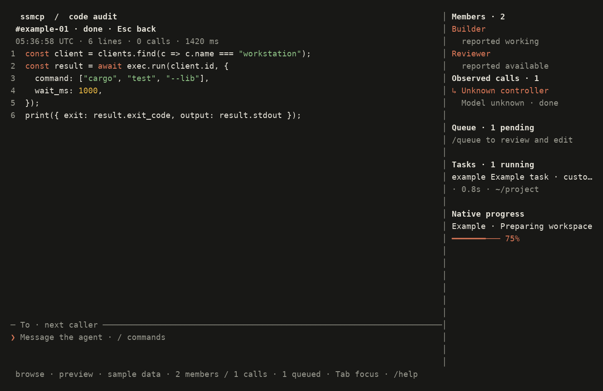
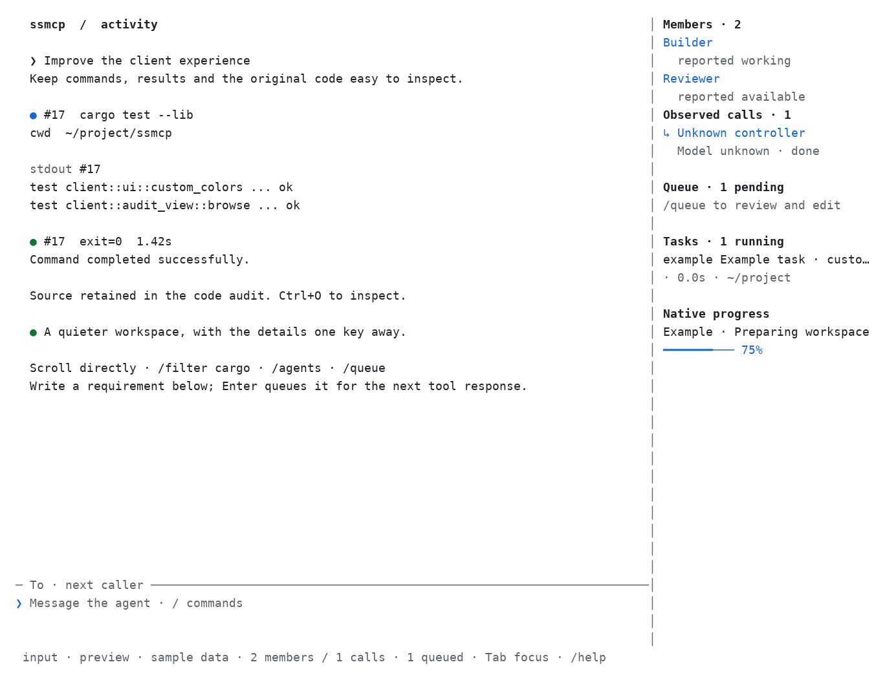

# 客户端 UI

ssmcp 默认使用 `dark` 主题和 `chat` 布局：主区域连续显示调用、输出和结果，底部固定输入框用于追加用户要求，侧栏展示成员、队列与工作区状态。要求进入可编辑队列，在后续符合目标的 `code_mode` 响应中交付；源码审计按需展开。显示设置独立于执行接口，自己的前端可以分别读取配置、状态、终端输出和审计事件。

## 先预览，再连接

```sh
ssmcp ui preview
ssmcp ui preview --theme light
ssmcp ui init
ssmcp ui show
ssmcp ui check
```

`preview` 使用实际终端渲染器展示固定示例，不连接服务器、不启动后端，也不会执行输入的要求。示例成员、命令、输出和耗时只用于检查布局。F1 打开快捷键与本地命令帮助；修改保留在内存，F8 可以保存到配置文件。按 Ctrl-C 或 Ctrl-] 退出预览，再运行 `ssmcp` 连接设备。

| 命令 | 用途 |
| --- | --- |
| `ssmcp ui preview` | 交互预览主题、布局和状态面板 |
| `ssmcp ui init` | 创建默认配置；已有文件时停止，保留原文件 |
| `ssmcp ui show` | 以 TOML 输出加载后的配置 |
| `ssmcp ui check` | 检查配置格式、颜色和参数范围 |

这些命令可使用 `--ui-config FILE` 指定配置。`show` 和 `preview` 还接受 `--theme NAME`，便于比较预设。`show` 和 `check` 读取文件；运行中界面的当前状态通过 `ssmcp.ui.get` 获取。

无交互终端时，可以输出一帧真实渲染结果，用于截图或检查不同窗口尺寸：

```sh
ssmcp ui preview --static --rows 36 --cols 120 --theme light
```

`--rows`、`--cols` 范围为 `1`–`1000`，只用于 `--static`，默认 `36` 行、`120` 列。输出包含 ANSI 序列；`NO_COLOR` 可关闭颜色。交互预览需要前台终端、`dashboard = true` 和 `pretty` 或 `pretty-verbose` 日志模式。

## 输入要求与队列

输入框交付功能用于直接连接服务器的前台客户端。后台连接可以通过 `ssmcp.ui.queue` 管理要求；本地 `attach` 目前只观察后台会话，不转发 attach 自己的输入框队列。

在底部输入框写下要求，按 Enter 提交。本地入队成功后，正文保存在客户端队列中，输入框立即清空；如果此前暂存了另一份草稿，则立即恢复其文字、接收目标和光标。此时可以继续写下一条要求，后续输入不会追加到刚提交的正文。队列条目在等待服务器确认时显示 `sending`；确认只更新队列状态，不清空后来输入的草稿。发送失败时，队列记录和当前草稿保留，供用户检查。前台输入与后台 `ssmcp.ui.queue` 提交的要求都在服务器确认接收后写入本地会话历史，保存失败会提示；`requested:true` 只表示已请求处理，不表示已经确认或交付。

默认目标为 `Next caller`，即下一次实际访问本客户端、且仍有授权的 `code_mode` 调用方；也可以在输入框为空或光标位于整份草稿开头时按 ←，从 Agent 面板选择成员。要求只附加到符合目标的响应，不广播给全部成员。

自定义界面刷新 `ssmcp.ui.*`、查询工具目录，或调用 `capabilities(clientId)` 与 `resources.forClient(clientId)` 的 `list/templates/read` 时，默认不领取这些要求，避免界面轮询抢先消耗队列。后两者对应 `ssmcp.client.capabilities` 和 `ssmcp.resources.list/templates/read` 四个观测原语，原生调用仍记录源码审计。显式通过 `collab.bind` 绑定成员的编排仍可领取符合目标的要求。

`/queue` 打开队列。内容区中 ↑/↓ 选择记录，Enter 请求取回尚未交付的要求，→ 只读查看详情，← 返回列表，Delete 取消可撤回的待交付项。取回获得服务器确认后，文字进入输入框，修改后按 Enter 重新提交同一条要求。输入框与内容区通过 Tab 或 Shift-Tab 切换。

| 状态 | 含义 |
| --- | --- |
| `queued` | 已确认入队，等待符合目标的 `code_mode` 响应 |
| `editing` | 已取回，交付暂停，等待重新提交 |
| `delivered` | 已附加到响应，无法修改已经交付的内容 |
| `sending` | 正文已存入本地队列，正在等待服务器确认；输入框可继续编辑下一条 |
| `taking-back` / `cancelling` | 取回或取消正在等待确认，当前草稿不变 |
| `uncertain` | 先前交付无法确认，或服务器已裁剪该项历史，需要复核后决定是否补发 |
| `retarget-required` | 连接或原接收目标已经变化，需要重新选择目标 |
| `offline` | 当前未连接，要求尚未发布到服务器 |
| `cancelled` | 已取消，不再等待交付 |

取回与交付可能同时发生。若服务器已经交付，取回会失败并显示最新状态，不能把正在传输的内容改写成“已撤回”。在队列中对 `uncertain`、`retarget-required` 或 `offline` 项按 R，会显式改为 `Next caller` 并进入复核编辑；仍需按 Enter 才重新提交。对 `delivered` 项按 R 只复制成一条新草稿，原记录保持不变。

复制队列内容时，输入框中的原草稿会暂存。在普通复制草稿中，如果没有正在取回编辑的要求或等待确认的变更，按 Esc 可恢复原草稿的文字、接收目标和光标。已有暂存草稿时，界面会阻止再次复制或取回另一条要求来覆盖它。

已交付只描述 ssmcp 的响应处理，不证明模型已阅读、同意或执行要求。响应可能在网络中丢失，因此交付不确定的记录不会自动重发。没有后续符合目标的调用时，要求继续等待；客户端不会启动模型或立即打断任意外部会话。

单条要求和输入草稿最多 16 KiB UTF-8 字节，允许换行与制表符。服务器每条客户端连接最多保留 64 条待处理要求、64 条近期结束记录，队列总容量为 512 KiB，含封装开销；容量不足时明确返回错误。每次响应最多附加 8 条、合计 64 KiB，其余继续等待。

要求附加在 `code_mode` 响应的 `structuredContent.user_messages` 和单独的用户要求文本块中，不替换原生输出，也不改变原本的成功或错误状态。`list` 和直接 `collab` 响应不承担这条交付通道。[队列原子接口](#要求队列接口)

为代理包装或压缩工具结果时，应保留 `user_messages` 及对应文本块，并将要求交给代理处理。只转发原生结果里的 `result` 或 `stdout` 会丢掉这条交付通道；界面的已交付状态仍只表示服务器把要求放进了响应。

## 文件、技能与长粘贴

输入 `@src/main.rs` 引用工作区内的文件，含空格时写成 `@"docs/设计 说明.md"`；`$skill-name` 引用当前有效的项目或全局技能。发送前检查路径和权限，文本只附最多 1 KiB 预览，图片或二进制附类型、大小与实际读取方法。目录、越界路径、不可读文件或超限引用会显示错误并保留原稿；重试复用第一次成功展开的正文，取回编辑显示原始输入。

图片的原生读取接口是 `ssmcp.fs.read_image`，接受工作区相对路径，支持 PNG、JPEG、GIF、WebP，单图最多 400 KiB。原生结果返回后，前台按终端能力显示彩色或灰度缩略图；日志不展开 base64。旧中转端可继续处理 PNG/JPEG，GIF/WebP 还需要中转端使用支持这两种 MIME 的版本。

支持整段粘贴事件的 Unix 终端中，超过 8 KiB 的粘贴会保存到私有的 `.ssmcp/inputs/paste-<随机ID>.txt`，插入带引号的 `@file` 后可继续追加要求。单次最多 4 MiB UTF-8；Windows 可手动保存工作区文件再引用。输入文件不会自动删除，请在确认后续读取结束后自行管理。[完整语法、读取边界与示例](client-input.md)

## 用方向键切换 Agent

输入框为空或光标已在整份草稿开头时，按 ← 打开 Agent 面板。输入文字中间的 ← 继续移动光标。面板定位当前收件人，● 标记当前目标，↑/↓ 移动选择；对已登记成员按 Enter 或 → 后，直接返回默认会话页，底部 `To` 标签显示新收件人。Esc 或 ← 关闭面板，保留原收件人、草稿文字、光标和正在编辑的要求。切换目标本身不发送消息，仍需在输入框按 Enter。

列表突出成员名称与报告状态，同名成员附带缩短的 ID；宽窗口在列表右侧展示角色、状态与身份详情，窄窗口保留紧凑列表和返回提示。自动观察到的普通调用以 `Call` 和 `view only` 标示，选择后进入源码与结果审计；详情中按 ←、Esc 或鼠标左键返回列表，再按 Esc 回到会话。普通调用无需先执行 `collab.join`，查看它不会修改消息收件人。

本地命令入口已移除 `/agents`，命令候选和帮助统一提示方向键入口。

普通调用按服务器分配的 `run_id` 区分；相同昵称或相同模型的并发调用保持独立。列表保留最多 32 条可见调用记录，正在执行的排在前面；侧栏只预览前三条。状态栏分别显示已登记成员数和调用数，不把同一调用方的多次运行计作多个持久 Agent。这些记录用于查看活动，不被当成可认证的收件人；定向需求仍使用已登记成员的 ID，默认 `Next caller` 继续交给下一次符合条件的工具响应。缺失名称或模型时显示未知，不沿用其他调用的身份。

## 本地命令

输入框中的 `/` 用于本地命令，日志搜索使用 `/filter 文本`。命令候选展开时，↑/↓ 选择，Tab 补全，Enter 执行选中的命令，Esc 收起候选并保留文字；选择候选不会取回排队要求或切换输入历史。

| 命令 | 作用 |
| --- | --- |
| `/help` | 打开可滚动的完整快捷键与本地命令帮助 |
| `/reload` / `/restart` | 请求重新启动客户端；两个命令等价 |
| `/queue` | 查看、取回或取消待交付要求 |
| `/tasks` / `/tasks cancel JOB_ID` | 查看实际本地执行任务；仅显式 `cancel` 才取消指定任务 |
| `/audit` | 浏览 `code_mode` 源码与调用记录 |
| `/logs` | 返回活动与日志流 |
| `/filter 文本` | 按文本筛选当前保留的日志 |
| `/filter --all` / `--commands` / `--errors` | 切换日志类别；保留已有文本条件 |
| `/theme [名称]` | 指定主题；省略名称时切换到下一预设 |
| `/sidebar` | 展开或收起侧栏 |
| `/clear` | 清空可见日志与屏幕回看缓存，不删除输出归档或会话文件 |
| `/resume` | 列出本工作区的已保存会话，选中后按 Enter 继续该文本历史 |
| `/pi` / `/cc` / `/codex` | 查看对应后端的实际工具目录；`TOOL` 查看 schema，`TOOL {...}` 显式调用 |

`/reload` 重新启动客户端，F5 和原子 UI 动作 `reload` 只重载显示配置。重启前，客户端尝试取回仍在服务器排队的要求，并通过私有、单次读取的交接文件保留草稿与队列。新连接只继续发布确定尚未交付且目标仍适用的要求；目标成员失效或交付不确定时等待显式复核，不自动重发。

若重启在取回要求之后中止，已获服务器确认、仍属于当前连接的要求恢复排队，沿用原消息 ID 和最新版本。迟到的取回确认也会恢复要求；确认尚未到达时继续等待，用户主动进入的编辑状态保持原样。

重载仍遵守已有会话生命周期，连接所属任务会随旧连接结束；重连后需要确认新的客户端 ID。交接文件用于这次受控重启，不是跨任意退出的永久会话存档。[重载与恢复](session-control.md)

帮助页可用 ↑/↓、滚轮、PgUp/PgDn、Home/End 滚动。按 F1 或 Esc 关闭。`/resume` 使用版本化的 `ssmcp.conversation.v1` JSONL，恢复显示文本并将后续消息写入所选会话；它不会重发旧要求、执行旧工具调用或恢复外部模型会话与凭据。[历史位置、容量与格式](conversation-history.md)

`/pi`、`/cc`、`/codex` 以及后接 `tools [OFFSET]` 只列出当前已注册工具；后接工具名只查看原始描述与参数 schema。显式追加 JSON 对象才异步调用原生工具，沿用其授权要求。`cc` 对应 Claude 的规范工具命名空间；工具缺失时直接报错。Pi RPC 的 `get_commands` 不等于内部 LSP 或模型工具清单，界面不会虚构这类接口。[目录与显式调用示例](client-input.md)

## 本地消息与回答问题

Agent 面向本机用户的 Markdown 进度与结果使用 `ssmcp.ui.message`；需要用户输入时用 `ssmcp.ui.ask` 创建问题，立即取得 ID 后继续工作，再通过 `ssmcp.ui.questions` 读取答案。消息显示固定 Agent 标签，不会变成新的用户要求。这条通道只处理本地 ssmcp 消息，不拦截外部聊天应用。

按 Shift+↑ 进入待回答问题，输入选项编号或自由文本后按 Enter 保存。回答编辑器与普通要求草稿分开，返回后保留原稿及目标；Esc 回到问题列表，列表中 Delete 跳过，Esc 再回会话。待答问题最多 32 条，总计保留最多 64 条、256 KiB；同一进程断线重连保留，客户端重启或 `/reload` 后不恢复待答状态。答案通过本机前台输入，后台 API 可提问与读取，观察模式的 attach 不代答。[API 示例与限制](client-input.md)

## Agent 面板与成员身份

Agent 页分别显示已登记成员和观测到的调用方，标题分别统计 `members` 与 `callers`。`Next caller` 是后续输入的收件选项，不计为在线成员。侧栏跟随当前选中项，显示它的身份、状态及相关消息；窄窗口把详情放入主区域。

已登记成员来自服务器协作成员表，展示名称、角色和成员报告的状态。选择记录并按 Enter 或 →，即可将后续输入定向到该成员；名称允许重复，同名成员显示各自的 ID 后缀，目标始终以完整 `agent_id` 区分。成员离线后保留原收件人选择并显示离线提示，需要用户重新选定有效成员。

观测到的调用方按调用来源、名称和模型归并。重复工具调用更新同一行的调用数与运行状态，模型名称也显示在列表中；无法识别身份的调用保留独立记录。选择调用方并按 Enter 或 → 会打开其代表调用的审计详情，原来的消息目标、草稿与光标保持不变。显示名称与模型只用于归类，不能作为可接收定向要求的成员凭证。

新活动和列表重新排序按稳定的调用方键或成员 ID 保留选择。鼠标点击按上一帧实际显示的条目定位，避免新调用插入时选中相邻对象。[Agent 页实现](../src/client/terminal/conversation.rs)与[调用方分组](../src/client/activity.rs)

成员由 `collab.join` 显式加入，租约到期或退出后不再是有效成员。`status` 由成员自行报告，不等于某个模型正在生成内容，也不等于后台命令进程的状态。`agents.*` 用于项目 AGENTS 指令文件，在线成员由 `collab.*` 管理。[成员、邮箱与租约](agent-collaboration.md)

要接收定向要求，agent 在每次 `code_mode` 开始时绑定已经登记的身份：

```javascript
const clientId = "CLIENT_ID_FROM_LIST";
await collab.bind(clientId, {
  agent_id: "AGENT_ID_FROM_JOIN",
  token: "PRIVATE_TOKEN_FROM_JOIN"
});
return await exec.list(clientId);
```

绑定只作用于本次编排，同一客户端不能在一次编排中切换到另一成员。服务器在交付前重新检查授权与成员凭证；名称、角色和 `controller.model` 只作展示，不决定接收者。`Next caller` 可以接收未绑定成员的合格调用方，定向要求只进入经过验证的对应成员响应。

要求队列与 `collab` 邮箱分别管理。成员之间的 JSON 消息通过 `collab.send/receive/ack` 交换；输入框中的用户要求由 `ssmcp.ui.queue` 管理，不使用邮箱的 `ack`。

客户端和服务器现在只接受协议 v7，要求队列、成员快照、源码审计和控制者元数据使用同一协议。版本不匹配会明确拒绝连接，不再逐级尝试 v6/v5/v4；更新两端后重新连接。

## 配置文件

配置路径依次选择：

1. `--ui-config FILE`。
2. `SSMCP_UI_CONFIG` 环境变量。
3. `$XDG_CONFIG_HOME/ssmcp/config.toml`。
4. `~/.config/ssmcp/config.toml`，Windows 使用用户目录下的 `.config/ssmcp/config.toml`。

命令行显示选项覆盖对应的文件设置。默认路径不存在时使用内置默认值；显式指定的文件不存在、格式损坏或参数非法时返回错误。修改文件后按 F5 重载，或调用 `ssmcp.ui.action` 的 `reload` 动作。

同一个 TOML 文件可以同时包含 `[client]` 和 `[ui]`。显示配置保存会保留服务器设置；服务器地址与可信公钥的选择规则见[中转服务器与信任](client-server.md)。`SSMCP_CLIENT_CONFIG` 与 `SSMCP_UI_CONFIG` 分别选择客户端和显示配置，不能互相替代。

下面是完整的显示配置示例，可直接作为 TOML 文件使用：

```toml
[ui]
color = true
dashboard = true
log_format = "pretty"
theme = "dark"
layout = "chat"
log_height_percent = 60
sidebar = true
sidebar_width = 30
panels = ["agents", "queue", "controller", "tasks", "progress", "git", "history"]
hide_empty = true
timestamps = false
show_request_id = true
show_raw_json = false
max_inline_output = 8
activity_interval_secs = 5

[ui.colors]
background = ""
foreground = ""
muted = ""
accent = ""
success = ""
warning = ""
error = ""
heading = ""
```

空字符串表示继承所选主题的颜色。可以只写需要修改的字段，其余使用默认值。F8 和 `save` 动作保存当前显示设置；`set` 调用使用 `persist:true` 时也会写入本机配置文件。

`dashboard` 与 `log_format` 是启动设置，不能通过 `ssmcp.ui.set` 修改；内置界面运行时，配置重载也不能切换这两项。修改文件后重启客户端即可应用。主题、颜色、布局和面板设置可在运行时调整。

## 布局与状态面板

| 设置 | 默认值 | 可选值与作用 |
| --- | --- | --- |
| `layout` | `"chat"` | `chat` 显示事件流与底部输入框；`split` 上下显示日志与源码审计；`audit` 展开审计区；`logs` 展开日志 |
| `log_height_percent` | `60` | `10`–`80`，控制 `split` 布局中日志的高度占比 |
| `sidebar` | `true` | 是否显示状态侧栏 |
| `sidebar_width` | `30` | `20`–`60` 列；可用空间不足时收起侧栏 |
| `panels` | 七种面板 | 按数组顺序排列，移除名称即可隐藏对应面板 |
| `hide_empty` | `true` | 收起没有内容的状态面板；成员和队列面板保留入口提示 |
| `dashboard` | `true` | 是否启用终端合成界面；关闭时使用行式输出 |

`panels` 可以是空数组，名称不能重复。面板名称与内容：

| 名称 | 内容 |
| --- | --- |
| `agents` | 当前连接中的登记成员、成员报告的状态与最近普通调用 |
| `queue` | 本地用户要求与交付状态摘要 |
| `controller` | 当前或上次调用方声明的应用、模型信息 |
| `tasks` | 正在运行的任务、命令与耗时 |
| `progress` | 原生工具实际报告的进度 |
| `git` | 当前工作区的分支和改动摘要 |
| `history` | 最近提交 |

`agents` 和 `queue` 只在 `chat` 布局中显示；配置了这两个面板时，即使为空也保留计数和入口提示。`hide_empty` 作用于其余状态面板。

例如，展开源码审计，同时保留任务和工作区状态：

```toml
[ui]
layout = "audit"
sidebar = true
sidebar_width = 26
panels = ["tasks", "git"]
hide_empty = true
```

窗口变化后，布局根据可用行列重新计算。Git 状态来自本地读取；控制者的模型名称来自调用方声明；进度百分比来自工具实际提供的进度与总量。

默认 `chat` 中 F2 切换活动、审计、成员与队列内容，仍保留输入框。`layout` 则决定整个显示方式；使用配置或 `ssmcp.ui.set` 选择 `split`、`audit`、`logs`。这些专用布局保留此前的浏览方式，F2 可以继续切换布局并回到 `chat`。

前台输入用于用户要求和本地命令，不会写入隐藏的 PTY。需要交互终端时，在另一个终端运行 `ssmcp -i`；自定义前端可以直接使用 `terminal.*`。本地 `attach` 用于观察后台会话，目前不转发其前端输入框的要求队列；可通过后台连接的 `ssmcp.ui.queue` 原子接口管理要求。[交互终端与后台输入](terminal-control.md)

## 源码审计与运行状态

审计区按运行 ID 保留调用方提交的 `code_mode.code`，源码经过现有审计脱敏处理。使用 `/audit` 或 Ctrl-O 打开审计，内容区中的 ↑/↓ 选择运行记录，Enter 或 → 展开带行号与语法颜色的源码；详情中继续用 ↑/↓ 滚动，← 返回列表。Tab 切回输入框后，方向键用于文字编辑和历史浏览。



*由实际渲染器回放的审计示例；示例源码不会执行。*

审计信息分别记录三个层次的状态：

| 状态 | 含义 | 后续查看 |
| --- | --- | --- |
| `code_mode` 运行 | 这次 JavaScript 编排正在运行、已经返回、失败或超时 | 审计运行 ID、耗时与错误 |
| 原生调用 | 编排发出的某个工具请求及其返回结果 | 调用 ID、工具名、耗时及实际返回的退出码或任务 ID |
| 后台命令 | 设备上的命令进程仍在执行，或已经退出 | `exec.status/read/wait` 和日志中的真实退出状态 |

例如，`exec.start` 返回任务 ID 后，`code_mode` 可以正常结束，命令仍在后台执行。要判断命令是否成功，读取对应任务的 `running` 和 `exit_code`。日志用 `python3 -c · 83 lines` 这类中性标签识别脚本，再分别显示 stdout、stderr、退出码和耗时；`--verbose` 可展开脚本正文。

源码审计使用当前唯一支持的 **协议 v7**。服务器将源码发送给本次编排实际访问的客户端，每次运行按 ID 合并；设备列表中的其他客户端不会收到这份源码。协议不匹配时连接被拒绝，不会退回缺少审计的旧连接。

界面最多保留 **128 次运行、合计 2 MiB** 的审计浏览数据，单段源码显示上限为 **64 KiB**。达到容量后淘汰最旧的运行记录，截断状态随快照返回。屏幕回看与长期输出保存各有容量边界；需要读取归档时使用审计事件返回的 artifact 和 `outputs.read`。

## 日志滚动与筛选

缓冲工具输出默认只展示 8 行摘要，保留开头与末尾并注明省略；`max_inline_output` 可调整这一上限。用户要求、Agent 消息和回答保持会话正文显示，图片只显示摘要或缩略图，不逐字段打印 base64。常规模式收起重复的请求元数据，详细模式仍可用于诊断；原生工具返回值不被显示压缩改写。

默认 `chat` 布局的活动页按每次发布显示一条事件。Tab 切到内容区，↑/↓ 选择，Enter 切换折叠，→ 展开，← 收起；鼠标点击同样可选择并切换。长工具事件默认折叠，用户、Agent、回答和图片默认展开。事件视图最多保留 128 条、合计 2 MiB 的展示正文，与审计浏览缓存独立。展开只显示本地仍保留的正文，不会找回先前被摘要省略的输出，也不重新执行工具；完整输出需通过相应任务游标或输出归档读取。

滚轮和 PgUp/PgDn 直接滚动当前内容，无需先切换焦点。Ctrl-Home/Ctrl-End 到最早保留日志或最新输出。浏览记录与编辑输入分别处理；输入框中的方向键先按实际显示行移动光标，包括自动换行；到达第一或最后一行后再取回排队内容或浏览历史。内容区中的方向键用于浏览。F7 冻结当前画面并释放鼠标，让终端原生选择与复制；复制通常使用终端的 Ctrl-Shift-C，F7 或 Esc 恢复界面。支持的终端可直接按住 Shift 拖选。

输入 `/filter 文本` 并提交，应用不区分大小写的搜索。搜索使用普通文本包含匹配，保留命中命令的输出和结果上下文。单独输入 `/filter` 清除文本；`/filter --all`、`/filter --commands`、`/filter --errors` 选择类别，F9 在类别间循环：

| 类别 | 显示内容 |
| --- | --- |
| `all` | 全部保留的日志 |
| `commands` | 命令、输出与结果相关记录 |
| `errors` | 包含错误、警告或 stderr 等诊断信息的记录 |

日志筛选和其他日志布局沿用原有屏幕历史显示，不使用活动页的逐事件展开。筛选在当前屏幕历史范围内进行，不改变任务执行和审计归档。文本上限为 256 个 UTF-8 字节。无界面前端可以按游标读取事件，再自行筛选。

## 主题与颜色



*实际渲染器的固定示例，展示浅色主题、输入框与可折叠侧栏。*

| 主题 | 风格 |
| --- | --- |
| `dark` | 默认主题，深色背景、浅色正文与蓝色强调；成功、警告和错误使用独立语义色 |
| `codex-dark` | 冷色强调的深色主题 |
| `nord` | 冷色背景与柔和强调色 |
| `solarized` | Solarized 深色配色 |
| `light` | 浅色背景与深色文字 |
| `minimal` | 跟随终端底色，使用基础语义色 |

默认主题的颜色用于分清结构与状态：蓝色标记调用与交互，绿色标记成功，黄色标记警告，红色标记错误；标签文字仍保留含义。F4 和不带名称的 `/theme` 按表中顺序循环。`/theme light` 等命令直接选择预设。

`[ui.colors]` 按语义覆盖主题，支持以下值：

| 写法 | 含义 |
| --- | --- |
| `#RRGGBB` | 六位十六进制真彩色，例如 `#8ab4f8` |
| `black`、`red`、`green`、`yellow`、`blue`、`magenta`、`cyan`、`white` | ANSI 基础色，`purple` 是 `magenta` 的别名 |
| `bright-` 加上述颜色名 | ANSI 高亮色，例如 `bright-blue`、`bright-purple` |
| `gray`、`grey` | ANSI 高亮黑色 |
| `default` | 终端自己的默认前景或背景色 |
| `""` | 继承当前主题的对应颜色 |

颜色名使用小写，十六进制数字支持大小写。十六进制颜色通过终端真彩色序列输出，最终效果取决于终端的颜色支持。

```toml
[ui]
theme = "minimal"

[ui.colors]
background = "#101214"
foreground = "#e8eaed"
muted = "#9aa0a6"
accent = "#8ab4f8"
success = "#81c995"
warning = "#fdd663"
error = "#f28b82"
heading = "#e8eaed"
```

要沿用终端自己的背景与前景色，可以设置：

```toml
[ui.colors]
background = "default"
foreground = "default"
```

`NO_COLOR`、`--no-color`、`TERM=dumb` 或重定向日志会关闭日志颜色。终端内应用自行输出的颜色由应用控制。JSONL 与后台日志使用结构化事件，主题不会写入原生调用结果。

## 键盘与鼠标操作

下面的操作用于默认 `chat` 布局。F1 显示当前帮助；Tab 或 Shift-Tab 在输入框与内容区之间切换焦点。输入框出现斜杠命令补全时，Tab 优先接受补全，Shift-Tab 仍可切换焦点。

| 操作 | 作用 |
| --- | --- |
| 鼠标滚轮、PgUp / PgDn | 直接滚动当前内容 |
| Ctrl-Home / Ctrl-End | 到最早保留日志 / 最新输出 |
| Tab / Shift-Tab | 在输入框与内容区之间切换焦点；Tab 优先接受显示中的命令补全 |
| 输入框 ↑ / ↓ | 先按实际显示行移动光标，包含自动换行；到边界后浏览历史，首行按 ↑ 优先取回最新待交付项 |
| 输入框 ← / →、Home / End | 移动光标或到当前逻辑行起止位置 |
| 输入框 Enter | 提交新要求、重新提交编辑内容，或执行本地命令 |
| Ctrl-J、Shift-Enter、反斜杠后按 Enter | 换行；Shift-Enter 需要终端能区分该按键 |
| 内容区 ↑ / ↓ | 选择活动事件，或浏览审计、成员、队列、问题与历史记录 |
| 活动区 Enter / → / ← | 切换折叠 / 展开 / 收起所选事件；点击事件也可切换 |
| 内容区 Home / End | 到当前内容的起止位置 |
| 审计区 Enter / → | 展开当前记录 |
| 审计区 ← | 返回列表 |
| 成员区 Enter | 登记成员设为接收目标；普通调用展开其源码与结果审计 |
| 队列区 Enter / Delete | 取回编辑 / 取消待交付项 |
| 队列区 → / ← | 只读查看详情 / 返回列表 |
| 队列区 R | 对需复核项显式改为 Next caller 并编辑；对已交付项复制为新草稿 |
| Shift-↑ | 打开待答问题；重复按键切换待答项 |
| 问题回答 Enter / Esc | 保存答案 / 返回问题列表；列表中 Delete 跳过 |
| 历史区 Enter | 恢复所选本地文本历史，不重放工具或要求 |
| `/filter 文本` | 筛选日志 |
| Ctrl-O | 在活动与源码审计间切换 |
| Esc | 关闭帮助或详情、返回输入；普通复制草稿可恢复暂存的原稿，不中断外部模型 |
| F1 | 打开或关闭完整帮助；页内方向键、滚轮、PgUp/PgDn、Home/End 滚动 |
| F2 | 在活动、源码审计、成员、队列、问题与历史之间切换 |
| F3 | 显示或隐藏侧栏 |
| F4 | 切换内置主题 |
| F5 | 从配置文件重载显示设置 |
| F7 | 冻结画面并开启终端鼠标选择；再次 F7 或 Esc 返回 |
| Shift+拖选 | 在支持的终端中直接进行原生文本选择 |
| F8 | 保存当前显示设置 |
| F9 | 在 `all`、`commands`、`errors` 日志类别间切换 |

日志回看使用有界屏幕缓存，命令输出通过任务游标或输出归档读取。

## 原子 UI 接口

客户端提供以下原生工具，和文件、终端、任务接口一样由已授权的连接调用：

| 工具 | 参数 | 结果与作用 |
| --- | --- | --- |
| `ssmcp.ui.get` | `{}` 或 `{path, offset?, limit?}` | 获取完整快照，或按 JSON Pointer 读取字段、分页读取数组与字符串 |
| `ssmcp.ui.set` | `{patch, persist?}` | 合并并验证配置改动，应用后返回当前状态；`persist` 默认 `false` |
| `ssmcp.ui.action` | `{action}` | 执行一个界面动作并返回当前状态 |
| `ssmcp.ui.filter` | `{text?, level?}` | 设置当前日志筛选；省略字段时保留该项 |
| `ssmcp.ui.queue` | `{action, ...}` | 读取或修改本机用户要求队列，见下方动作表 |
| `ssmcp.ui.message` | `{text}` | 向本机用户显示 Markdown 进度或结果，记录为 Agent 消息 |
| `ssmcp.ui.ask` | `{question, title?, options?, idempotency_key?}` | 非阻塞创建本地问题，返回问题 ID |
| `ssmcp.ui.questions` | `{id}` 或 `{state?, offset?, limit?}` | 读取问题与已保存答案，不消费记录 |
| `ssmcp.ui.history` | `{action:"list", offset?, limit?}` 或 `{action:"read", id, offset?, limit?}` | 只读浏览本工作区的版本化会话历史 |
| `ssmcp.ui.harness` | `{action:"tools", provider, offset?, limit?}` 或 `{action:"inspect", provider, tool}` | 只读发现实际后端目录与原始 schema，不调用模型 |

`patch` 使用工具 schema 列出的可动态修改字段，`colors` 是其嵌套对象。例如 `{theme:"nord", colors:{accent:"#8ab4f8"}}`。颜色设为 `""` 恢复预设；`null` 不是有效配置值。将 `panels` 设为新的数组可以整体替换面板顺序。

空参数 `get` 返回 `schema_version`、`config`、`config_path`、`display`、`activity`、`steering` 和 `questions`。内置界面活动时，`display` 提供内容区尺寸、事件状态、鼠标选择模式、审计记录、筛选与输入焦点；`activity` 提供经过脱敏的控制者、任务、进度、Git 和诊断摘要；`steering` 提供队列、连接支持状态和实际成员快照；`questions` 提供本地提问状态。界面应根据实际返回状态绘制，完整工具 schema 可通过发现接口读取。

在 `code_mode` 中先定位设备和工具：

```javascript
const matches = clients.filter(c => c.name === "dev");
if (matches.length !== 1) throw new Error("Select a unique client ID from list");
const client = matches[0];

return await tools.search(client.id, {
  query: "ssmcp.ui",
  include_schemas: true
});
```

读取输入与浏览状态：

```javascript
const client = clients.find(c => c.name === "dev");
if (!client) throw new Error("dev is offline");

return await call(client.id, "ssmcp.ui.get", {
  path: "/display/conversation"
});
```

自定义界面应按实际需要轮询字段，例如 `/config`、`/display/panes`、`/display/filter` 或 `/steering/connected`。`path` 使用非空 JSON Pointer，返回 `{schema_version:1, path, value}`；键名中的 `~` 和 `/` 分别写成 `~0` 和 `~1`。这样读取输入状态时，不会顺带返回不断增长的源码审计记录。

数组与字符串支持 `offset` 和 `limit`，返回 `total`，有后续内容时提供 `next_offset`。数组偏移按元素计，字符串偏移按 Unicode 码点计；默认从 0 开始，每页分别为 32 个元素或 1024 个码点，`limit` 范围为 1–4096。对象和标量不接受分页参数。

```javascript
const client = clients.find(c => c.name === "dev");
if (!client) throw new Error("dev is offline");

return await call(client.id, "ssmcp.ui.get", {
  path: "/steering/queue",
  offset: 0,
  limit: 4
});
```

投影响应最多 8 KiB；超过时返回明确错误，要求缩小字段或页大小，不会静默截断对象或改成输出附件。单个队列项很大时，可以读取 `/steering/queue/0/text` 并对正文分页。`{}` 保留完整快照的兼容行为，长快照仍遵守通用输出归档规则；持续刷新界面优先使用 `path`，避免为了读取状态而调用会领取要求的工作类接口。

应用颜色与布局，并保存到客户端选择的配置路径：

```javascript
const client = clients.find(c => c.name === "dev");
if (!client) throw new Error("dev is offline");

return await call(client.id, "ssmcp.ui.set", {
  patch: {
    theme: "minimal",
    layout: "chat",
    panels: ["agents", "queue", "tasks", "git"],
    colors: { background: "#101214", accent: "#8ab4f8" }
  },
  persist: true
});
```

可调用的动作：

| `action` | 作用 |
| --- | --- |
| `layout.next` | 切换布局 |
| `sidebar.toggle` | 切换侧栏可见性 |
| `theme.next` | 切换内置主题 |
| `reload` | 读取并应用配置文件 |
| `save` | 保存当前设置 |
| `logs.clear` | 清空内置界面的日志屏幕与回看缓存 |
| `audit.up` / `audit.down` | 选择上一条或下一条记录；详情模式滚动源码 |
| `audit.open` / `audit.back` | 展开当前源码 / 返回列表 |
| `logs.page-up` / `logs.page-down` | 翻阅日志 |
| `logs.end` | 返回最新日志 |

筛选示例：

```javascript
const matches = clients.filter(c => c.name === "dev");
if (matches.length !== 1) throw new Error("Select a unique client ID from list");

return await call(matches[0].id, "ssmcp.ui.filter", {
  text: "cargo",
  level: "commands"
});
```

`text:""` 清除文本条件，`level:"all"` 恢复全部类别。筛选与浏览动作需要内置界面处于活动状态；无界面时使用事件接口构建自己的浏览器。清空日志视图后，命令输出和审计归档继续遵守原有保留规则。UI 操作沿用当前客户端的访问授权，配置保存到当前设备选择的本地文件。

## 要求队列接口

`ssmcp.ui.queue` 提供独立的队列操作，自定义前端无需模拟按键：

| `action` | 参数 | 作用 |
| --- | --- | --- |
| `get` | 无 | 读取连接支持状态、成员、草稿和队列快照 |
| `submit` | `text`、可选 `target` | 创建要求；目标默认 `"next"` |
| `takeback` | `id` | 按当前版本请求取回尚未交付的要求，等待进入 `editing` |
| `edit` | `id`、`text`、可选 `target` | 重新发布已取回的要求；省略目标时保留原目标 |
| `cancel` | `id` | 请求取消尚未交付且可确认状态的要求 |
| `retarget` | `id`、可选 `target` | 显式重新选择目标并进入编辑；省略时设为 `"next"`，不自动发布 |

`target` 使用 `"next"` 或当前成员快照中的精确 `agent_id`。显式 `null` 无效，文本不能为空白，长度上限为 16 KiB UTF-8 字节。`id` 与成员 ID 必须使用实际返回值。

提交示例：

```javascript
const matches = clients.filter(c => c.name === "dev");
if (matches.length !== 1) throw new Error("Select a unique client ID from list");

return await call(matches[0].id, "ssmcp.ui.queue", {
  action: "submit",
  text: "请先检查命令的真实退出状态，再继续下一步。",
  target: "next"
});
```

变更返回 `{requested:true, id, queue}`，表示本地已接收请求，不表示服务器已经确认交付或取回。随后读取快照，检查对应 ID 的 `status`、`revision` 和 `error`：

```javascript
return await call("CLIENT_ID_FROM_LIST", "ssmcp.ui.queue", {
  action: "get"
});
```

编辑同一条要求时，先 `takeback`，确认状态已是 `editing`，再 `edit`。如果交付先完成，取回返回错误，记录成为只读。对 `uncertain` 或 `retarget-required` 记录，先复核旧请求，再 `retarget` 并 `edit`；不确定旧要求是否已经交付时，不应由前端自动重试。需要再次发送已交付内容时，用 `submit` 创建新记录。

快照包含 `connected`、`supported`、`room_id`、`agents`、`draft`、`queue`、`error` 与 `reloading`。每条要求带目标、版本、状态和可用的交付信息。接口可用于没有内置 TUI 的客户端；队列发布仍需要支持协议 v7 的活动连接。

## 活动、颜色与图片

工具输出默认收起，摘要显示实际运行状态、退出码或失败原因。选中事件后按 Enter，或点击摘要，可以展开和折叠。错误、警告和 diff 保持可见；命令、路径、代码与状态使用不同的语义颜色。终端原有 ANSI 颜色会保留，关闭颜色或设置 `NO_COLOR` 时仍可通过标签和文字区分内容。

向上滚动后，输入区会显示下方还有多少行，以及 `Ctrl+End` 返回最新输出的提示。`Ctrl+End` 恢复跟随新输出，同时保留草稿和输入焦点。`/raw` 显示当前保留的未折叠终端记录，`/logs` 返回活动视图；完整命令输出仍按原有规则保存到归档，界面缓存不替代归档。

重复的连接器登录警告按来源和服务端点合并并累计次数。不同连接器或新的错误继续分别显示。同一调用方的多次编排在侧栏归组；断线时未确认结束的调用显示为未知状态，连接状态和身份选择保持独立。

原生图片需要终端同时确认 Kitty 图片协议和实际字符像素尺寸。确认后，图片按真实像素比例缩放与裁剪；不支持的终端继续使用有界预览或文字说明。窗口大小改变后会重新测量字符尺寸，避免沿用旧字体几何。PNG 粘贴按二进制容器解析，内部控制字节不会触发快捷键；图片未完整到达或缺少外层结束标记时，两秒输入空闲后恢复编辑，保留原有草稿。

侧栏二维码只在完整图片能放下时以方形像素显示，并保留完整链接。网关的公开教程可用时进入中英文指南；旧网关未提供教程时回到门户首页。二维码生成和普通图片编码都不占用输入或显示状态锁。实现与真实终端验收见[终端图片](terminal-images.md)。

帧差分和边界计算使用工作区内的 [ztui 核心](../crates/ztui/README.md)。该核心不分配堆内存，缓冲区和 Unicode 宽度策略由调用方提供；图片、输入、主题与会话状态继续由客户端管理。

## 构建自己的界面

前端可以分别消费状态、终端字节和执行事件，自行决定布局与颜色。下面的接口分工适合 TUI、桌面面板或 MCP 应用：

| 前端需要的数据或动作 | 接口 |
| --- | --- |
| 客户端版本、能力与资源目录 | `capabilities(clientId)`、`resources.forClient(clientId)` |
| 配置、面板活动与当前显示状态 | `ssmcp.ui.get` |
| 调整和筛选内置界面 | `ssmcp.ui.set`、`ssmcp.ui.action`、`ssmcp.ui.filter` |
| 用户要求、草稿和交付队列 | `ssmcp.ui.queue` |
| Agent 的本地消息、提问与答案 | `ssmcp.ui.message`、`ssmcp.ui.ask`、`ssmcp.ui.questions` |
| 本工作区已保存的会话文本 | `ssmcp.ui.history` |
| 实际后端工具目录与参数 | `ssmcp.ui.harness` |
| 成员通信与本次编排的接收身份 | `collab.*`；`collab.bind` 只在 `code_mode` 中调用 |
| 编排源码与原生调用生命周期 | `ssmcp.audit.events` |
| 列出、创建、选择和关闭交互终端 | `terminal.list/open/select/close` |
| 终端输出、键盘输入和尺寸 | `terminal.read/write/resize` |
| 启动任务、读取输出和取消 | `exec.start/read/write/wait/cancel` |
| 命令的开始、输出和结束事件 | `exec.events` |
| 长输出归档 | `outputs.read` |

例如，前端一次轮询输入状态、布局和队列摘要：

```javascript
const matches = clients.filter(c => c.name === "dev");
if (matches.length !== 1) throw new Error("Select a unique client ID from list");
const id = matches[0].id;

const [conversation, panes, requests] = await Promise.all([
  call(id, "ssmcp.ui.get", { path: "/display/conversation" }),
  call(id, "ssmcp.ui.get", { path: "/display/panes" }),
  call(id, "ssmcp.ui.get", { path: "/steering/queue", limit: 4 })
]);
return { conversation, panes, requests };
```

这些 UI 原子读取，以及能力清单和客户端资源查询，默认不领取 `Next caller` 要求。独立读取 `ssmcp.audit.events`、`exec.events`、终端或输出归档属于工作类调用，会使本次编排具备领取要求的资格；需要由 agent 采集这些事件时，应同时处理响应中的 `user_messages`，定向接收时先绑定身份。

采集事件的调用分别保存每个流返回的 `next_cursor`，后续沿用各自游标，避免重复展示历史内容。检查 `truncated` 和归档状态，以便在缓存不足时读取归档。终端字节使用终端解析器绘制；命令 stdout/stderr 可按游标分开读取。调用结果还应检查原生 `isError`、任务 `running` 与 `exit_code`，让界面显示实际执行状态。

无需内置终端界面时，在配置中设置 `dashboard = false`。使用 `ssmcp --log-format jsonl` 可以将脱敏后的事件交给自己的日志消费者。自定义前端仍通过现有客户端授权访问设备能力。

相关说明：[输入、引用与本地沟通](client-input.md) · [会话历史](conversation-history.md) · [命令与事件](commands.md) · [多终端](terminal-control.md) · [后端与代码模式](backends.md) · [日志与归档](logging.md)
