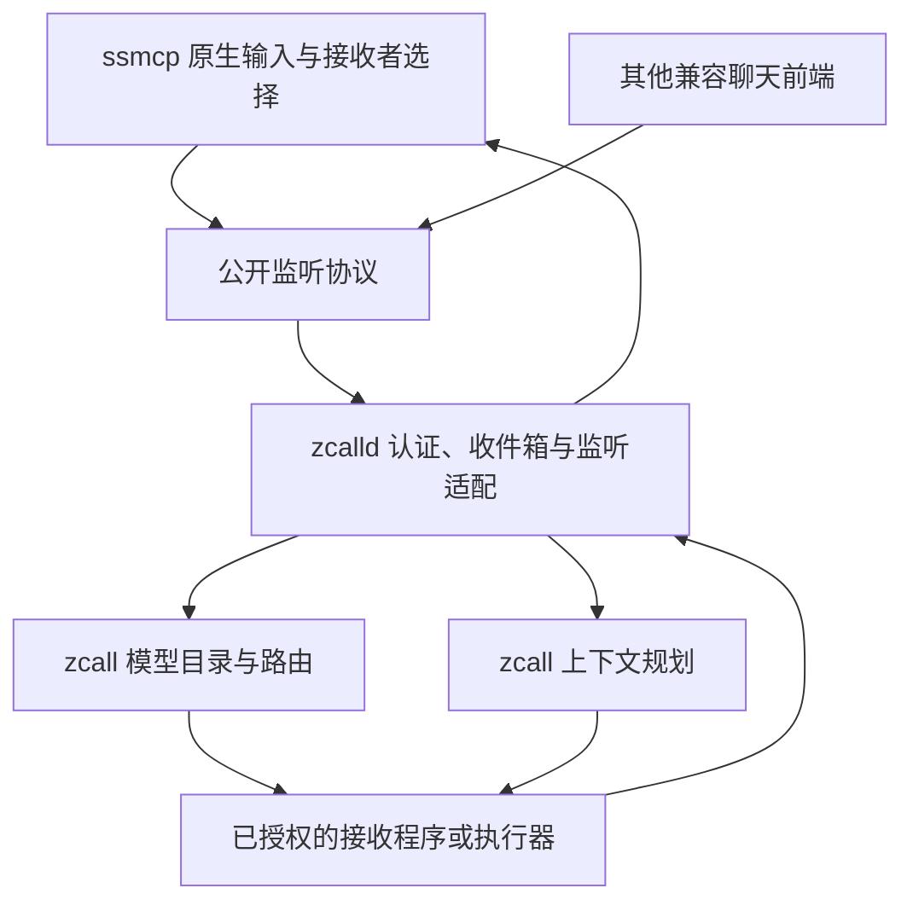
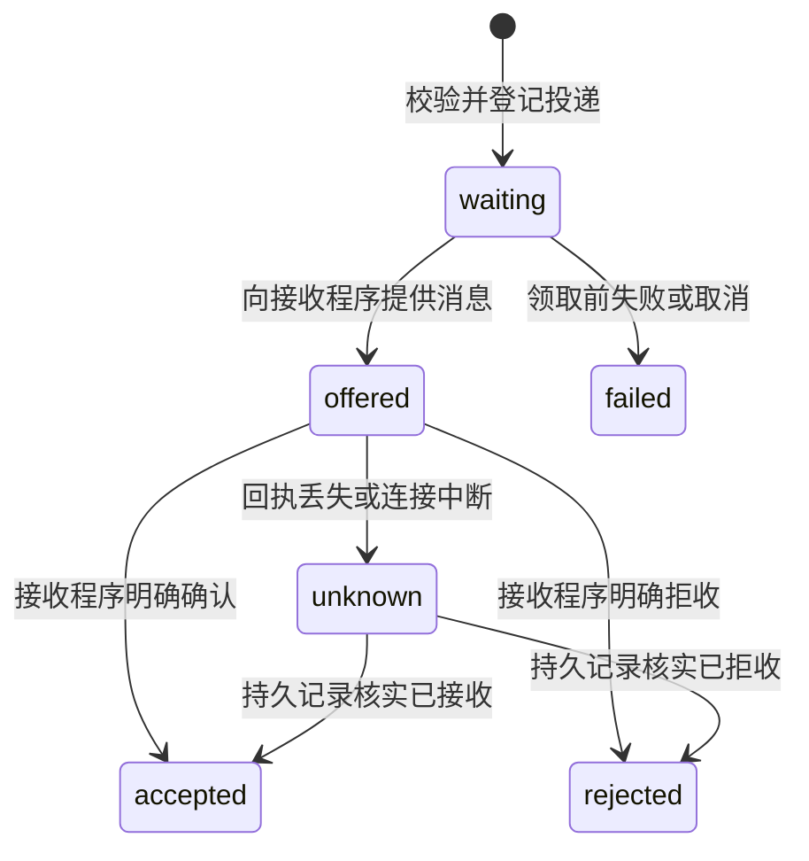

# 跨会话聊天监听协议：下一阶段设计

状态：**设计提案，尚未实现或部署**。日期：2026-11-20。

本稿落实下一阶段的职责分工：ssmcp 提供原生输入、明确的收件人选择和可确认的交付；zcall 管理模型路由、别名、属性及上下文构造；zcalld 承载服务、凭据、持久化和监听适配。公开协议与参考实现独立成库。本文中的“必须”约束后续实现；本次提交只增加设计文档。

设计顺序：

1. 固定源码依据，区分已有能力和本阶段差距。
2. 明确进程、连接、持久会话、线程和授权身份。
3. 定义版本协商、服务发现和动态模型能力。
4. 定义消息交付、配置变更及上下文预算的可观察结果。
5. 规定兼容迁移、资源边界和可重复验收。
6. 保留来源与结论对应表，供实现负责人逐项复核。

## 1. 依据与当前边界

### 1.1 固定源码

以下结论来自只读源码检查；检查没有启动模型、修改 zcall/zcalld、运行 Cargo 或重载服务。

| 项目 | 本稿采用的源码 | 观察与发布状态 |
| --- | --- | --- |
| ssmcp | `ea821da7dc63a065a468d2a2eca3cddc163c052b` | 含连接范围监听器、原发送者断线回执和归档候选改动；本稿不据此标记部署状态。 |
| zcall | `45df84f93848a9f7dc66eb7da953d18d14bb08f7` | `Cargo.toml` 为 0.4.0，含 `server` feature；Project Z 协调方回报已发布。本稿核对该 SHA 的代码。 |
| zcalld 外层 | `e03b002b89b7511e46f928bd8e34532d8a7fc0f2` | 协调方确认的已接收集成源码；其 manifest 为 0.2.5，固定 zcall 0.4.0。协调方另报告 core 0.3.0 发布进行中，本文没有替该发布填写验收结果。 |
| zcall-gui | `a28eba7c5c630d94d242732bb6136c2cdbcef43c` | 上述 zcalld SHA 固定的子模块。 |
| zcall-omarchy | `5615e80cd77ab4774612577bc2a71aa24012c12a` | 上述 zcalld SHA 固定的子模块。 |

`GITHUB/zcall` 主工作树当时为 `1fbebe9352317ff1198c3e8516b43323d558a70a`、manifest 0.2.0；`GITHUB/zcalld` 主工作树为 `226764bd980419bfd123bf297b891e09ccdc94c1`。本稿对当前能力的判断采用上表不可变 Git 对象。zcall 0.4.0 对象从 `zcalld/vendor/zcall` 的 Git 对象库读取；未切换这些工作树。

适用本机说明为 `/home/lightjunction/AGENTS.md`；所查 zcall/zcalld 项目根目录没有另一个 `AGENTS.md`。未进入或修改有独立说明的 UI 底层依赖。

### 1.2 已有能力与待补接口

| 领域 | 已观察的能力 | 下一阶段差距 |
| --- | --- | --- |
| 聊天输入交付 | ssmcp `ssmcp.ui.listener` 有 open/read/ack/close/status、账号和线程范围、连接代数、30 秒租约、5 秒接收确认；一个连接一个监听租约和一条待确认消息。[S1][S2] | 持久会话地址、多个明确接收端的选择、跨连接查询原消息结果、独立协议 schema。 |
| 本地与远程入口 | ssmcp 复用认证 MCP 调用；Linux 提供核对 UID 的私有 Unix socket。[S2] | 将这些入口接入同一公开语义，并为 Windows/macOS 明确各自可用的传输能力。 |
| 共享服务底层 | zcall 0.4.0 `server` 提供固定工作者、Handler、Router、KeyAuthenticator、HTTP/Unix 连接和协议适配；默认内核继续保留 Sans-I/O 边界。[Z1][Z2] | 聊天控制处理器、线程收件箱与上下文服务的接线。复用现有服务底层。 |
| 模型属性 | zcall `CapabilitySet` 已表达已知/未知窗口、输出限制、思考档位及 provenance；`prepare` 有能力检查。[Z3] | 可分页、带 revision 和过期时间的网络发现；会话实际选项与运行时变化通知。 |
| 路由与别名 | zcalld 有显式 aliases 插件、groups/routing、模型目录及 effort 映射。`/v1/models` 从已配置路由和保存的目录构造，部分条目只含模型 ID。[D1][D2][D6] | 将公共策略抽为 zcall 可复用接口，统一属性语义，公开“请求值/实际生效值”，保持单一配置来源。 |
| 协议发现 | zcall `Discovery` 生成由调用方发送的小型生成探测，默认输出上限 16 tokens。[Z4] | 无生成、无额度消耗的声明式元数据发现。浏览模型选择器不发送这种探测。 |
| 上下文 | zcall 有单次模型轮转/流事件和窗口检查；zcalld 向插件提供有限请求元数据。[Z3][Z5][D3] | 持久线程的上下文构造、预算、版本、摘要来源及原子切换。`src/compression.rs` 当前负责 HTTP gzip/zstd 解码。[D4] |
| GUI 联动 | 所查 GUI/Omarchy 展示管理、路由和模型选择；相应源树未找到 ssmcp 聊天监听或持久线程收件箱入口。[D5][D7] | 明确实现接收适配器，再把其能力和确认结果接到原生聊天框。模型配置面板保留自己的用途。 |

“未找到”的范围是上表 SHA 的核心 `src`、`plugins`、`crates` 和指定 GUI/Omarchy 源码；后续新提交应重新对照。服务源码、发布状态和运行中版本分别记录。

## 2. 组件职责与依赖方向

建议协议暂称 **Z Chat Listener Protocol**，独立库暂称 **zchat-protocol**。这些是本稿的工作名称；创建公开仓库、选择最终包名和许可证属于后续独立交付。

`zchat-protocol` 只定义消息、能力、错误、版本和状态转换；它不导入 ssmcp、zcall 或 zcalld。ssmcp 与 zcalld 的适配层依赖它。zcall 的路由/上下文算法通过宿主适配为协议能力，默认内核不被协议 JSON、数据库或认证提供商绑定。



| 组件 | 负责 | 可验证产出 |
| --- | --- | --- |
| 独立协议库 | Wire 类型、JSON Schema、状态机、错误分类、兼容向量 | 两种语言对相同向量产生相同接收结果；不运行模型也能验收。 |
| zcall | 模型属性与别名解析、路由约束、能力校验、上下文预算和构造计划 | 给定版本化输入，返回确定的路由/预算/上下文计划或明确错误。 |
| zcalld | 调用现有 `server`、可信身份、存储和时钟、provider 凭据、执行适配 | 认证后的登记、持久接收回执、实际执行状态与受限资源占用。 |
| ssmcp | 输入草稿、实际接收人列表、发送/撤销/核实、动态模型和思考选项 | 用户能看见目标、当前生效选项和交付阶段；未知结果保留草稿。 |
| 接收程序 | 明确登记能力，接收或保存输入，给出 ACK；按既有策略执行 | `accepted` 表示它已接收；运行和完成分别报告。 |

现有 zcalld 路由插件先调用新增 zcall 公共策略接口，维持已保存配置格式和插件执行顺序。隐私处理仍在需要读取正文的分类/路由之前；路由纯策略迁移与监听协议接入分开提交。[D2][D3]

上下文存储由 zcalld 提供实现，zcall 接收事件/预算并返回计划；摘要生成由明确的宿主回调提供。这样的职责符合用户要求的 zcall 上下文管理，同时保持存储凭据和实际 I/O 由服务宿主管理。

## 3. 身份、地址和跨会话协作

### 3.1 六类标识

| 标识 | 生命周期 | 规则 |
| --- | --- | --- |
| `authority_id` | 认证/目录服务的稳定标识 | 由配置和认证建立；发现文档中的字符串本身不授予信任。 |
| `principal_id` | 真实账号或受委托身份 | 服务端从认证上下文获得；请求正文无权覆盖它。 |
| `session_id` | 持久会话 | 拥有独立 ACL 和存储；重连后经授权恢复。 |
| `thread_id` | 会话内持久线程 | 与 session 一起检查；主线程有明确 ID，不把另一个线程作为回退。 |
| `process_instance_id` | 接收进程的一次启动 | 随启动产生新随机 ID；PID、启动时间和显示名是诊断信息。 |
| `connection_id / lease_id` | 一次连接/登记租约 | 重连、退出或授权撤销使旧租约失效；不作为持久会话 ID。 |

可投递目标是 `authority_id + endpoint_id + session_id + thread_id`。实际登记再绑定 `process_instance_id` 和租约。目录中展示的标题、模型名、项目路径或 PID 都不能替代这个完整地址。

ssmcp 的旧 listener 仍按已验证的账号、注册参与者和连接范围工作。适配器为它返回 `persistence: "connection"`；持久会话能力必须由新实现明确声明。旧 `thread_id: null` 映射到该连接的主线程地址，连接重建后重新登记。[S1][S2]

### 3.2 授权与发现分开

网络访问沿用已验证账号和精确委托范围；本机访问沿用 OS peer 核验和私有端点。新持久接口需要覆盖具体 session/thread/动作的授权。zcall 的 `Identity` 和 `Authorizer` 可作为入口，zcalld 再绑定持久范围；`TrustedLoopback` 只提供本机来源信息，私有线程权限仍通过范围凭据建立。[Z2]

授权应覆盖 `discover`、`receive`、`send`、`configure`、`context.read`。未获得 `context.read` 的前端仍可显示经过授权的预算元数据。长期轮询返回前复验授权；撤销后不再返回新正文。服务端生成的 sender 和审计作者来自认证上下文。

租约秘密、OAuth token、provider key 和模型内部不透明推理状态不进入目录、配置选项或普通日志。监听租约委托只允许其约定范围，不扩展为模型服务凭据。现有 ssmcp 外层 `user_messages` 规则继续保留；接收程序仍检查原 MCP envelope。[S2]

### 3.3 跨会话选择与群发

`recipients.list` 返回经过授权的目标、登记实例、能力 revision、可用状态和目录 revision。每页有稳定快照游标；目录发生变化时返回 `stale_cursor`，前端刷新完整页。

用户明确选择跨会话目标后，发送时再次校验目标地址和目录 revision。过期目标返回 `recipient_unavailable`，保持草稿和原选择。原生程序、已注册线程和普通 Next caller 分别显示，发送入口保持它们原有的语义。

群发以用户选择的固定地址数组为输入，返回每个目标各自的 `delivery_id` 和状态。后来加入的进程不加入该次群发。部分成功时，重试界面显示未确认的具体目标；已经接收的目标不会再次生成新消息。

## 4. Wire、版本与服务发现

### 4.1 独立的版本化接口

Wire 采用 UTF-8 JSON-RPC 2.0。JSON-RPC 的 `id` 仅关联一次请求与响应，协议另用 `message_id` 标识逻辑消息。所有发送、确认和配置变更使用有响应的请求；通知只作为刷新提示。JSON-RPC 规范明确通知没有响应，因此交付确认需要单独请求/结果。[R1]

首个实现协商精确的 `wire_versions`，例如提案值 `["1.0"]`。库 SemVer、wire 版本、provider API 版本和能力 revision 分别表示。客户端只发送协商版本定义的字段和已声明方法；无共同版本返回 `unsupported_version`，不尝试模型调用。

Schema 使用 JSON Schema 2020-12，核心请求字段封闭，扩展放在 `extensions` 下以发布者命名空间标识。新语义通过新 wire 版本或明确能力协商加入。未知可选扩展可忽略；标记为必需的扩展未支持时拒绝整次操作。Schema 本身不承担授权、持久化或状态机校验。[R2]

### 4.2 无生成的发现

给定用户或已有配置指定的服务 origin，读取其声明文档；该步骤不扫描网段、不启动服务、不发送生成探测。拟定 HTTP 路径为 `/.well-known/zcall-chat`，JSON 文档示例如下：

```json
{
  "schema_version": 1,
  "protocol": "zchat-listener",
  "wire_versions": ["1.0"],
  "authority_id": "authority_fixture",
  "endpoints": {
    "rpc": "/zcall/chat/v1/rpc",
    "models": "/zcall/chat/v1/models"
  },
  "capabilities_revision": "catalog_17",
  "authentication": {
    "required": true,
    "schemes": ["scoped_bearer"]
  },
  "cache": {
    "max_age_seconds": 30
  }
}
```

RFC 8615 定义 `/.well-known/` 的根级位置与注册要求；应用仍需确定 origin 和元数据范围。上述后缀是本稿提案，正式公开发布前完成名称与登记核对，本稿未提交 IANA 注册。[R3]

初次发现只返回服务和传输元数据。账号相关模型、接收者与线程目录放在认证后接口。相对 endpoint 解析到同一已授权 origin；跨 origin 端点须在已配置授权范围内单独认证，原 bearer 不随重定向转发。远程传输使用 HTTPS 或既有认证 MCP 通道；本机 HTTP 仅绑定受控 loopback，仍核验范围凭据。HTTP 缓存按权限范围隔离，使用 ETag/条件读取或明确 revision；TTL 到期重新验证。

本机 Unix 入口通过已授权客户端的能力元数据或私有 runtime descriptor 定位。descriptor 只描述端点和协议，不存放密钥；使用实际 OS 用户和私有目录校验。Unix 路径不套用 RFC 8615 的 HTTP URI 规则。缺少 Unix 支持的平台声明可用的认证 HTTP/MCP 适配能力。

旧服务返回 404 时，将发现状态标为 `legacy`。此时仍可显式使用旧 listener；模型选项保持“未声明”，不从模型名称推断。zcall 现有 `Discovery` 生成探测继续用于它本来的显式诊断流程。[Z4]

### 4.3 初始化结果

`listener.initialize` 返回选中的 wire 版本、已授权范围、服务实例、实际功能和限制。身份字段是服务端投影。支持项至少区分：

- 连接型或持久型收件箱。
- 可查询回执、回执保留期限和去重容量。
- 可用的模型/配置选项与 revision。
- 运行状态、取消及按游标读取事件。
- 接收消息的类型、大小、队列深度和超时。
- 支持的传输，及 context 管理是否启用。

每次连接重新协商。客户端仅恢复用户的选择意图，再核对当前目标和能力；旧租约凭据不恢复。第一次公开版保持 HTTP 请求/响应与有界轮询作为基础，不要求 WebSocket。当前 zcall 服务的 WebSocket 行为是返回 HTTP/SSE 回退信号，接线应尊重这一事实。[Z1]

## 5. 方法与消息语义

### 5.1 最小方法集

| 方法 | 作用 | 状态变化 |
| --- | --- | --- |
| `listener.initialize` | 版本/范围/功能协商 | 只创建本连接的协议状态。 |
| `recipients.list` | 授权范围内的真实接收端 | 只读；返回快照 revision。 |
| `listener.bind / read / ack / close` | 登记、取件、确认和释放 | 只操作当前精确租约。 |
| `messages.send` | 提交一个固定目标的逻辑消息 | 在校验通过后登记 `message_id`；群发逐目标展开。 |
| `messages.status` | 核实同范围消息的接收结果 | 只读；不得隐式入队或重新执行。 |
| `messages.cancel` | 尝试取消尚未开始的交付/工作 | 返回实际获胜状态；是否支持由能力声明。 |
| `models.list / resolve` | 模型属性和实际路由约束 | 只读、无生成。 |
| `session.getOptions / setOptions` | 读取或有条件变更模型/思考设置 | 使用 options revision 校验；返回完整生效状态。 |
| `context.inspect / prepare` | 检查预算、创建有来源的上下文快照 | inspect 只读；prepare 明确创建快照，独立于发送。 |
| `events.read` | 按范围和游标读取状态变化 | 只读；游标过期要求重新获取快照。 |

这是待固化 schema 的接口清单，现有 ssmcp native 工具名保持不变。适配层把旧 `ssmcp.ui.listener` 操作映射为同一语义；第一版仅暴露它实际提供的功能。

### 5.2 提交示例与幂等

以下 ID 是合成示例，认证通过传输提供：

```json
{
  "jsonrpc": "2.0",
  "id": "rpc_42",
  "method": "messages.send",
  "params": {
    "wire_version": "1.0",
    "message_id": "msg_fixture_42",
    "recipient": {
      "authority_id": "authority_fixture",
      "endpoint_id": "endpoint_zcalld",
      "session_id": "session_project",
      "thread_id": "thread_review"
    },
    "expected_directory_revision": "directory_8",
    "expected_options_revision": "options_12",
    "content": [
      {
        "type": "text",
        "text": "检查归档恢复的边界。"
      }
    ],
    "delivery_timeout_ms": 5000
  }
}
```

幂等键由服务端绑定的 principal、完整目标地址和 `message_id` 构成。同键同语义内容返回原状态；改变正文、目标或语义选项返回 `idempotency_conflict`。RPC 请求编号、等待时长和认证 token 不进入逻辑消息内容。

持久实现保存规范化语义字段的摘要或原值用于上述比较；采用摘要时固定为 SHA-256 over RFC 8785 JCS，跨语言以测试向量核对。拒绝重复 JSON 键、无效 Unicode 及越界数字；正文 Unicode 原样保留。协议计数值限安全整数范围，大范围游标与 revision 使用不透明字符串。[R4]

服务端先校验授权、目标、revision、大小和容量，再持久提交投递记录（waiting）。校验错误没有执行副作用。已登记消息的正文不再修改；用户主动编辑后发送会产生新的逻辑消息 ID。

### 5.3 接收与执行分层



| 字段/阶段 | 含义 | 前端行为 |
| --- | --- | --- |
| `waiting` | 投递已登记，等待接收程序领取 | 显示待接收。 |
| `offered` | 已构造或发出取件响应 | 继续等待明确 ACK。 |
| `accepted` | 接收程序确认已接收 | 原草稿及接收人仍与提交时一致才清空。 |
| `rejected` | 接收程序明确拒收 | 显示有界原因并保留草稿。 |
| `failed` | 尚未向接收程序提供消息便结束 | 保留草稿，允许用户处理原因后再次发送。 |
| `unknown` | 已尝试交付，最终确认缺失 | 保留草稿，提供“核实结果”；不自动生成新消息。 |
| `durability` | `memory` 或 `durable`，描述接收方记录保障 | UI 可显示“已接收”与“已持久接收”的差别。 |
| `execution_state` | 可选的 queued/running/completed/failed/cancelled | 只在接收程序提供证据时显示，独立于接收 ACK。 |

接收端声明 `durable` 时，必须在 inbox 事务提交成功后发 accepted。磁盘满、提交失败和授权失效均不得返回持久接收成功。模型完成需要独立执行结果；模型或外部工具的副作用使用其自身的幂等/核实机制。

旧连接型 listener 继续以五秒界限收敛到 failed/unknown。它不从新连接公开旧回执。原发送者的本机一次性断线提示继续保留；新协议的持久查询只向对原 session/thread 仍有权限的原发送范围开放。[S1]

持久接收后 ACK 丢失，重连先 `messages.status`。查询返回相同消息的事实，保持执行计数不变。接收方只拥有内存状态且已经重启时，结果维持 unknown。超过承诺的回执保留期返回 `receipt_expired`，由用户决定后续动作。

每个线程保持消息序列和事件游标；不同线程不承诺全局顺序。正文中携带的 `role` 或“用户说”文本不改变作者身份。跨线程转发作为显式协作消息记录来源，工具结果和摘要保持各自类型。

## 6. 动态模型、别名和思考强度

### 6.1 模型目录契约

模型目录按“可调用的实际部署/路由”发布属性。公共 alias、真实路由和 provider 模型标识分别保存，避免 alias 改名导致上下文错误续接。条目必须带 `catalog_revision`、`route_revision`、来源与有效期。

关键属性至少包括：

| 属性 | 表达 |
| --- | --- |
| 模型/路由 ID 与显示名 | 显示名可变化，ID 用于协议引用。 |
| alias 与解析结果 | 明确记录解析到的 route；循环或无效链返回错误。 |
| 上下文与输出窗口 | 数值或 unknown，加来源和观测/配置 revision。 |
| 输入/输出模态与工具能力 | supported / unsupported / unknown。 |
| 思考控制 | 是否可设置、当前值、允许值与实际语义映射。 |
| 上下文服务 | 是否可构造、计数质量、可用压缩方式。 |
| 可用状态 | 已配置、暂不可用或过期；普通发现不探测生成。 |

zcall 已有的 `TokenLimit::Unknown`、`Support`、`Provenance` 和 reasoning-level 列表可成为内部标准表示。[Z3] 导入 zcalld 旧模型目录时，把缺失字段保留为 unknown；`/v1/models` 中出现一个 ID，只提供该路由存在的信息。

动态 group 在实际路由尚未选定时，目录发布所有可能候选的能力交集和已知窗口下界。若某个候选关键窗口未知，则相应保证保持 unknown。选定具体 route 后重新计算；路由变化触发能力 revision。目录读取本身不调用意图分类模型。

### 6.2 前端只呈现接收端声明的选项

思考强度由接收适配器结合模型和 harness 的实际能力声明。支持列表可以是任意稳定字符串；ssmcp 保留接收端顺序和标签，不固定 low/medium/high，也不从模型名推断。

配置响应示例：

```json
{
  "options_revision": "options_12",
  "catalog_revision": "catalog_17",
  "effective_from": "next_turn",
  "options": [
    {
      "id": "reasoning",
      "category": "thought_level",
      "type": "select",
      "current_value": "balanced",
      "values": [
        {"id": "brief", "label": "简短"},
        {"id": "balanced", "label": "均衡"},
        {"id": "deep", "label": "深入"}
      ]
    }
  ]
}
```

`setOptions` 包含期望 revision，服务端原子校验并返回完整的生效选项和新 revision。第一版规定变更从下一轮生效；正在运行的模型轮次保持它开始时的配置。UI 只有收到成功响应才更新当前值，超时则读取 getOptions 核实。

切换模型时同时更新允许的思考值、输出限制和上下文预算。旧思考值不可用时返回可选择列表，保留待发送草稿。若产品需要“接近档位”映射，适配器必须在选项中说明，并返回 requested/effective 两个值。现有 routing 插件的 `apply_effort` 有按候选列表就近映射和协议字段转换，接线时须使这些变化可见。[D2]

ACP v1 的 session config options 已覆盖模型及 thought-level 选择器，并有完整状态更新模式；后续 ACP adapter 可按固定版本对接。官方 v2 页面目前标为 Draft，本协议的稳定契约不依赖它。采用类似选择器结构只说明设计借鉴，ACP 互操作通过单独适配和向量验收交付。[R5]

## 7. 上下文构造与默认一半窗口

### 7.1 默认预算的精确定义

将“默认使用模型最大上下文的一半”落实为：**一次模型请求中全部活动输入上下文的目标上限，默认取有效窗口的一半**。它包含系统说明、当前用户消息、保留历史、工具 schema/结果、附件开销和摘要。

令：

- `C` 为模型与实际部署都允许的上下文窗口的已知下界。
- `R` 为本轮预留输出预算，包含 provider/适配器规定的相关推理计数。
- `S` 为请求封装和计数误差的明确预留量。
- `I` 为额外部署输入限制；无额外限制时不参与取最小值。

默认目标为 `B = min(floor(C × 0.5), C − R − S, I)`。当 `C − R − S ≤ 0` 时，prepare 返回预算错误。已知精确计数的适配器可令误差预留为零；估算计数必须声明经过验证的上界或预留策略。

合成验收例：C=200000、R=32000、S=1000、无额外输入限制时，B=100000；切到 C=64000 的模型时重新计算，不能继承前一模型的预算。例子不对应任何真实商业模型规格。

窗口未知时，自动 managed-context 模式返回 `capability_unknown`。有明确来源的管理员部署上限可补充证据，界面显示其来源；未经证实的默认窗口不写入模型属性。原有外部 harness 自主管理上下文的方式仍声明为 `context_owner: "external"`。

### 7.2 上下文事件与快照

上下文管理使用不可变事件和可替换的活动快照。事件保留作者、来源消息 ID、会话/线程、内容类型和序号；快照保存 route/options revision、源事件范围、预算、token 计数质量以及压缩方式。原始 ssmcp JSONL 和归档文件保留原有生命周期。

旧 JSONL 的会话元数据记录工作区，线程归属需要额外来源证据。[S3] 导入这类旧记录时，由原所有者明确选取来源并绑定到目标线程；新存储记录导入动作和原来源 ID。没有线程授权依据的整库扫描不进入代理的上下文构造路径。

必须明确只有一个上下文构造者：`context_owner` 为 zcall 或 external。由 zcall 管理的线程通过上下文事件增量构造；外部 harness 已提供完整请求时，zcalld 不再拼接第二份历史。

一次 prepare 的流程：

1. 读取精确线程的已授权事件快照，固定 source revision、route revision 和 options revision。
2. 解析实际模型/部署约束，计算 B，并计入本轮完整请求封装。
3. 固定系统约束、当前用户输入、未完成需求、进行中的工具调用及其关联结果、未决权限问题。
4. 在剩余预算内优先保留近期完整轮次；对更早的可压缩内容生成候选摘要或有界提取。
5. 为派生内容记录源事件范围和摘要方法，保持原作者/工具来源，避免把工具文本提升为用户指令。
6. 重新计数；仍超 B 时返回 `context_over_budget`，保留原草稿、事件和旧快照。
7. 用 source revision 的比较并交换提交新快照。期间有新消息或配置变化则返回 `stale_context` 并重新准备，不覆盖并发更新。

工具调用与结果作为关联单位处理；不可拆成一个无来源结果或悬空调用。未解决需求与权限状态单独保留。provider 不透明状态只在对应能力允许时传递，跨模型无法继续使用时返回明确适配错误。

摘要生成是独立宿主能力。默认可采用有界提取；如配置模型摘要，宿主通过既有 zcall 路由执行，并记录该调用的预算和结果。发现、列表、UI 选项刷新及本次设计任务都不触发摘要模型。摘要失败时保留旧快照，不删除原始记录。

### 7.3 压缩与发送的关系

prepare 可以先于实际发送执行；它只创建上下文快照。发送固定一个有效 snapshot/options revision，进入执行时再验证该绑定。接收 ACK、上下文构造成功、上游开始和模型完成分别记录，避免把其中一个阶段显示成全部完成。

归档操作不重放上下文事件，也不启动压缩。显式恢复归档时，原消息可成为新快照的授权来源；同一 source ID 不重复导入。跨会话引用只读有权限的选定源，附来源关系，不合并两个会话的 ACL。

## 8. 容量、恢复和错误

提案第一版使用明确的有界默认值；实现可发布更小限制，双方按协商值校验。这些值不修改现有 listener v1 的限制。

| 资源 | 提案默认值/边界 |
| --- | --- |
| 文本消息 | 16 KiB UTF-8；大内容通过已授权引用，不隐式读取任意路径。 |
| 单个 JSON 控制请求/响应页 | 64 KiB；目录最多 64 条/页，超限分页。 |
| 领取等待与接收回执 | 每次 read 最多 5 秒；普通交付确认默认 5 秒，执行时间独立。 |
| 租约 | 30 秒，服务端单调时钟计算；续租不恢复已撤销权限。 |
| 未确认消息 | 每个接收端最多 128 条；每线程最多一轮执行，其余显式排队或 busy。 |
| 群发 | 最多 16 个明确目标，每目标独立结果。 |
| 持久去重 | 默认承诺 24 小时；每授权主体最多 4096 个尚在承诺期内的 ID。容量满则拒绝新增，不提前遗忘已承诺记录。 |
| 事件与上下文读取 | 分页、有界，游标同时绑定线程和流 epoch。原始历史不随派生快照回收而删除。 |

控制请求、轮询和 ACK 需要独立的有界处理能力。zcalld 当前固定工作者可被长生成占用；接线必须把聊天控制调度与生成占用隔离，在原有 HTTP/Unix 服务边界内保留控制容量，并通过饱和验收。不得让一次五秒等待占满全部生成工作者。[D3]

| 错误 | 语义 | 客户端处理 |
| --- | --- | --- |
| `unsupported_version / unsupported_capability` | 没有共同契约或未声明能力 | 显示兼容状态；保留草稿。 |
| `unauthorized_scope` | 当前认证无该范围权限 | 停止该范围收发；不改投其他目标。 |
| `recipient_unavailable / lease_expired` | 已选目标或租约失效 | 刷新目标状态，由用户选择。 |
| `stale_revision / stale_context / stale_cursor` | 对象已更新 | 读取完整新快照，不将旧选择当作已生效。 |
| `idempotency_conflict` | 同一逻辑 ID 对应不同内容 | 保留原记录；显式新消息使用新 ID。 |
| `capacity_exceeded / busy` | 队列或承诺存储已满 | 返回 retry_after 和当前状态；不自动制造新投递。 |
| `capability_unknown / context_over_budget` | 缺少预算依据或必保留内容超限 | 停止该次 prepare/执行，显示具体缺口。 |
| `receipt_expired` | 持久核实窗口已过 | 明确显示结果未知，保留用户决策。 |

错误码稳定，用户可读 detail 有长度限制并保持原范围。公共 roster 只显示状态摘要；正文、原始拒收 detail 和历史摘要遵守对应 session/thread 的访问权限。

## 9. 兼容与实施顺序

### 9.1 兼容矩阵

| 接收端 | 可承诺的能力 | ssmcp 行为 |
| --- | --- | --- |
| 旧 ssmcp listener v1 | 单连接租约、读取/ACK、内存回执 | 原 `/send` 行为和错误保持；无持久恢复、无模型配置按钮。 |
| 新协议 + connection inbox | 新发现/配置契约，接收状态随连接存在 | 显示实际能力；断线按 unknown/failed 处理。 |
| 新协议 + durable inbox | 按完整范围持久核实、明确去重期限 | 重连先查询原 ID，再恢复已授权界面状态。 |
| zcalld 仅普通模型网关 | 模型调用与已配置目录 | 原有 API 可用；聊天目标显示未登记。 |
| 外部 harness adapter | 仅适配器实测并声明的功能 | 其模型、思考和上下文所有权按返回值显示。 |

新 discovery 和 listener 接口不更名或替换现有六种模型 API；旧工具 schema、socket 帧、正文和 ACK 语义继续可用。新协议适配与旧入口共享相应状态，避免同一输入进入两份独立队列。新协议持久状态使用新的存储版本；旧连接租约不会被导入为持久凭据。

### 9.2 分阶段交付与负责人边界

| 阶段 | 可审查交付 | 接收条件 |
| --- | --- | --- |
| P0 协议冻结候选 | 独立公开仓库、规范、JSON Schema、Rust 类型/状态机、Python 对照向量、许可和版本策略 | 不依赖产品源码，也能检验解析、幂等和状态转换。 |
| P1 现有监听接线 | ssmcp adapter 与 zcalld 接收 adapter；使用合成接收程序 | Linux Unix 与已认证 MCP 两条入口核对同一消息 ID；旧行为全通过。 |
| P2 动态模型选项 | zcall 公共模型/路由属性接口、zcalld revision 发现、ssmcp 原生选择器 | 无生成发现、准确生效值、切换模型使不适用选项失效。 |
| P3 持久会话与上下文 | zcall 规划 API、zcalld 持久 inbox/context store、原子压缩和恢复 | 断电/断连、半窗口预算、并发源 revision 和来源保全验收通过。 |
| P4 发布接入 | 固定依赖、反向依赖清单、真实跨产品验收及发布说明 | 协调 Project Z 现有 owner，记录各包/源码/制品/运行版本；再发布兼容声明。 |

zcall/zcalld 与其子项目由 Project Z 现有 owner 接手实际变更。ssmcp 本阶段只提交这份设计；后续底层库发布需要枚举直接和间接反向依赖并逐一验证。协议 crate 发布、两个产品集成和运行中部署各自单独报告。

## 10. 验收矩阵

基础验收使用隔离状态目录、真实进程/套接字和合成上游。无模型的接收 fixture 足以验证协议交付；实际模型/摘要质量另设可授权的后续验收，不把这一层混入基础监听成功率。

| 编号 | 场景 | 必须观察的结果 |
| --- | --- | --- |
| A01 | 两种语言编解码及 Unicode/分片输入 | 同一规范向量结果一致；无效 UTF-8、重复键、超限帧有界拒绝。 |
| A02 | 无共同 wire 版本、未知必需扩展 | 零入队、零模型调用；保留草稿与目标。 |
| A03 | 读取 well-known、分页模型、打开选项 | provider 生成调用计数为零；未知能力不被补全为支持。 |
| A04 | 两账号、两 session、同名 thread、猜测 ID/token | 越界读取/ACK/配置/上下文访问均失败；范围内正常通过。 |
| A05 | 参与者退出、ACL 撤销、轮询返回前撤销 | 不返回失效范围的新正文，原租约失效。 |
| A06 | 同进程重连、PID 复用、旧实例重启 | 旧租约不恢复；持久 session 仅经重新授权恢复。 |
| A07 | 同消息读取/ACK/提交重试；同 ID 改正文 | 合法重试返回同记录；冲突拒绝；执行计数保持一。 |
| A08 | 领取前断开、领取后断开、持久提交后丢 ACK | 分别 failed、unknown、按原 ID 核实 accepted；无自动新执行。 |
| A09 | 三个明确群发目标，部分失败，期间加入第四个 | 每目标独立回执，第四个不收到；再次核实不重复已接收项。 |
| A10 | 用户发送中编辑草稿或切换目标 | 旧 ACK 不清除新草稿；不改投当前的新目标。 |
| A11 | 模型/alias/group revision 改变 | 陈旧变更失败；重新显示允许值、实际 route 与来源。 |
| A12 | 自定义思考档位、空列表、unknown、映射档位 | UI 只呈现声明能力；requested/effective 可核对，无静默降档。 |
| A13 | 运行中修改选项、并发两客户端修改 | 本轮绑定不变；下一轮使用确认的新 revision；冲突可见。 |
| A14 | 已知/未知 C、模型切换、输出预留及误差预算 | B 符合公式；未知预算或必保留内容超限明确失败。 |
| A15 | 工具调用/结果、未完成需求、权限问题跨压缩 | 关联、作者和源消息 ID 保留；原始记录字节不变。 |
| A16 | 压缩同时追加消息、摘要失败、提交失败 | CAS 阻止覆盖新事件；旧快照与草稿可恢复。 |
| A17 | 去重承诺期内容量满、磁盘满、到期后查询 | 不提前遗忘去重记录、不虚报 durable；容量和过期状态准确。 |
| A18 | 生成工作者全部占用、控制队列饱和 | 控制 ACK/取消仍有有界响应，超载明确 busy，无无限线程增长。 |
| A19 | 已归档会话恢复后导入上下文 | 无旧需求重放、无来源重复、原归档日志保全。 |
| A20 | 旧 v1 工具/Unix 客户端与新产品共存 | 旧参数/回执和超时行为保持；仅新声明能力进入新路径。 |

每项报告记录固定源码与制品版本、实际参与进程、状态转换及副作用计数。基础通过后再选择一组已授权真实 harness 做模型/思考档位接线验收；后续报告单列支持的模型、部署和适配器，避免泛化为全部 provider。

## 11. 结论与证据对应

| 结论 | 依据 | 状态 |
| --- | --- | --- |
| 已有 listener 是连接范围、显式 ACK 的接口 | [S1][S2] | 源码支持。 |
| zcall 已提供可复用服务底层与能力检查 | [Z1][Z2][Z3] | 0.4.0 固定源码支持。 |
| 当前路由/alias/catalog 可作为适配基础 | [D1][D2] | 固定源码支持；公共接口迁移待实现。 |
| 动态配置可采用完整快照与 revision | 本稿 `6；[R5] 提供已有协议设计参考 | 设计；产品互操作待验收。 |
| 半窗口预算与原子上下文构造有可执行边界 | 本稿 `7 与 A14–A16 | 设计；实现和压力/质量数据待补。 |
| 跨会话持久交付需要独立身份和结果查询 | 本稿 `3、`5 与 A04–A09 | 设计；不将连接型结果升级为持久承诺。 |
| 发布必须按实际能力声明 | 兼容矩阵与 A01–A20 | 发布门槛；本稿未填通过结果。 |

按 research-paper-writing 方法对草稿做了五项自审：

| 维度 | 问题与处理 |
| --- | --- |
| 贡献 | 把输入接收、模型配置、上下文管理和执行分别落到具体方法与负责人；核心新增范围可单独验收。 |
| 清晰度 | 标识生命周期、预算公式、revision 和回执阶段均有明确定义；没有以模型名代替能力证据。 |
| 实证强度 | 仅把实际读到的源码写作现状；设计部分没有成功率、性能或部署声明。 |
| 评价完整性 | 列入跨账号/线程、断线、容量、配置并发、压缩来源和旧客户端共存；质量评估留在明确的后续模型验收。 |
| 方法可靠性 | 去重窗口满时拒绝新增、控制面独立容量、未知预算显式失败、来源 CAS 和原始历史保全均写入验收。 |

## 12. 来源

源码链接固定到本稿采用的提交；ssmcp 相对链接以表中观察 SHA 为基准。

[S1]: ../../src/client/interface/listener.rs
[S2]: ../../docs/thread-listeners.md
[S3]: ../../src/client/interface/history.rs
[Z1]: https://github.com/LIghtJUNction/zcall/blob/45df84f93848a9f7dc66eb7da953d18d14bb08f7/docs/SERVER.md
[Z2]: https://github.com/LIghtJUNction/zcall/blob/45df84f93848a9f7dc66eb7da953d18d14bb08f7/src/server/gateway.rs
[Z3]: https://github.com/LIghtJUNction/zcall/blob/45df84f93848a9f7dc66eb7da953d18d14bb08f7/src/capability.rs
[Z4]: https://github.com/LIghtJUNction/zcall/blob/45df84f93848a9f7dc66eb7da953d18d14bb08f7/src/discovery.rs
[Z5]: https://github.com/LIghtJUNction/zcall/blob/45df84f93848a9f7dc66eb7da953d18d14bb08f7/src/session.rs
[D1]: https://github.com/LIghtJUNction/zcalld/blob/e03b002b89b7511e46f928bd8e34532d8a7fc0f2/src/config.rs
[D2]: https://github.com/LIghtJUNction/zcalld/blob/e03b002b89b7511e46f928bd8e34532d8a7fc0f2/plugins/routing/src/lib.rs
[D3]: https://github.com/LIghtJUNction/zcalld/blob/e03b002b89b7511e46f928bd8e34532d8a7fc0f2/src/server.rs
[D4]: https://github.com/LIghtJUNction/zcalld/blob/e03b002b89b7511e46f928bd8e34532d8a7fc0f2/src/compression.rs
[D5]: https://github.com/LIghtJUNction/zcall-gui/blob/a28eba7c5c630d94d242732bb6136c2cdbcef43c/src/backend.rs
[D6]: https://github.com/LIghtJUNction/zcalld/blob/e03b002b89b7511e46f928bd8e34532d8a7fc0f2/plugins/aliases/src/lib.rs
[D7]: https://github.com/LIghtJUNction/zcall-omarchy/blob/5615e80cd77ab4774612577bc2a71aa24012c12a/README.md
[R1]: https://www.json-rpc.org/specification
[R2]: https://json-schema.org/draft/2020-12
[R3]: https://www.rfc-editor.org/rfc/rfc8615.html
[R4]: https://www.rfc-editor.org/rfc/rfc8785.html
[R5]: https://agentclientprotocol.com/protocol/v1/session-config-options

官方资料检索日期为 2026-11-20。RFC 8615 用于 well-known 位置/登记规则；JSON-RPC 2.0 用于消息 envelope；JSON Schema 2020-12 用于 schema 格式；RFC 8785 用于内容比较的规范化；ACP v1 用于配置选择器的对照设计。以上资料不构成本项目已经实现相应能力的声明。
