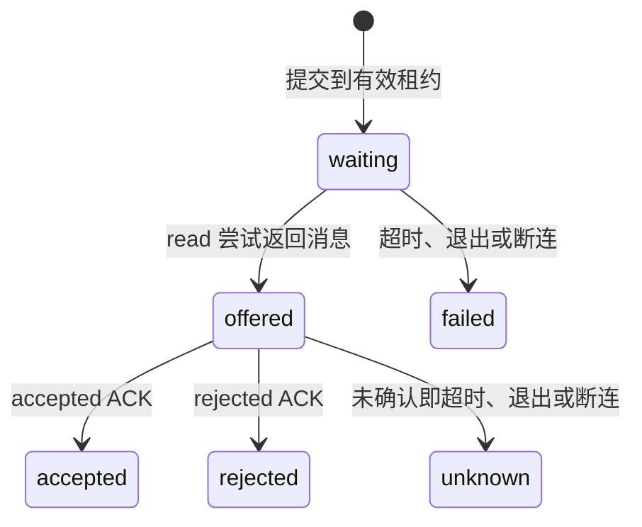

# 强制发送与单监听程序接口

`/send <正文>` 向最近一次明确选择的组、原生收件人或本地目标发送，并保留草稿等待回执。命令后一个空白分隔字符以外的正文，包括缩进和尾换行，原样用于当前发送路径。

## 选择 `/send` 的收件人

| 当前选择 | 发送路径 |
| --- | --- |
| 组 | 在 `/sessions` 用空格勾选精确目标，或用 `/group add`、`/group use` 选择。正文按原生文本发送，每个目标独立返回回执。 |
| 原生收件人 | 从 `/message` 或 `/recipients` 选择账号收件箱或已验证线程。发送时复核精确连接、账号和相应线程，正文保留字面字符。 |
| 本地目标 | 选择 `Next caller` 对应主线程监听器，或选择已登记成员并使用该线程的监听器。此路径会准备正文里的 `@file` 和 `$skill` 引用。 |

选择失效、账号变化或原生能力不可用时，保留草稿并报告失败。原生单发和组发均不会改投本地监听器。

组发部分成功时保留草稿，`/group status` 可查看失败的目标。在同一连接用 `/group retry [GROUP_REQUEST_ID]`，或对相同正文与选择再次提交，会沿用组与子请求 ID。已获接受回执的目标会被跳过，即使后续状态查询出错。[原生消息与组发](thread-messaging.md)

以下租约和 ACK 规则适用于本地目标。没有匹配监听程序时，界面显示发送失败。界面显示 **“监听程序已接收”** 表示监听程序已返回 `accepted`，执行结果由接收程序另行报告。使用 zcalld 原生监听时，先明确选择 `Next caller`。[监听状态机](../src/client/interface/listener.rs) · [网络与私有 Unix socket](thread-listeners.md) · [zcalld 原生监听](zcalld-listener.md)

## 为什么需要独立的接收回执

普通 Enter 把需求放入现有 Requests 队列，随后符合接收条件的工具响应会携带该需求。这个过程没有证明某个常驻程序正在等待消息，也不能证明程序实际收到了响应。因此强制发送使用独立的登记、读取和确认流程；它不把一次普通 `code_mode` 调用当作监听程序。

强制发送的核心约束是“明确知道谁在等待，以及知道到哪一步为止”。登记返回独占租约；读取返回稳定的消息编号；确认给出终态。发送方看到不确定结果后，可以自行核实接收方状态，但系统不会自动把这条消息重新投递到监听程序或普通队列。

## “当前会话”的准确范围

本版本把一个会话限定为客户端当前已注册的 Broker **连接生命周期**。`connection_id` 标识连接，客户端另用不对外暴露的递增代数区分每次连接初始化。重新连接会清除旧租约，旧凭据和旧投递目标都失效，即使外部连接标识被复用也不能继承旧租约。

监听登记绑定这次连接及登记时的账号和线程。它随重连失效，且只属于当前客户端。`thread_id` 是登记成员的逻辑 ID，未绑定登记使用主线程。

每个连接最多有一个有效监听租约，以及一条等待回执的强制消息。登记与投递检查在同一状态锁内完成，两个同时登记的程序只会有一个成功。一个租约同时只允许一个进行中的 `read`；取消读取会释放这个占用，不会夺走租约。

| 资源 | 生命周期与限制 | 作用 |
| --- | --- | --- |
| 监听租约 | 30 秒；使用单调时钟计算 | 限制退出或失联程序占用接收位置的时间 |
| `read` | `wait_ms` 为 0–5000，默认 5000 | 长轮询或立即查询；有效读取会续租 |
| 接收回执 | 从投递提交开始最多等待 5 秒 | 给用户一个有界结果，而不是无限显示“发送中” |
| 在途消息 | 每连接最多 1 条 | 消息编号与回执保持清楚的一一对应关系 |
| 正文 | 原始正文与引用展开结果各不超过 16384 个 UTF-8 字节 | 沿用需求文本校验；允许换行和制表符 |
| 完成回执 | 当前连接内保留最近 32 条 | 允许近期相同 ACK 重试；本地回复关联也受这个窗口约束 |

建议监听程序连续使用 `read(wait_ms: 5000)` 长轮询，收到结果后立即进入下一次读取。若选择 `wait_ms: 0`，轮询间隔应显著短于 5 秒，例如约 1 秒，为网络往返和接收处理留出余量。`heartbeat_ms: 5000` 只是续租提示，不是后台心跳服务，也不保证消息在 ACK 截止前被读取；每隔恰好 5 秒查询一次可能错过回执期限。

程序崩溃不能被瞬时发现：有效租约存在时仍可能提交，未及时领取会得到失败；已经尝试返回消息却没有收到 ACK，则得到结果未确认。

## 消息状态与 ACK 的含义

`waiting` 表示消息在客户端等待读取。`offered` 表示某次 `read` 已构造了含该消息的返回值；网络或权限复验仍可能阻止回包到达，所以它不能证明程序已收到消息。只有明确 ACK 能把状态变成 `accepted` 或 `rejected`。



| 终态 | 准确含义 | 草稿与重试 |
| --- | --- | --- |
| `accepted` | 监听程序明确确认已接收 | 只有原草稿仍完全一致时才清空；不自动调用模型 |
| `rejected` | 监听程序明确拒收，并提供原因 | 保留草稿；不自动重投 |
| `failed` | 消息尚未进入任何 `read` 返回值便失败 | 保留草稿；用户可以检查原因后主动发送 |
| `unknown` | 已尝试投递，但没有收到监听程序的接收确认 | 保留草稿；用户应先核实接收方，避免主动重发造成重复 |

同一租约重复读取未确认消息会得到相同 `delivery_id`、原始正文和展开正文。相同消息编号与相同 ACK 内容的近期重试返回原回执；改变 ACK 结果、改变拒收原因、确认旧连接消息或确认已经超时的消息都会被拒绝。ACK 和超时只能产生一个最终回执。

监听程序负责决定何时发送 `accepted`。如果其要求断电后仍能处理消息，应先把消息写入自己的可靠队列，再确认。ssmcp 的 `accepted` 只记录该程序的声明，既不替它完成持久化，也不证明后续业务处理成功。

接受后，客户端将用户原始正文按发送时的会话归属写入本地 JSONL，终端显示“监听程序已接收”，原始 Logs 保留 `[USER] #<delivery_id>` 及正文。历史保存经过审计脱敏的原始正文，沿用容量与会话保留限制。历史写入失败会另行提示“历史记录未保存”，接收回执仍为 `accepted`。

基础接收模式的这些记录不是永久投递台账。监听回执只在内存保留最近 32 条元数据；现有历史的消息编号由投递编号与正文计算而来，没有独立保存原 `delivery_id` 字段。引用展开后的文件全文也没有另存到历史。因此 ACK 不能被解释为已经保存了完整的文件快照、可长期关联的投递记录或模型对话历史。

## 原生 API：`ssmcp.ui.listener`

通过已获授权的客户端原生调用使用此工具。所有请求必须带 `op`；操作不接受的字段会被拒绝。成功结果使用原有 MCP `structuredContent` 包装，下面的字段指包装内部的业务对象。

| `op` | 请求字段 | 主要返回字段 |
| --- | --- | --- |
| `open` | `label`（1–96 个 UTF-8 字节，无控制字符）、可选 `idempotency_key` | `schema_version`、`connection_id`、`listener_id`、`token`、`thread_id`、`expires_in_ms`、`heartbeat_ms`、`ack_timeout_ms` |
| `read` | `listener_id`、`token`、可选 `wait_ms` | `schema_version`、`delivery` 或 `null`、`timed_out` |
| `ack` | `listener_id`、`token`、`delivery_id`、`status`；拒收时还须有 `reason` | `schema_version`、`receipt` |
| `close` | `listener_id`、`token` | `schema_version`、`closed: true` |
| `status` | 无额外字段 | `connected`、`connection_id`、脱敏的 `listener`、`pending`、近期 `receipts` |

`listener_id` 与 `delivery_id` 是 32 个十六进制字符的公开编号。`token` 是 64 个十六进制字符的秘密租约凭据，只在显式 `open` 成功时返回；它必须留在接收程序的私有内存或受保护存储中。租约凭据不是模型身份，也不能替代现有账户与会话访问授权。

`read` 中的 `delivery` 包含 `delivery_id`、`connection_id`、`listener_id`、`cursor`、`source: "client_user"`、`source_text`、`text` 和 `created_at_ms`。`source_text` 是去掉 `/send` 与一个分隔字符后的原始正文。`text` 是经过 `@` 文件与 `$` 技能准备后的正文。展示时间使用 Unix 毫秒；租约与超时判断使用单调时钟，不依赖墙上时间。

`ack.status` 只能是 `accepted` 或 `rejected`。接受时不得提供 `reason`；拒收时必须提供 1–512 个 UTF-8 字节的非空原因，且不得含控制字符。错误消息不会回显凭据。`status` 和 `ssmcp.ui.get` 的 `/listener` 投影都不会包含 token 或在途消息正文。

## 终端操作与草稿保护

在输入框使用 `/send <正文>` 后按 Enter。本地目标下，普通文本仍可按 Enter 提交到 Requests 队列。`/send` 没有正文时会显示用法，`/sender` 不会被识别为这个命令。

解析仅移除命令和紧随其后的一个空白分隔字符。命令前的空白可被识别，正文的其余空格、制表符与尾换行保留。例如 `  /send hello` 的正文是 `hello`，而 `/send\n    code\n` 的正文是 `    code\n`。这样发送代码块时不会丢失缩进。

输入框的 16 KiB UTF-8 上限计入命令前缀。本地监听准备后的正文也须符合 16 KiB 上限。

无匹配监听、引用语法或消息大小校验失败、拒收或结果未确认都会保留草稿。缺失文件或未知技能是引用警告，正文仍可投递给匹配监听器。准备引用之前检查租约，提交时复检同一连接代数与监听编号。[输入语法与限制](client-ui.md#文件技能与长粘贴)

等待回执期间可以编辑草稿。只有匹配的接受回执才能清空正文、目标、修订号和光标都与提交时一致的草稿。把文字删掉后重新键入相同文字也属于新修订。原生路径以 `queued`、`included` 或 `acknowledged` 为接受回执；本地监听路径要求 `accepted`。

正在取回、编辑或提交普通队列消息时，须先完成该操作才能使用 `/send`。

## 接收程序的最小工作流程

接收程序先登记并在内存中保存租约凭据，然后循环读取。每次收到消息后以 `delivery_id` 去重，确认是否愿意接收，再返回 ACK。最终退出时调用 `close`。遇到凭据失效或连接变化，应结束旧循环；重新登记只服务后续新发送，不恢复旧消息。

下面是传输无关的伪代码；`native` 表示调用当前授权客户端的 `ssmcp.ui.listener` 并解包 `structuredContent`。`storeIfNew` 由接收程序实现，这里没有模型或持久队列实现。

```javascript
const lease = await native({op: "open", label: "My receiver"});
const credential = {listener_id: lease.listener_id, token: lease.token};
try {
  while (!stopping) {
    const response = await native({op: "read", ...credential, wait_ms: 5000});
    if (!response.delivery) continue;
    const delivery = response.delivery;
    const decision = await storeIfNew(delivery.delivery_id, delivery.text);
    await native({
      op: "ack", ...credential, delivery_id: delivery.delivery_id,
      status: decision.accepted ? "accepted" : "rejected",
      ...(decision.accepted ? {} : {reason: decision.reason})
    });
  }
} finally {
  // 连接已结束时 close 可能失败；不能据此自动重放旧消息。
  await native({op: "close", ...credential}).catch(() => {});
}
```

这段基础循环只负责接收和确认消息。接收程序管理超时和停止。有时限的 `code_mode` 调用结束后，长期监听由接收程序维持。

Linux 上同一系统用户的程序可以通过私有 Unix socket 用 `open(enable_reply: true)` 启用回复。先 `read`，对该投递返回 `accepted` ACK，再用 `reply` 提交一条 `completed` 或 `failed` 结果。原租约与回执须仍有效，原会话须仍是当前会话。认证 MCP 的 `open` 只支持普通监听。回复记录的是程序自身的执行结果，模型调用和任务结束审批仍由各自的入口处理。[本地生成程序的执行结果](thread-listeners.md#本地生成程序的执行结果)

## 自动日志与验证边界

租约凭据字段固定命名为 `token`，以使用现有自动审计脱敏；凭据不进入标题、公开编号、快照或错误文案。调用者若主动打印或外传凭据，已经越过这项自动日志保护，因此示例不打印 `open` 的完整结果。

| 检查内容 | 验证入口 | 范围 |
| --- | --- | --- |
| 单监听、读取消、重复读取与 ACK 竞争 | `client::interface::listener::tests::force_listener_*` | 独立 Hub 的并发与状态机 |
| 旧连接、失效凭据与 unknown 无自动重投 | 同一测试模块的 reconnect、expiry、unknown 用例 | 当前连接内的租约和投递 |
| 文本缩进与旧回执保护新草稿 | `client::terminal::conversation::listener::tests::force_listener_*` | TUI 命令解析与草稿状态 |
| 监听观察不领取普通队列 | `code_mode::tests::ui_observation_retains_source_audit_without_claiming_user_requirements` | 观察调用的需求领取判定 |
| 终端中选择本地监听或原生收件人后的 `/send` | `scripts/e2e_force_send.py` | 私有账户路由、真实 PTY、合成接收程序、引用准备和收件回执 |

以下命令用于本地验证。具体结果记录在对应的验收报告中。

```sh
cargo test --lib force_listener_
cargo test --lib ui_observation_retains_source_audit_without_claiming_user_requirements
SSMCP_E2E_FIXTURE_BINARY=/path/to/ssmcp-lib-tests \
SSMCP_CODE_MODE_RUNNER=/path/to/bin/code-mode.js \
python3 scripts/e2e_force_send.py --bin-dir /path/to/bin \
  --decoder /path/to/bin/examples/vt_snapshot --out /path/to/results
```
