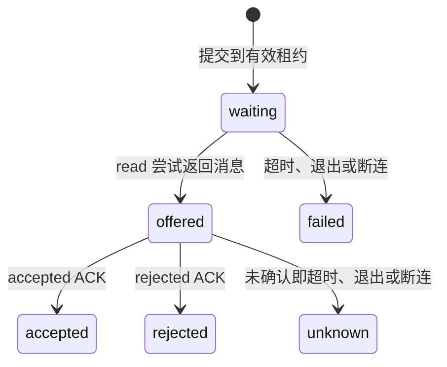

# 强制发送与单监听程序接口

`/send <正文>` 显式发送当前输入，收件人由当前选择决定。本文介绍其中的程序监听器分支：输入交给当前连接中显式登记的监听程序，并等待接收回执。没有有效监听程序时，界面立即显示 **“发送失败：没有程序在监听”**。只有监听程序返回 `accepted`，界面才显示 **“监听程序已接收”**；这不表示模型已经读取、执行或完成任务。本接口不启动模型。

本文依次说明连接范围、消息状态、API、终端行为、接入方式和验证边界。实现入口是 [listener 状态机](../src/client/interface/listener.rs) 和 [终端发送任务](../src/client/terminal/conversation/listener.rs)。

## 为什么需要独立的接收回执

普通 Enter 把需求放入现有 Requests 队列，随后符合接收条件的工具响应会携带该需求。这个过程没有证明某个常驻程序正在等待消息，也不能证明程序实际收到了响应。因此强制发送使用独立的登记、读取和确认流程；它不把一次普通 `code_mode` 调用当作监听程序。

强制发送的核心约束是“明确知道谁在等待，以及知道到哪一步为止”。登记返回独占租约；读取返回稳定的消息编号；确认给出终态。发送方看到不确定结果后，可以自行核实接收方状态，但系统不会自动把这条消息重新投递到监听程序或普通队列。

## “当前会话”的准确范围

本版本把一个会话限定为客户端当前已注册的 Broker **连接生命周期**。`connection_id` 标识连接，客户端另用不对外暴露的递增代数区分每次连接初始化。重新连接会清除旧租约，旧凭据和旧投递目标都失效，即使外部连接标识被复用也不能继承旧租约。

这个范围不是持久化的 `session_id` 或 `thread_id`。监听登记不会跨重新连接恢复，也不会跨多个客户端共享。未来若需要跨连接的持久会话，应另行定义身份、存储、恢复和去重协议，不能把这里的连接编号直接当作持久线程。

每个连接最多有一个有效监听租约，以及一条等待回执的强制消息。登记与投递检查在同一状态锁内完成，两个同时登记的程序只会有一个成功。一个租约同时只允许一个进行中的 `read`；取消读取会释放这个占用，不会夺走租约。

| 资源 | 生命周期与限制 | 作用 |
| --- | --- | --- |
| 监听租约 | 30 秒；使用单调时钟计算 | 限制退出或失联程序占用接收位置的时间 |
| `read` | `wait_ms` 为 0–5000，默认 5000 | 长轮询或立即查询；有效读取会续租 |
| 接收回执 | 从投递提交开始最多等待 5 秒 | 给用户一个有界结果，而不是无限显示“发送中” |
| 在途消息 | 每连接最多 1 条 | 消息编号与回执保持清楚的一一对应关系 |
| 正文 | 原始正文与引用展开结果各不超过 16384 个 UTF-8 字节 | 沿用需求文本校验；允许换行和制表符 |
| 完成回执 | 当前连接内保留最近 32 条 | 允许近期相同 ACK 重试；本地回复关联也受这个窗口约束 |

建议监听程序连续使用 `read(wait_ms: 5000)` 长轮询，收到结果后立即进入下一次读取。若选择 `wait_ms: 0`，轮询间隔应显著短于 5 秒，例如约 1 秒，为网络往返和接收处理留出余量。`heartbeat_ms: 5000` 只是续租提示，不是后台心跳服务，也不保证消息在 ACK 截止前被读取；每隔恰好 5 秒查询一次可能错过回执期限。

程序崩溃不能被瞬时发现：有效租约存在时仍可能提交，未及时领取会得到失败；已经尝试返回消息却没有收到 ACK，则得到结果未确认。

## 消息状态与 ACK 的含义

`waiting` 表示消息在客户端等待读取。`offered` 表示某次 `read` 已构造了含该消息的返回值；网络或权限复验仍可能阻止回包到达，所以它不能证明程序已收到消息。只有明确 ACK 能把状态变成 `accepted` 或 `rejected`。



| 终态 | 准确含义 | 草稿与重试 |
| --- | --- | --- |
| `accepted` | 监听程序明确确认已接收 | 只有原草稿仍完全一致时才清空；不自动调用模型 |
| `rejected` | 监听程序明确拒收，并提供原因 | 保留草稿；不自动重投 |
| `failed` | 消息尚未进入任何 `read` 返回值便失败 | 保留草稿；用户可以检查原因后主动发送 |
| `unknown` | 已尝试投递，但没有收到监听程序的接收确认 | 保留草稿；用户应先核实接收方，避免主动重发造成重复 |

同一租约重复读取未确认消息会得到相同 `delivery_id`、原始正文和展开正文。相同消息编号与相同 ACK 内容的近期重试返回原回执；改变 ACK 结果、改变拒收原因、确认旧连接消息或确认已经超时的消息都会被拒绝。ACK 和超时只能产生一个最终回执。

监听程序负责决定何时发送 `accepted`。如果其要求断电后仍能处理消息，应先把消息写入自己的可靠队列，再确认。ssmcp 的 `accepted` 只记录该程序的声明，既不替它完成持久化，也不证明后续业务处理成功。

接受后，终端会追加用户原始正文与“监听程序已接收”提示，原始 Logs 保留 `[USER] #<delivery_id>` 及正文。客户端也尝试通过现有 `history::record_request` 写入本地 JSONL 历史；该历史保存经过现有审计脱敏的原始正文，沿用容量与会话保留限制。历史写入失败会另行提示“历史记录未保存”，但不会把已经确认的接收结果改成失败。

基础接收模式的这些记录不是永久投递台账。监听回执只在内存保留最近 32 条元数据；现有历史的消息编号由投递编号与正文计算而来，没有独立保存原 `delivery_id` 字段。引用展开后的文件全文也没有另存到历史。因此 ACK 不能被解释为已经保存了完整的文件快照、可长期关联的投递记录或模型对话历史。

## 原生 API：`ssmcp.ui.listener`

通过已获授权的客户端原生调用使用此工具。所有请求必须带 `op`；操作不接受的字段会被拒绝。成功结果使用原有 MCP `structuredContent` 包装，下面的字段指包装内部的业务对象。

| `op` | 请求字段 | 主要返回字段 |
| --- | --- | --- |
| `open` | `label`：1–96 个 UTF-8 字节，无控制字符 | `schema_version`、`connection_id`、`listener_id`、`token`、`expires_in_ms`、`heartbeat_ms`、`ack_timeout_ms` |
| `read` | `listener_id`、`token`、可选 `wait_ms` | `schema_version`、`delivery` 或 `null`、`timed_out` |
| `ack` | `listener_id`、`token`、`delivery_id`、`status`；拒收时还须有 `reason` | `schema_version`、`receipt` |
| `close` | `listener_id`、`token` | `schema_version`、`closed: true` |
| `status` | 无额外字段 | `connected`、`connection_id`、脱敏的 `listener`、`pending`、近期 `receipts` |

`listener_id` 与 `delivery_id` 是 32 个十六进制字符的公开编号。`token` 是 64 个十六进制字符的秘密租约凭据，只在显式 `open` 成功时返回；它必须留在接收程序的私有内存或受保护存储中。租约凭据不是模型身份，也不能替代现有账户与会话访问授权。

`read` 中的 `delivery` 包含 `delivery_id`、`connection_id`、`listener_id`、`source: "client_user"`、`source_text`、`text` 和 `created_at_ms`。`source_text` 是去掉 `/send` 与一个分隔字符后的原始正文；`text` 是相同正文经过现有 `@` 引用展开后的内容。展示时间使用 Unix 毫秒；租约与超时判断使用单调时钟，不依赖墙上时间。

`ack.status` 只能是 `accepted` 或 `rejected`。接受时不得提供 `reason`；拒收时必须提供 1–512 个 UTF-8 字节的非空原因，且不得含控制字符。错误消息不会回显凭据。`status` 和 `ssmcp.ui.get` 的 `/listener` 投影都不会包含 token 或在途消息正文。

## 终端操作与草稿保护

在输入框使用 `/send <正文>` 后按 Enter。普通文本的 Enter 行为保持原来的 Requests 队列语义。`/send` 本身没有正文时会显示用法；`/sender` 不会被误识别为这个命令。

解析仅移除命令和紧随其后的一个空白分隔字符。命令前的空白可被识别，正文的其余空格、制表符与尾换行保留。例如 `  /send hello` 的正文是 `hello`，而 `/send\n    code\n` 的正文是 `    code\n`。这样发送代码块时不会丢失缩进。

无监听、引用读取失败、拒收或结果未确认都会保留草稿中的文字、`@` 引用和附件引用。引用展开之前检查租约，提交时再检查同一个连接代数与监听编号；展开期间出现替代监听程序也不能悄悄接收原消息。

等待回执期间可以编辑草稿。接受回执只在草稿修订号、正文、光标、目标、编辑中的队列编号和视图仍与提交时一致的情况下清空输入。把文字删掉后重新键入相同文字也属于新修订，旧 ACK 不能清掉它。

明确选择了某个 agent 的草稿不会被改投监听程序；界面会要求先明确选择 Next caller。正在编辑或提交普通队列消息时也会拒绝强制发送，避免把队列编辑转成另一条投递路径。

## 接收程序的最小工作流程

接收程序先登记并在内存中保存租约凭据，然后循环读取。每次收到消息后以 `delivery_id` 去重，确认是否愿意接收，再返回 ACK。最终退出时调用 `close`。遇到凭据失效或连接变化，应结束旧循环；重新登记只服务后续新发送，不恢复旧消息。

下面是传输无关的伪代码；`native` 表示调用当前授权客户端的 `ssmcp.ui.listener` 并解包 `structuredContent`。`storeIfNew` 由接收程序实现，这里没有模型或持久队列实现。

```javascript
const lease = await native({op: "open", label: "My receiver"});
const credential = {listener_id: lease.listener_id, token: lease.token};
try {
  while (!stopping) {
    const response = await native({op: "read", ...credential, wait_ms: 5000});
    if (!response.delivery) continue;
    const delivery = response.delivery;
    const decision = await storeIfNew(delivery.delivery_id, delivery.text);
    await native({
      op: "ack", ...credential, delivery_id: delivery.delivery_id,
      status: decision.accepted ? "accepted" : "rejected",
      ...(decision.accepted ? {} : {reason: decision.reason})
    });
  }
} finally {
  // 连接已结束时 close 可能失败；不能据此自动重放旧消息。
  await native({op: "close", ...credential}).catch(() => {});
}
```

这段循环应由接收程序管理自己的停止与超时。一次有时限的 `code_mode` 调用不是永久守护进程；不要把一次调用仍在运行等同于持久监听服务。这个基础循环只接收和确认消息。Linux 本地生成程序可以显式启用[范围绑定的执行结果回复](thread-listeners.md#本地生成程序的执行结果)，或使用[zcalld 原生监听](zcalld-listener.md)；模型调用由接收程序负责。持久多轮上下文、多个在途生成和跨连接恢复仍不由这条基础接收循环提供。

## 自动日志与验证边界

租约凭据字段固定命名为 `token`，以使用现有自动审计脱敏；凭据不进入标题、公开编号、快照或错误文案。调用者若主动打印或外传凭据，已经越过这项自动日志保护，因此示例不打印 `open` 的完整结果。

| 行为声明 | 可核对的实现与验证入口 | 证据范围 |
| --- | --- | --- |
| 单监听、读取消、重复读取与 ACK 竞争 | `client::interface::listener::tests::force_listener_*` | 独立 Hub 的并发与状态机测试 |
| 旧连接、失效凭据与 unknown 无自动重投 | 同一测试模块的 reconnect、expiry、unknown 用例 | 当前连接内协议；不声称持久线程恢复 |
| 文本缩进与旧回执保护新草稿 | `client::terminal::conversation::listener::tests::force_listener_*` | TUI 命令解析与真实草稿状态 |
| 监听观察不领取普通队列 | `code_mode::tests::ui_observation_retains_source_audit_without_claiming_user_requirements` | 观察调用的需求领取判定 |
| 真实终端、引用展开与接收回执 | `scripts/e2e_force_send.py` | 私有账户路由与真实 PTY，合成接收程序；不调用模型 |

可执行验证命令如下。测试源码存在不代表某次候选已经通过；发布验收应同时记录不可变源码 SHA、二进制 SHA、脚本 SHA 和实际结果。

```sh
cargo test --lib force_listener_
cargo test --lib ui_observation_retains_source_audit_without_claiming_user_requirements
SSMCP_E2E_FIXTURE_BINARY=/path/to/ssmcp-lib-tests \
SSMCP_CODE_MODE_RUNNER=/path/to/bin/code-mode.js \
python3 scripts/e2e_force_send.py --bin-dir /path/to/bin \
  --decoder /path/to/bin/examples/vt_snapshot --out /path/to/results
```
