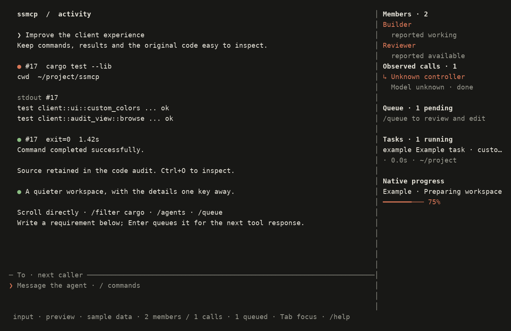

# 终端日志与服务端诊断

客户端默认使用 `pretty`，按请求、输出、结果和诊断分别排版。每个命令显示任务 ID，stdout 与 stderr 明确标记来源，结束时显示实际退出状态与耗时；颜色由主题和语义配色决定。默认摘要限制为终端内的一行，任务与请求 ID 使用短显示形式，工作区内路径相对启动目录显示。完整 ID、路径和参数仍保留在原生事件及工具结果里，Diff 保留行号与原有布局。

## 三种输出模式

```sh
ssmcp --log-format pretty
ssmcp --log-format pretty-verbose
ssmcp --log-format jsonl 2>events.jsonl
ssmcp --no-color

# 使用已有 SSH 配置时，显式选择 SSH 路径。
ssmcp --ssh --log-format pretty my-server
```

`--verbose` 选择 `pretty-verbose`，展开脱敏后的事件元数据；已经实时显示的 stdout/stderr 和 Diff 预览不会在附加 JSON 中再次打印。`--raw-events` 和原有的 `--raw` 选择 `jsonl`。JSONL 每个事件独占一行，连接状态、SSH stderr、原生 stderr 和 PTY 输出都以事件表示。PTY 字节使用 base64，进入审计的副本仍经过敏感信息检查；不要将 JSONL 的 raw 名称理解为绕过脱敏。启动参数解析或配置加载失败发生在日志配置生效之前，错误使用默认可读格式。

EventLog 在持久化前调用同一脱敏函数，渲染器在 pretty、verbose 和 JSONL 模式也处理副本。环境变量映射、凭据字段、私钥材料、敏感路径正文及可识别令牌被隐藏。原生 RPC response 的任意 result/error 正文不进入日志摘要，只保留路由、状态、退出码和审批等允许的元数据；传回调用方的原生结果保持类型与内容。识别未知格式的任意秘密仍有边界，因此不能把脱敏视为读取敏感文件内容的授权。[审计副本](../src/audit.rs)

stdout 用于连接信息。重定向 stdout 或选择 JSONL 时，保留单行连接 JSON，兼容现有脚本；交互终端默认显示 MCP 地址和登录说明。一次性登录码仍是敏感凭据，保存 stdout 时请限制文件权限。OpenSSH 自身通过 `/dev/tty` 发出的主机密钥或私钥口令交互不属于事件日志。

默认每个缓冲 stdout/stderr 块显示最多 12 行，保留开头与末尾，省略处注明折叠数量和展开参数。实时流式输出持续显示；大对象和数组显示有界摘要。`--max-inline-output N` 调整缓冲输出的行数。这里的折叠只影响展示。事件滚动缓存有界，过早的游标会得到 `truncated:true`；检查事件页的 JSONL artifact 和归档错误，通过 `outputs.read` 分页读取已保存记录。来源、容量或存储错误造成的不完整由 metadata 明确标记。

## 固定状态区与窗口尺寸

真实交互终端默认启用 `ui.dashboard = true` 和 `layout = "chat"`。主区域连续显示调用、输出和结果，底部保留用户要求输入框，右侧显示登记成员、要求队列、控制者、任务、原生进度、Git 状态与最近提交。F2 在活动、源码审计、成员、队列内容间切换；F3 收起侧栏。也可配置 `split`、`audit`、`logs` 专用布局。[完整配置与预览](client-ui.md) · [布局](../src/client/panel.rs)

仪表盘中的文字用于用户要求和本地命令，不会传给隐藏的 PTY。Tab 切换输入与内容焦点。需要直接终端输入时，在另一个终端运行 `ssmcp -i`，或由自定义前端调用 `terminal.read/write/resize`。面板只接收文字和语义颜色；分支、路径、任务名和进度消息中的控制字符转成可见文字，按 Unicode 显示宽度截断。`NO_COLOR` 和 `--no-color` 仅关闭颜色。JSONL、重定向 stderr、`TERM=dumb` 或 `ui.dashboard = false` 保留行式输出。[终端原语](terminal-control.md)

Git 状态在授权启动目录独立查询，约每 2 秒刷新；读取本地 Git 信息，不执行 fetch；面板不展示工作区文件正文。右栏显示分支、已知的 ahead/behind、暂存/工作区/未跟踪项计数、冲突和少量路径。未跟踪目录可能作为一项计数。查询失败时保留的旧数据标为 Last known state；没有成功观测时显示 pending、unavailable 或 checking，不报告工作区干净。Git 观察不代替成功文件操作的审计事件。[Git 观察器](../src/client/git_status.rs) · [Git porcelain v2 与后台刷新](https://git-scm.com/docs/git-status)

右栏各段连续排列，以留白分隔任务、工作区与提交历史；Git 状态不再固定到窗口底部。最近提交从已观察的完整 HEAD 读取，最多保留 5 条：每条显示短 SHA、原生提交时间的相对值，以及最多两行标题。标题先脱敏再按 Unicode 字符宽度换行；有足够空间时显示 3–5 条，更矮的窗口减少条数并标明当前显示数量。

HEAD 改变时先清除旧历史，再读取对应提交链，失败显示 unavailable，空仓库显示 No commits yet。Git 状态过期时，保留的历史明确标为 stale，不把其他 HEAD 的提交当作当前分支记录。相对时间依据实际观察时间推进；未知时间不会补成当前时间。[最近提交观察](../src/client/git_status.rs) · [侧栏排版](../src/client/panel.rs)

### 直接回看与筛选日志

鼠标停在日志区时，滚轮直接回看，无需先切换焦点。窗口底部显示当前布局、筛选条件和可用操作：

| 操作 | 作用 |
| --- | --- |
| 鼠标滚轮、PgUp / PgDn | 向前或向后滚动当前内容 |
| Ctrl-Home / Ctrl-End | 到最早保留日志或最新输出 |
| `/filter 文本` | 应用不区分大小写的普通文本筛选 |
| F9 | 在 `all`、`commands`、`errors` 类别间切换 |
| Esc | 关闭帮助或详情，返回输入；普通复制草稿可恢复暂存的原稿 |
| 内容区 ↑ / ↓、Enter 或 →、← | 选择审计记录、展开源码、返回列表 |

上表对应默认 `chat` 布局，输入框中的 Home/End 和方向键仍用于编辑。筛选保留命中命令的输出与结果上下文：`commands` 显示命令相关记录，`errors` 显示错误、警告或 stderr 等诊断记录。`/filter` 清除文本，`/filter --all` 恢复全部类别；筛选只改变当前保留历史的显示，不改变任务和事件归档。自定义前端可调用 `ssmcp.ui.filter`，或读取事件后自行筛选。[键盘与鼠标操作](client-ui.md#键盘与鼠标操作) · [原子 UI 接口](client-ui.md#原子-ui-接口)

日志窗保留 512 行滚动历史。这只是屏幕回看范围，输出流、事件游标和 artifact 另有保留规则；滚动到最早一行不代表已经读完命令输出。Ctrl-End 返回最新日志。正常退出时恢复原终端屏幕、光标和输入模式。

## code_mode 源码与事件

审计区按运行 ID 展示调用方提交的 `code_mode.code`。使用 `/audit` 或 Ctrl-O 打开审计，在内容区用 ↑/↓ 选择记录，Enter 或 → 展开带行号与语法颜色的源码，← 返回列表；鼠标滚轮浏览。源码经过现有审计脱敏处理，界面最多保留 128 次运行、合计 2 MiB 的浏览数据，单段源码上限为 64 KiB。

源码审计需要客户端与服务器都支持协议 v6 或更新版本。v4/v5 连接继续使用已有能力，但不能提供这份源码；连接提示会说明缺失原因。服务器仅向本次编排实际访问的客户端发送源码，设备列表中的其他客户端不会收到。`ssmcp.audit.events` 按游标提供本地审计事件，其中的源码与编排生命周期同样依赖 v6 或更新版本；JSONL 或“原始事件”模式不会补出旧连接未接收的源码，也不会绕过脱敏。[源码审计与运行状态](client-ui.md#源码审计与运行状态)

编排完成、原生调用返回和后台命令退出是三个独立状态。`exec.start` 返回后，编排可以已经完成而命令仍在执行；原生错误也可能被 JavaScript 捕获。判断命令结果时，继续读取实际任务的 `running`、`exit_code` 和输出，不能只看编排的完成标签。

底部输入框的要求队列使用协议 v7。要求与工具执行输出分别展示；`delivered` 只表示附加到符合目标的 `code_mode` 响应。它不代表模型已经阅读或执行，也不改变该次工具调用的错误或退出状态。排队、取回、重新选目标与重载恢复见[要求队列](client-ui.md#输入要求与队列)。

## 并行任务与真实进度

任务开始时显示短任务号、命令与工作目录，stdout/stderr 各自标注来源和任务号，结束时显示对应命令、实际状态、退出码或信号及耗时。只有明确的 exit 0 才显示命令成功；缺少最终退出信息或耗时时显示 unknown。多个任务同时运行时，摘要列出活跃数量与短任务号。

`python -c`、`node -e`、`bash -lc` 等内联脚本使用 `python3 -c · 83 lines` 这样的中性标签，按解释器与源码行数识别命令，不把某一条赋值或文件操作当作执行结论。默认日志直接展示命令输出与退出状态；`--verbose` 额外展开带行号的脱敏脚本正文。编排源码可在审计视图浏览，`--max-inline-output N` 控制缓冲输出的展示行数。[命令展示](../src/client/command.rs) · [渲染器](../src/client/render.rs)

Codex 命令调用以一次原生 `command/exec` 请求和响应为显示单位。外层工具调用通过桥接端生成的 `harness_call_id` 与原生请求精确对应；默认日志显示一套开始和结果，右侧活动区跟踪同一条命令。并行命令乱序完成时仍按各自 ID 配对。派发或发送失败、没有收到原生响应时保留外层失败提示；verbose 和 JSONL 保留外层审计元数据。其他工具调用继续显示各自的开始和结束。[调用关联](../src/backend/rpc.rs) · [回归事件](../src/client/readable_log_fixture.rs)



图片使用固定示例数据，由客户端实际渲染器生成；其中的命令与耗时属于样例。运行 `ssmcp ui preview` 可以在自己的终端检查布局、配色和操作。

启用固定状态区时，活跃任务持续显示活动标记与已运行时间，周期刷新不向日志重复追加心跳。未使用面板时，默认每 5 秒追加活动摘要；非 TTY 日志至少间隔 30 秒，近期有交互式 PTY 输出时推迟提示。活动标记只说明任务仍在运行。只有原生 `notifications/progress` 同时给出合法 `progress` 与正数 `total` 时才显示百分比条；未知总量显示原生数值和 total unknown。原生进度按来源与 token 独立展示，不推断它属于哪个 Shell 任务；长时间没有更新时注明更新时间。

程序打印的 JSON 保留 stdout/stderr 来源，字段值和多行字符串按可读文本排版，长输出与超大记录明确标记折叠。JSON 中的 `status`、`exit_code` 等字段仍是程序输出，不会被提升为命令成功事件。JSONL 保留脱敏后的原始事件；输出正文按捕获与查询规则访问。显示短 ID 只用于辨认，调用 `exec.status/read/wait` 时使用 `exec.list` 或原生结果中的完整任务 ID。

已明确标记为内部发现的重复成功 RPC 摘要在默认 pretty 中折叠，首次观察、错误、恢复和显式用户调用仍可见。原生工具目录或可用性变化由发现事件报告。pretty-verbose 与 JSONL 保留脱敏后的事件来源；来源不明的 stderr 不按文本猜测或隐藏。

## 命令、文件与技能活动

后台命令以 `exec.started`、`exec.stdout`、`exec.stderr`、`exec.exited` 记录开始、增量输出和退出。显示包含任务 ID、命令与工作目录，结束时包含状态和实际退出码。不同任务可以交错，单任务各流保留顺序和游标。输出在任务执行时推送，不需要等待 `wait` 返回；`read/wait` 的历史响应只显示元数据，避免重复打印正文。超过阈值时给出转储引用，正文通过 `outputs.read` 查询。

成功原生文件读取显示 `READ`；原子写入或编辑提交成功后显示 `EDIT`，随后显示 `DIFF` 路径与实际 `+新增 / -删除` 行数。快照有 missing、known、unknown 三态。敏感路径、二进制、不可读或过大快照显示具体不可用原因和未知计数，不用空文本伪造 Diff。小 Diff 在事件内保留完整正文，大 Diff 由 `diff_artifact` 引用同一输出存储；终端预览不足时仍可查询完整结果。[文件审计](../src/workspace/audit.rs)

技能事件明确区分发现元数据、读取正文和实际调用。`ssmcp.skill.discovered/read` 与扫描摘要来自 Context；它们不表示模型已使用技能。只有原生接口提供明确调用证据才能展示 invoked。Harness 的 started/completed 记录提供者、工具、调用 ID、耗时和状态，外部文件副作用为 `file_audit:"unknown"`，不会根据参数或工具名猜测写入成功。

## 本地主题配置

配置文件依次选择 `--ui-config FILE`、`SSMCP_UI_CONFIG`、`$XDG_CONFIG_HOME/ssmcp/config.toml` 或 `~/.config/ssmcp/config.toml`。命令行覆盖对应配置项。默认路径缺失时使用内置设置；显式路径缺失、格式损坏、未知字段和非法取值会阻止启动。

```toml
[ui]
color = true
dashboard = true
log_format = "pretty"
theme = "dark"
layout = "chat"
log_height_percent = 60
sidebar = true
sidebar_width = 30
panels = ["agents", "queue", "controller", "tasks", "progress", "git", "history"]
hide_empty = true
timestamps = true
show_request_id = true
show_raw_json = false
max_inline_output = 12
activity_interval_secs = 5
```

`dashboard` 控制交互式面板，默认 true。`activity_interval_secs` 可设为 0–300 秒，控制行式日志的周期活动提示；0 关闭该提示，面板、开始、完成、文件和原生调用事件仍会更新。两个设置都不改变任务并发或执行超时。

支持 `dark`、`codex-dark`、`nord`、`solarized`、`light`、`minimal` 六种主题，F4 按此顺序循环。默认 `dark` 绘制自己的背景，`minimal` 跟随终端；`[ui.colors]` 可以按语义覆盖十六进制真彩色、ANSI 颜色名或 `default`。F5 重载显示配置，F8 保存当前设置；输入框中的 `/reload` 则重新启动客户端。`dashboard` 与 `log_format` 是启动设置，切换这两项需要修改文件并重启。[主题与颜色](client-ui.md#主题与颜色)

`--theme nord`、`--timestamps` 可直接覆盖对应设置，时间戳使用 UTC。`NO_COLOR`、`--no-color`、`TERM=dumb` 和重定向 stderr 都关闭日志 ANSI 颜色。主题只影响显示；原生工具结果、终端字节和 JSONL 事件不受配色影响。

## 后台会话日志

`--daemon` 的服务进程关闭面板与颜色，使用 JSONL 输出；创建命令中的前台显示选项不会改变服务日志。普通 `sessions status` 和生命周期记录不包含登录码。确需登录码时才在本机显式调用 `sessions auth NAME`；其私有输出应只用于登录。[后台会话与权限](session-control.md#后台运行与延时重连)

```sh
ssmcp sessions logs workstation --lines 100
ssmcp sessions logs workstation --lines 100 --json
```

`--lines` 默认 50，范围为 1–1000。JSON 返回 `source`、`fallback`、`warning`、`coverage`、`unit`、`events`、`limit` 和 `truncated`，读取时先判断来源：

| 来源与覆盖 | `events` 内容 | 如何解释 |
| --- | --- | --- |
| Linux：`source:"journal"`、`coverage:"native_events"` | 对应 unit 的实际 journal 消息；每项包含 `timestamp_us`、`pid`、`event` | `event` 为 MESSAGE 解析出的 JSON 或普通字符串，经过审计脱敏；时间或 PID 不可用时为 null |
| Linux 降级：`source:"lifecycle"`、`fallback:true` | 原始生命周期观测字段，如 `phase`、`attempt`、`retry_after_secs`、`observed_at` | journal 不可用或无记录，`warning` 会说明；不能据此确认完整工具输出 |
| macOS / Windows：`source:"lifecycle"`、`coverage:"lifecycle_only"` | 生命周期观测 | 这是当前支持范围，`warning` 明确说明；`fallback:false` 不表示具有完整原生输出 |

两种来源不会拼接，以免把同一次活动重复显示。`truncated:true` 表示受本次读取界限约束，返回的事件不是完整历史。该接口不导出 journal 的环境变量、完整命令行等附加字段；也不会读取私有 `auth.json`。Linux 原生 journal 的保留策略由主机管理，ssmcp 的生命周期文件有独立容量界限；命令和 MCP 的完整结果仍按原有 OutputStore 策略保存、分页读取。[本地日志实现](../src/session.rs) · [连接输出保留](session-control.md#长输出自动转储)

## 服务端日志

`ssmcpd` 使用单行 `key=value` 结构，分类包括 `auth`、`oauth`、`identity`、`session`、`mcp`、`proxy`、`timeout` 和 `persistence`。运行日志只写入允许的元信息字段，不记录 HTTP 请求体、查询字符串、OAuth token、client secret 或后端输出。请求 ID 由服务器生成，并在 `X-Request-ID` 响应头返回；身份授权日志包含 GitHub 稳定 subject ID，转发日志包含 client/session ID。

```sh
journalctl -u ssmcpd --since '10 minutes ago' -o cat
RUST_LOG='warn,ssmcpd::proxy=debug,ssmcpd::persistence=debug' ssmcpd serve
```

`RUST_LOG` 支持 `off/error/warn/info/debug/trace` 全局级别以及 `ssmcpd::分类=级别` 或 `ssmcp::分类=级别`，更具体的分类优先；默认 `info`。健康检查成功记录属于 debug，避免日常刷屏。终端交互时自动着色，systemd journal 中保持无 ANSI 的纯文本记录。

## 代理与部署边界

提供 [Caddy](../packaging/Caddyfile) 和 [Nginx](../packaging/nginx-ssmcp.conf.example) 示例：控制接口 30 秒，长调用 930 秒，长输出关闭代理缓冲。930 秒留在内部 910 秒原生转发期限之外，让应用有机会先返回明确结果。Nginx 504 响应提醒先检查已有任务状态，避免重复执行有副作用的命令。访问日志使用不含查询字符串的 `$uri`。

当前公网 MCP 使用 JSON-response Streamable HTTP。反代保留流式及 Upgrade 相关设置；这些设置不会自动增加新的 SSE 或 WebSocket MCP 端点。原生后端进度仍通过现有事件工具读取。

systemd 固定使用 `ssmcpd` 用户，持久状态位于 `/var/lib/ssmcpd`，缓存位于 `/var/cache/ssmcpd`，控制 socket 位于 `/run/ssmcpd`，配置仍位于 `/etc/ssmcpd/ssmcpd.toml`。配置只读，StateDirectory/CacheDirectory/RuntimeDirectory 提供所需写入空间。保留 bubblewrap 所需的 `/proc/sys/user` 例外，避免破坏代码模式隔离。

DCR 注册持久化已包含原子替换、0600 文件、0700 私有目录、单写者锁和损坏文件拒绝启动。授权码、access token 和 refresh token 仍在内存中；重启后保留客户端登记，但当前连接和授权需要重新建立。

参考：[Caddy reverse_proxy](https://caddyserver.com/docs/caddyfile/directives/reverse_proxy)、[Nginx proxy module](https://nginx.org/en/docs/http/ngx_http_proxy_module.html)、[systemd.exec](https://www.freedesktop.org/software/systemd/man/latest/systemd.exec.html)。
