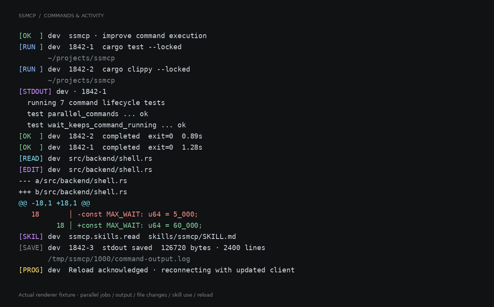

# 终端日志与服务端诊断

客户端默认使用 `pretty`：请求蓝色，成功绿色，响应元信息青色，工具及 stdout 标题紫色，警告与进度黄色，错误和超时红色。stderr 在成功调用中为黄色，失败调用中为红色。默认摘要限制为终端内的一行，任务与请求 ID 使用短显示形式，工作区内路径相对启动目录显示；完整 ID、路径和参数仍保留在原生事件及工具结果里。Diff 保留行号与原有布局。

## 三种输出模式

```sh
ssmcp --log-format pretty my-server
ssmcp --log-format pretty-verbose my-server
ssmcp --log-format jsonl my-server 2>events.jsonl
ssmcp --no-color my-server
```

`--verbose` 选择 `pretty-verbose`，展开脱敏后的事件元数据；已经实时显示的 stdout/stderr 和 Diff 预览不会在附加 JSON 中再次打印。`--raw-events` 和原有的 `--raw` 选择 `jsonl`。JSONL 每个事件独占一行，连接状态、SSH stderr、原生 stderr 和 PTY 输出都以事件表示。PTY 字节使用 base64，进入审计的副本仍经过敏感信息检查；不要将 JSONL 的 raw 名称理解为绕过脱敏。启动参数解析或配置加载失败发生在日志配置生效之前，错误使用默认可读格式。

EventLog 在持久化前调用同一脱敏函数，渲染器在 pretty、verbose 和 JSONL 模式也处理副本。环境变量映射、凭据字段、私钥材料、敏感路径正文及可识别令牌被隐藏。原生 RPC response 的任意 result/error 正文不进入日志摘要，只保留路由、状态、退出码和审批等允许的元数据；传回调用方的原生结果保持类型与内容。识别未知格式的任意秘密仍有边界，因此不能把脱敏视为读取敏感文件内容的授权。[审计副本](../src/audit.rs)

stdout 用于连接信息。重定向 stdout 或选择 JSONL 时，保留单行连接 JSON，兼容现有脚本；交互终端默认显示 MCP 地址和登录说明。一次性登录码仍是敏感凭据，保存 stdout 时请限制文件权限。OpenSSH 自身通过 `/dev/tty` 发出的主机密钥或私钥口令交互不属于事件日志。

默认每个缓冲 stdout/stderr 块显示最多 12 行，保留开头与末尾，省略处注明折叠数量和展开参数。实时流式输出持续显示；大对象和数组显示有界摘要。`--max-inline-output N` 调整缓冲输出的行数。这里的折叠只影响展示。事件滚动缓存有界，过早的游标会得到 `truncated:true`；检查事件页的 JSONL artifact 和归档错误，通过 `outputs.read` 分页读取已保存记录。来源、容量或存储错误造成的不完整由 metadata 明确标记。

## 并行任务与真实进度

任务开始时显示短任务号、命令与工作目录，结束时显示实际状态、退出码或信号及耗时。只有明确的 exit 0 才显示成功；缺少最终退出信息时显示未知。多个任务同时运行时，摘要列出活跃数量与短任务号。长 `python -c`、`node -e` 等内联脚本以程序名和脚本行数代替源码墙；原始参数没有改变。

任务尚未结束时，默认每 5 秒追加一条活动标记与已运行时间；非 TTY 日志至少间隔 30 秒。它不占用全屏、不清除终端内容、不移动光标，近期有交互式 PTY 输出时会推迟状态提示。活动标记只说明任务仍在运行，不代表估算完成比例。只有原生 `notifications/progress` 同时给出合法 `progress` 与正数 `total` 时才显示百分比条；未知总量显示当前活动和耗时。

程序打印的 JSON 保留 stdout/stderr 来源，默认显示字段摘要，多行字符串和超大 JSON 记录有界折叠，不裸打印转义换行或完整对象墙。JSON 中的 `status`、`exit_code` 等字段仍是程序输出，不会被提升为命令成功事件。JSONL 保留脱敏后的原始事件；完整输出仍按原有捕获与查询规则访问。显示短 ID 只用于辨认，调用 `exec.status/read/wait` 时使用 `exec.list` 或原生结果中的完整任务 ID。

## 命令、文件与技能活动

后台命令以 `exec.started`、`exec.stdout`、`exec.stderr`、`exec.exited` 记录开始、增量输出和退出。显示包含任务 ID、命令与工作目录，结束时包含状态和实际退出码。不同任务可以交错，单任务各流保留顺序和游标。输出在任务执行时推送，不需要等待 `wait` 返回；`read/wait` 的历史响应只显示元数据，避免重复打印正文。超过阈值时给出转储引用，正文通过 `outputs.read` 查询。

成功原生文件读取显示 `READ`；原子写入或编辑提交成功后显示 `EDIT`，随后显示 `DIFF` 路径与实际 `+新增 / -删除` 行数。快照有 missing、known、unknown 三态。敏感路径、二进制、不可读或过大快照显示具体不可用原因和未知计数，不用空文本伪造 Diff。小 Diff 在事件内保留完整正文，大 Diff 由 `diff_artifact` 引用同一输出存储；终端预览不足时仍可查询完整结果。[文件审计](../src/workspace/audit.rs)

技能事件明确区分发现元数据、读取正文和实际调用。`ssmcp.skill.discovered/read` 与扫描摘要来自 Context；它们不表示模型已使用技能。只有原生接口提供明确调用证据才能展示 invoked。Harness 的 started/completed 记录提供者、工具、调用 ID、耗时和状态，外部文件副作用为 `file_audit:"unknown"`，不会根据参数或工具名猜测写入成功。

## 本地主题配置

配置文件依次选择 `--ui-config FILE`、`SSMCP_UI_CONFIG`、`$XDG_CONFIG_HOME/ssmcp/config.toml` 或 `~/.config/ssmcp/config.toml`。命令行覆盖对应配置项。默认路径缺失时使用内置设置；显式路径缺失、格式损坏、未知字段和非法取值会阻止启动。

```toml
[ui]
color = true
log_format = "pretty"
theme = "codex-dark"
timestamps = true
show_request_id = true
show_raw_json = false
max_inline_output = 12
activity_interval_secs = 5
```

`activity_interval_secs` 可设为 0–300 秒；0 关闭周期性活动提示，开始、完成、文件和原生调用事件仍会显示。该设置不改变任务并发或执行超时。

支持 `minimal`、`codex-dark`、`nord`、`solarized` 四种主题。`--theme nord`、`--timestamps` 可直接覆盖。时间戳使用 UTC；终端主题不改变原生工具返回。`NO_COLOR`、`--no-color`、`TERM=dumb` 和重定向 stderr 都关闭日志 ANSI 颜色。真实终端上的交互式 PTY 独立于配色，保留字节与光标、退格等控制序列；JSONL 模式仍输出事件格式。非 TTY 日志输出使用安全可读展示。



上图由项目的真实渲染器运行固定测试事件生成，展示排版与颜色；它是可复现的渲染示例，不是生产命令耗时记录。

## 服务端日志

`ssmcpd` 使用单行 `key=value` 结构，分类包括 `auth`、`oauth`、`identity`、`session`、`mcp`、`proxy`、`timeout` 和 `persistence`。运行日志只写入允许的元信息字段，不记录 HTTP 请求体、查询字符串、OAuth token、client secret 或后端输出。请求 ID 由服务器生成，并在 `X-Request-ID` 响应头返回；身份授权日志包含 GitHub 稳定 subject ID，转发日志包含 client/session ID。

```sh
journalctl -u ssmcpd --since '10 minutes ago' -o cat
RUST_LOG='warn,ssmcpd::proxy=debug,ssmcpd::persistence=debug' ssmcpd serve
```

`RUST_LOG` 支持 `off/error/warn/info/debug/trace` 全局级别以及 `ssmcpd::分类=级别` 或 `ssmcp::分类=级别`，更具体的分类优先；默认 `info`。健康检查成功记录属于 debug，避免日常刷屏。终端交互时自动着色，systemd journal 中保持无 ANSI 的纯文本记录。

## 代理与部署边界

提供 [Caddy](../packaging/Caddyfile) 和 [Nginx](../packaging/nginx-ssmcp.conf.example) 示例：控制接口 30 秒，长调用 930 秒，长输出关闭代理缓冲。930 秒留在内部 910 秒原生转发期限之外，让应用有机会先返回明确结果。Nginx 504 响应提醒先检查已有任务状态，避免重复执行有副作用的命令。访问日志使用不含查询字符串的 `$uri`。

当前公网 MCP 使用 JSON-response Streamable HTTP。反代保留流式及 Upgrade 相关设置；这些设置不会自动增加新的 SSE 或 WebSocket MCP 端点。原生后端进度仍通过现有事件工具读取。

systemd 固定使用 `ssmcpd` 用户，持久状态位于 `/var/lib/ssmcpd`，缓存位于 `/var/cache/ssmcpd`，控制 socket 位于 `/run/ssmcpd`，配置仍位于 `/etc/ssmcpd/ssmcpd.toml`。配置只读，StateDirectory/CacheDirectory/RuntimeDirectory 提供所需写入空间。保留 bubblewrap 所需的 `/proc/sys/user` 例外，避免破坏代码模式隔离。

DCR 注册持久化已包含原子替换、0600 文件、0700 私有目录、单写者锁和损坏文件拒绝启动。授权码、access token 和 refresh token 仍在内存中；重启后保留客户端登记，但当前连接和授权需要重新建立。

参考：[Caddy reverse_proxy](https://caddyserver.com/docs/caddyfile/directives/reverse_proxy)、[Nginx proxy module](https://nginx.org/en/docs/http/ngx_http_proxy_module.html)、[systemd.exec](https://www.freedesktop.org/software/systemd/man/latest/systemd.exec.html)。
