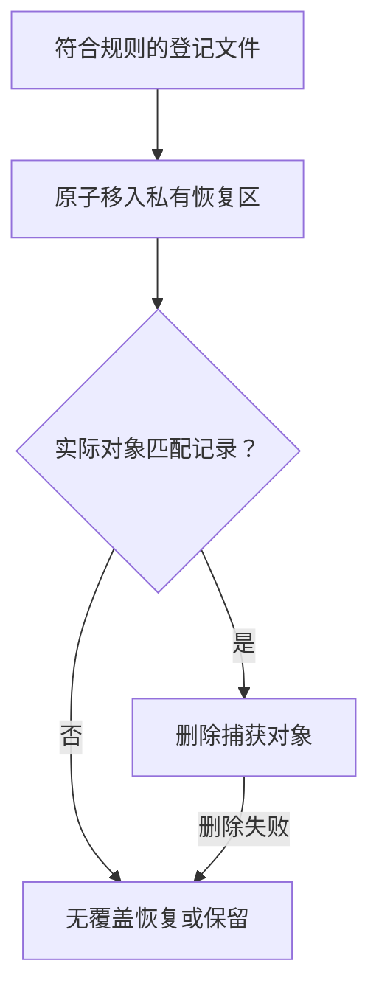

# 文件登记与自动清理

SSMCP 会登记它通过受支持入口新建的文件，并按工作区规则清理明确标记的临时文件。默认开启清理，临时文件保留时间为 24 小时，选中临时文件的容量阈值为 512 MiB；输入引用、普通用户文件和未登记文件会保留。

创建记录保存相对路径、用途分类、创建来源、文件对象标识、长度、修改时间和父目录身份。清理时会重新核对这些信息。同一个路径后来出现的新文件，不能仅凭原来的路径记录被删除。

## 1. 哪些文件会登记和清理

| 创建入口 | 登记分类 | 自动清理行为 |
| --- | --- | --- |
| `ssmcp.fs.write` / `ssmcp.fs.write_text` 新建普通文件 | `user_file` | 保留 |
| 上述入口显式设置 `temporary:true`，新建 `.ssmcp/tmp/` 下的文件 | `temporary` | 根据规则选择，再核对身份和活动租约 |
| 客户端保存粘贴文本、图片或 handoff 输入引用 | `persistent_input` | 保留 `.ssmcp/inputs/` 中的输入 |
| 覆盖已有文件 | 不伪造新的创建记录 | 原登记的身份已经变化时保留文件 |
| Shell、外部程序或其他尚未接入登记的入口创建的文件 | 未登记 | 保留 |

登记失败会保留已经成功写入的文件。原生文件写工具通过 `tracking_warning` 告知登记失败；输入引用仍指向原文件，并记录不含正文的诊断事件。未成功登记的文件不会进入自动删除范围。

清理记录位于 `.ssmcp/managed-files/`，规则位于 `.ssmcp/cleanup.json`。内部登记记录、锁文件和恢复区不能通过普通原生文件写工具覆盖；规则文件可以正常编辑，也可以使用专用配置接口。

## 2. 创建一个可清理的临时文件

调用 `ssmcp.fs.write_text`，使用当前已授权客户端的工作区：

```json
{
  "path": ".ssmcp/tmp/demo.txt",
  "text": "disposable build output\n",
  "temporary": true,
  "create_parents": true
}
```

`temporary:true` 用于新文件，要求相对路径位于 `.ssmcp/tmp/` 下，且不能与 `overwrite:true` 组合。省略 `temporary` 时，新文件按普通用户文件登记；即使路径位于 `.ssmcp/tmp/`，也会保留。

临时标记表示文件在规则允许后可以被移除。一次写操作结束后，创建接点不会自动为后续 Shell 命令持有活动租约。需要长期保留的工作文件应使用默认分类；内部 Rust 调用者可以持有 `Registration` 或 `FileLease`，让清理跳过仍在使用的对象。

## 3. 查看、预览和手动清理

在目标工作区目录运行：

```sh
ssmcp cleanup --list
ssmcp cleanup --config
ssmcp cleanup --dry-run
ssmcp cleanup
```

**CLI 的 `ssmcp cleanup` 会实际执行清理；原生工具 `ssmcp.files.cleanup` 省略参数时默认预览。** CLI 每次接受一种模式，不能把 `--list`、`--dry-run` 或配置参数混在同一次调用中。

| 目的 | CLI | 原生工具与参数 |
| --- | --- | --- |
| 查看登记记录 | `ssmcp cleanup --list` | `ssmcp.files.list`，例如 `{"offset":0,"max_entries":64}` |
| 查看当前规则 | `ssmcp cleanup --config` | `ssmcp.files.config`，`{}` |
| 预览清理 | `ssmcp cleanup --dry-run` | `ssmcp.files.cleanup`，`{}` 或 `{"dry_run":true}` |
| 实际清理 | `ssmcp cleanup` | `ssmcp.files.cleanup`，`{"dry_run":false}` |
| 设置规则 | `ssmcp cleanup --set-config cleanup-policy.json` | `ssmcp.files.configure`，`{"config":{...}}` |
| 查看帮助 | `ssmcp cleanup --help` | 查询工具 schema |

原生列表每页默认 64 条、最多 128 条，返回 `records`、`total` 和 `next_offset`。每次请求读取当前排序结果；并发创建或整理记录会改变后续页的位置。CLI 列表返回当前完整的受限视图，发现坏记录或扫描不完整时会报错。

## 4. 配置自动清理规则

连接中的客户端在启动时运行一次清理，此后每 5 分钟检查一次；同一个客户端不会重叠运行自己的定时扫描。reload 在旧请求和后端停止后、新 handoff 创建前再触发一次清理。单次清理出错会报告问题，reload 继续处理自身流程。

默认配置如下：

```json
{
  "enabled": true,
  "max_age_seconds": 86400,
  "max_total_bytes": 536870912,
  "rules": []
}
```

`rules` 为空时，规则适用于所有符合保护边界的已登记临时文件。年龄达到阈值，或选中文件的总字节数超过容量阈值时，清理会按较早的创建记录优先处理。活动租约、身份变化或删除失败都可能让容量暂时超过阈值，结果会列出保留原因。

下面的配置让 build 临时文件保留 1 小时，其他 `.ssmcp/tmp/` 临时文件保留 24 小时：

```json
{
  "enabled": true,
  "max_age_seconds": 86400,
  "max_total_bytes": 536870912,
  "rules": [
    {
      "relative_prefix": ".ssmcp/tmp/build",
      "category": "temporary",
      "max_age_seconds": 3600
    },
    {
      "relative_prefix": ".ssmcp/tmp",
      "category": "temporary"
    }
  ]
}
```

非空 `rules` 只选择匹配前缀的登记文件。前缀按路径组件匹配，较具体的前缀优先；同样具体时使用先出现的规则。前缀需要规范的相对写法，分类只能是 `temporary`；配置不能扩大到 `.ssmcp` 以外，也不能选择输入、配置、历史、凭据、锁或内部恢复区等受保护位置。

`max_age_seconds:0` 表示文件立即具备年龄条件，仍需通过身份、规则和租约检查。`enabled:false` 停止实际文件清理及已完成记录整理。配置最多 64 KiB、64 条规则。

`--set-config` 和 `ssmcp.files.configure` 都会验证并替换整份配置，省略字段使用默认值；设置配置本身不执行清理。修改现有策略时，先读取当前配置，再保存需要保留的字段。预览不会创建、删除或整理登记记录。

## 5. 恢复结果和记录维护

清理会先把待删目录项移入同一父目录下新建的私有恢复区，再核对真正移入对象的身份。只有匹配登记记录的捕获对象可以被删除。



如果外部程序替换了原路径，捕获对象与原记录不符时会尝试恢复。原路径已经被新文件占用时，保留该新文件，并把捕获对象留在恢复区；返回的 `recoveries` 包含恢复状态、可用的实际路径、恢复目录名、父目录身份和错误。可以根据这些信息检查内容，再复制到选定的新名称。

结果中，`removed_files` / `removed_bytes` 是实际删除的数据文件数量和字节数；`would_remove_files` / `would_remove_bytes` 是预览预计值。`busy`、`kept_active`、`kept_changed`、`kept_protected`、`errors` 等字段解释跳过或失败原因。已删除文件但空恢复目录未能移除时，删除计数仍保留，并单独报告警告。

已确认删除的文件会留下已完成登记记录。实际清理会逐步整理较旧的已完成记录，保留最近 1024 条，每轮最多整理 1024 条；这部分结果单独放在 `retention` 中，不计入数据文件删除量。一次最多扫描 32768 个目录项，活动记录与坏记录合计上限为 16384。达到扫描限制或管理目录身份发生变化时，本轮停止数据清理并返回明确状态；只读预览不会整理记录。

## 6. 实现依据与验证范围

本页描述源代码中的接口和处理规则。实际执行结果由对应提交的 CI 与验收报告给出；本页不声明跨平台测试已经通过。

| 行为 | 实现依据 | 已定义的回归范围 |
| --- | --- | --- |
| 创建登记、显式临时分类、覆盖保留 | [workspace.rs](../src/workspace.rs)、[portable.rs](../src/workspace/portable.rs) | `managed_file_integration_tests`：原生写入、`./` 路径、非法参数、登记失败、覆盖与并发锁 |
| 输入引用保留 | [paste.rs](../src/client/references/paste.rs) | 已保存输入在零年龄、零容量规则下保留；登记失败仍可读取引用 |
| CLI 与原生工具 | [command.rs](../src/managed_files/command.rs)、[native.rs](../src/managed_files/native.rs) | 默认预览、分页边界、未知字段和配置大小验证 |
| 身份核对及无覆盖恢复 | [managed_files.rs](../src/managed_files.rs)、[storage.rs](../src/managed_files/storage.rs) | [tests.rs](../src/managed_files/tests.rs)：捕获替换对象后恢复；原位置被新对象占用时保留两者 |
| 有界整理已完成记录 | [retention.rs](../src/managed_files/retention.rs) | 较旧完成记录整理，活动、坏记录和未知文件保留，预览不变及稳定排序 |
| 自动调度与 reload | [client.rs](../src/client.rs)、[reload.rs](../src/client/reload.rs) | 需与对应候选版本的连接、退出和真实 reload 验收结果一起核对 |
