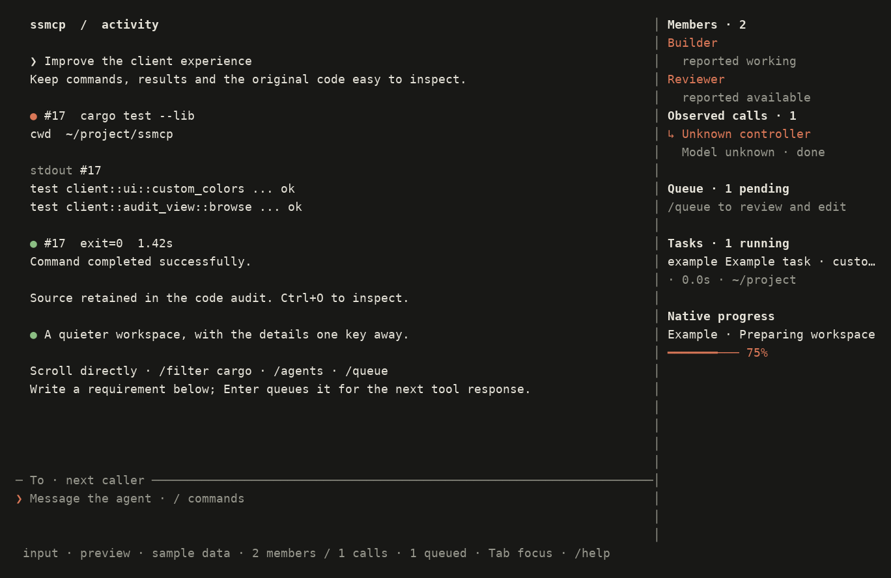

# 客户端交互与用户要求队列

日期：2026-11-18（Asia/Taipei）。本报告记录 `feat/client-experience` 分支的实现、验证与使用边界。验证在 ssmcp 连接的 Linux 开发机上完成，使用独立工作树和隔离测试会话。

验证源码基准：[940c636](https://github.com/LIghtJUNction/ssmcp/commit/940c636a275fe5dfeb039ee0dce3f9b6743b42ae)，已合入主分支的具名账号、实时项目上下文和 RTK 更新。最终二进制对应生产源码 [1eca0e9](https://github.com/LIghtJUNction/ssmcp/commit/1eca0e97ea7e457a2dea6b4991c0d2e7a3f29092)；之后仅修正三个测试夹具，生产实现未变。机器可读清单逐一核对了开发机的 187 个源码、脚本和构建文件，与验证基准全部一致。后续文档与证据提交不改变实现。

## 交付内容

默认客户端改为连续活动流、固定多行输入框和可折叠状态侧栏。深色主题采用浅色文字、低对比度辅助信息与暖色强调；浅色主题和逐项自定义颜色仍可使用。旧终端区域由原始 `code_mode` 审计取代，Shell 能力保留在独立的原生终端接口中。



图片由生产渲染器回放固定示例生成。成员、命令输出和耗时是用于检查排版的示例；它们不作为运行测试通过的证据。

| 用户操作 | 实现行为 |
| --- | --- |
| 直接滚轮、PgUp / PgDn | 浏览当前内容，无需先按 F6 |
| 输入要求，按 Enter | 本地入队后立即释放输入框，可以继续写下一条 |
| `/queue`，↑ / ↓，Enter | 选择尚未交付项，服务器确认取回后重新编辑同一条要求 |
| 队列中的 → / ← / Delete | 查看详情、返回列表、取消可撤回项 |
| `/agents`，↑ / ↓，Enter | 查看真实登记的成员，按成员 ID 选择接收目标 |
| `/audit` 或 Ctrl-O | 打开原始编排源码审计 |
| 审计中的 Enter / → / ← | 展开带行号和语法颜色的源码、返回列表 |
| `/filter 文本` | 按文本保留命中的命令、输出与结果上下文 |
| `/filter --commands`、`--errors`、`--all` | 切换日志类别 |
| F3 或 `/sidebar` | 折叠、展开右侧状态面板 |
| `/reload` | 重启客户端，使用新连接 ID，并按交接规则恢复草稿与队列 |
| F4 / F5 / F8 | 切换主题、重载显示配置、保存显示配置 |

Tab / Shift-Tab 在输入框和内容区之间切换。输入框支持逻辑行导航、历史、括号粘贴，以及 Ctrl-J、可识别的 Shift-Enter、反斜杠后 Enter 换行。完整按键、颜色与布局见[客户端 UI](../../client-ui.md)。

## 用户要求如何进入 agent 的下一次响应

输入的文字先形成一条有 ID、版本和目标的队列记录。服务端在符合授权与目标条件的 `code_mode` 返回响应时领取记录，将内容放入 `structuredContent.user_messages` 和单独的用户要求文本块。命令的 stdout、stderr、原生返回内容和错误状态保持原样。

默认目标 `Next caller` 表示下一次实际操作该客户端的合格调用方。选择明确成员后，接收方需要在本次编排中使用 `collab.bind(clientId, {agent_id, token})` 绑定真实登记身份。显示名称或模型名称不参与身份判断，同名成员仍以不同 ID 区分。

队列取回和交付使用同一把锁以及版本比较：取回先完成时暂停交付，交付先完成时拒绝编辑已交付内容。后台确认只更新记录状态，不清空用户后来输入的草稿。复制旧要求时会暂存当前草稿；重复复制不能覆盖暂存内容，Esc 可恢复原文、目标和光标。

“已交付”说明服务器已把要求放入响应，不证明模型已经阅读或执行。外部 agent 没有继续调用工具时，要求继续等待。连接中断导致的交付不确定不会自动重发；用户明确复核后才能补发。实现和边界见[队列说明](../../client-ui.md#输入要求与队列)及[成员身份](../../client-ui.md#成员身份与状态)。

## 自定义 UI 与长会话

`ssmcp.ui.get/set/action/filter/queue` 提供独立的状态、显示动作和要求队列接口。自己的前端可以读取结构化值，不必解析终端文字。

测试发现，完整 UI 快照随审计历史增长后可能超过通用 32 KiB 内联限制。为此增加 `ssmcp.ui.get` 的 JSON Pointer 投影和数组、字符串分页：例如只读取 `/display/conversation` 或 `/display/panes`，而不是每次带回全部审计内容。投影响应限制为 8 KiB，超限明确报错；完整快照的原有归档行为保持兼容。

只有 UI 操作或目录查询的编排默认不会领取下一调用方的用户要求。前端持续轮询应使用投影接口；不要为了获取状态而混入执行类接口。显式绑定成员的编排仍可领取符合该成员目标的要求。[接口参数与示例](../../client-ui.md#原子-ui-接口)

## 验证证据

最终计数、源文件摘要和二进制摘要以本目录的机器可读结果为准。验证工具链固定为 Rust 1.100.0，使用单 Cargo 编译任务；构建进程有独立 CPU 与内存上限，不改动开发机的全局 Cargo 配置。

| 验证 | 最终结果 | 证据 |
| --- | --- | --- |
| 格式、严格 Clippy、客户端与服务器构建 | 全部通过 | [gates.json](gates.json) |
| Rust library 测试 | 704 通过，0 失败，7 ignored | [gates.json](gates.json) |
| 真实 HTTP 工具响应与身份边界 | 9 通过，0 失败 | [http.json](http.json) |
| 启动与重载兼容性 | 15 通过，0 失败 | [compatibility.json](compatibility.json) |
| 服务器配置、上下文资源与 Linux helpers | 30 通过，0 失败；包括显式运行的 2 项 helpers | [compatibility.json](compatibility.json) |
| 真实 PTY 输入、队列、成员与客户端 reexec | 88 项检查通过，16.141 秒 | [composer.json](composer.json) |
| 专用布局、原生终端隔离与审计兼容性 | 84 项检查通过，25.888 秒 | [dashboard.json](dashboard.json) |
| 深色、浅色、窄窗口与交互预览 | 38 项检查通过 | [preview.json](preview.json) |
| 最终源码、脚本与二进制摘要 | 187 个文件一致，3 个二进制摘要一致 | [source-manifest.json](source-manifest.json) |

library 汇总中的 7 项 ignored 保留原始状态，不计为通过；需要既有 OpenCode 或 Omarchy 实机会话的检查不在本轮验收范围。Linux 上的上下文 helpers 单独显式运行，两项均通过。不同层级的测试与界面检查分别列出，不合并成一个含义不清的总数。

测试使用自己的 SSH 服务、OAuth 授权、临时工作区和 PTY。夹具隔离了开发机的已保存账号、客户端配置、托管会话目录及重载交接环境，避免测试误连真实账号或借用正在运行的会话。终端退出时核对替代屏幕、鼠标模式和 termios 恢复。报告只保存断言、指标和摘要，不保存授权凭据或原始终端记录。

测试期间修正了两处旧夹具假设：旧几何断言现在显式选择 `split` 布局；日志搜索使用完整命令，避免固定帮助文字中的同名关键词造成第二处合法命中。另补充独立状态消息与命令结果分组的回归检查。隔离夹具的账号问题和审计详情导航假设也已修正。

主分支合并后，保留了具名账号的连接与带宽策略，同时为源码通知和队列回执补齐同一带宽统计与限额检查。严格 Clippy 发现的嵌套条件只做等价格式调整。终端测试按实际画面等待任务计时更新。

最后的兼容复核发现，旧模拟 SSH 服务没有处理 v7 队列状态帧，提前退出，导致 6 项重载测试缺少结果文件。修正模拟协议处理后，全部 15 项启动与重载测试通过，原有断言保留。面板测试还发现独立 Escape 需要经过两层按键解析；夹具改为先打开筛选输入，再等待画面确认关闭，之后才发送 PageUp，全部 84 项检查通过。这两次失败、确认的原因及通过后的复核记录保存在证据中，没有将旧失败记录改写为成功。

## 已知范围

这次交付接近参考界面的输入和浏览方式；不声称完整兼容 Claude Code 的全部命令、权限流程或模型行为。

- 用户要求队列和成员目标需要客户端、服务器都支持协议 v7；原始源码审计需要 v6 或更新版本。
- 前台直接连接的客户端支持本地输入队列；本地 `attach` 目前不转发自己的输入框，可以通过后台连接的 `ssmcp.ui.queue` 管理要求。
- `/reload` 重启 ssmcp 客户端及其连接，不重启外部 ChatGPT 或 Claude 对话。它按现有生命周期结束旧连接拥有的任务。登录码会话需要新的授权；已交付记录不会因为重载再次发送。
- `collab` 记录已加入的真实成员和成员自报状态，不自动启动模型，也不唤醒已停止的 agent。
- 单条要求最多 16 KiB；单连接最多 64 条待处理要求、64 条近期结束记录，总容量 512 KiB。每次响应最多交付 8 条、合计 64 KiB。
- 本轮运行验证范围为 Linux。未将 Linux 结果当作 macOS 或 Windows 的实机验收。
- 本轮交付源码、文档和测试构建；没有发布 Release、替换在线二进制或重启正在使用的开发连接。

## 本机查看与复现

本轮 E2E 在 Linux 上使用 Python 3、OpenSSH 客户端与服务端、`ssh-keygen`、系统 Node.js，以及 `stty`、`tty`、`sleep`、`head`、`tr`。需要允许在回环地址启动临时 SSH/HTTP 服务和子 PTY。下面的构建同时生成独立 VT 解码器；PNG 渲染另需 Pillow 和等宽 TrueType 字体，客户端运行不依赖它们。

```sh
cargo build --locked --bins --example vt_snapshot -j1
target/debug/ssmcp ui preview
target/debug/ssmcp ui preview --theme light

cargo fmt --all -- --check
cargo clippy --locked --all-targets -j1 -- -D warnings
cargo test --locked --lib -j1 -- --test-threads=4
cargo test --locked --test two_tools -j1 -- --include-ignored --test-threads=2
cargo test --locked --test client_reload --test client_startup -j1 -- --test-threads=4
cargo test --locked --test client_server_config --test context --test context_helpers --test context_runtime --test resources -j1 -- --test-threads=4
cargo test --locked --test context_helpers -j1 -- --ignored --test-threads=1

python3 scripts/e2e_client_ui.py --bin-dir target/debug --out /tmp/ssmcp-client-ui
python3 scripts/e2e_composer.py --bin-dir target/debug --report /tmp/ssmcp-composer.json
python3 scripts/e2e_dashboard.py --bin-dir target/debug --report /tmp/ssmcp-dashboard.json
```

各脚本启动时检查所需二进制，测试结束后回收自己的临时会话。README 已重新组织为安装、接入、信任、客户端定制、原子接口和协作文档入口，并以实际渲染截图展示当前客户端。[早期 SSH 与 OAuth 验收](../../validation.md)单独保留，不与本轮结果混用。

显式运行 Linux context helpers 还需要系统 Node.js、bubblewrap 和可用的用户命名空间。它们使用确定性测试内容，不调用模型。
