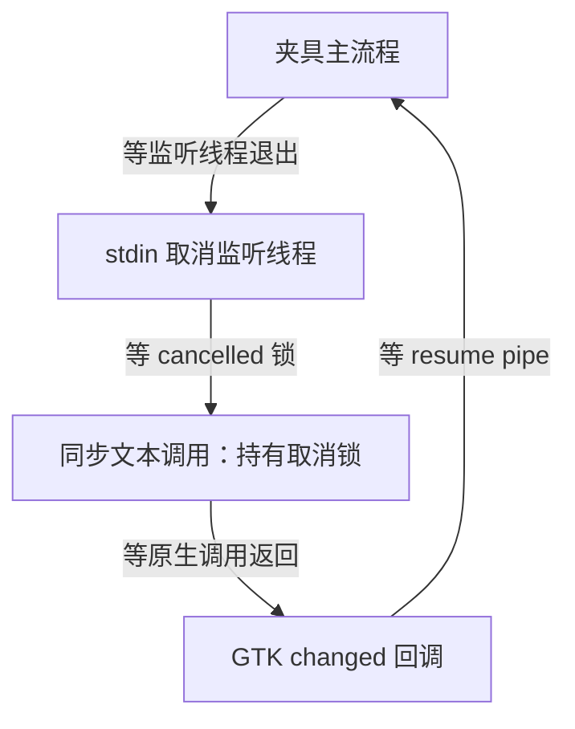

# X11 文本取消：线程退出谓词与同步调用的静态复核

**状态：供原作者审阅的静态复核记录，2026-11-21。** 没有运行测试或修改源码；不增加 UI24 的实际执行或通过数量，也不把其中 25 个逻辑 suite 写成 25 次执行。本文不新增验收阶段，不阻塞原作者。

固定来源：SSMCP `b8d94f5e12788ed19d1b74eecdcc068ea9fc0078`，zuse `ac5713c2bfc3cc4848e89107cc1a6929ec48e2dc`。以下结论仅适用于这些版本。

## 结论与实际观测

固定源码支持一种等待环：夹具释放 GTK 的前提是取消监听线程退出；该线程退出前要取得取消锁，而同步文本调用仍持有这把锁，并等待 GTK 回调返回。**这是有源码依据的条件性推断，不是已取得现场线程栈的死锁证明。**

运行事实见报告组已经独立读取原件的[本轮结果记录](current-iteration-runtime18-UI24-failure.md)；静态审阅者没有另外重跑或重复读取日志：whole-text 前五个 case 通过，随后报 `timed out: worker observed cancellation EOF`。该失败发生在 `finish()`、`record()` 之前；没有该失败 worker 的 PID、线程栈、exit、stderr 或 final text 记录。最终清理成功不能补足这些观测。

## 精确谓词与等待关系

`Worker.cancellation_reader()` 遍历 `/proc/<worker-pid>/task/*/comm`，使用 **`name.startswith("ssmcp-zuse-inpu")`**，要求恰好一个匹配，再保存其线程目录。生产线程名为 **`ssmcp-zuse-input`**。0.7 秒等待的实际谓词是 **`not reader.exists()`**，即该线程目录消失；它不是单独的 EOF 确认，也不是整个 worker 退出。[线程定位][reader] · [监听线程][monitor] · [夹具顺序][sequence]

GTK 的 `changed` 回调先写入单字节 `"1"`，然后阻塞读取 resume pipe。夹具读到该标记、定位监听线程、关闭 worker stdin 后，先等线程消失，再写 resume；因此超时发生时，正常路径尚未释放 GTK。[GTK 回调][gtk] · [夹具顺序][sequence]

**图的成立条件：** GTK 回调仍被夹具阻塞，原生调用尚未返回，监听线程已经从 stdin 读取返回并进入取消处理。没有现场线程栈证明本次各线程恰处于图中位置。原生库超时／错误返回，或夹具异常路径释放 GTK，都可能打破等待；不能写成无限期死锁。

具体锁与调用链如下：

- `Cancellation::submit()` 取得 `cancelled: Mutex<bool>` 的 guard，在同一作用域调用同步 `operation()`，没有在调用前释放 guard。`cancel()` 必须取得同一把锁才能设置取消状态。[本地取消锁][mutex]
- X11 whole-text 分支把整串 `desktop.type_text(...)` 放入 `submit()`；上游 `x11_input::insert()` 同步调用 `api.insert`，其符号绑定为 `atspi_editable_text_insert_text`。[文本提交][dispatch] · [原生插入][insert] · [符号绑定][symbol]
- stdin 线程读取返回后调用 `reading.cancel()`，随后才退出。因此“线程仍存在”不能区分“尚未读到 EOF”和“已读到 EOF、正在等待取消锁”。[监听线程][monitor]
- 本夹具请求只含 `operation`、`arguments`；`Request.host_ticket` 缺省为 `None`。这里的等待关系只需本地取消锁即可成立，不应归因于尚未证明参与的 host-ticket 锁。[夹具请求][reader] · [请求默认值][request]

## 证据边界与应保留的语义

超时只证明 0.7 秒内未满足线程目录消失谓词。它不证明 EOF 从未被读取，也不提供最终文本、取消回复或清理确认。异常路径会释放 GTK；外层随后按既有流程 terminate／kill／wait 回收自有进程。**兜底回收成功不等于该用例的取消语义通过。**[夹具异常路径][sequence] · [最终清理][cleanup]

后续改动的审阅应保留既有边界，不以本稿另建测试门槛：

- 保留提交前的许可和取消检查；该无 host-ticket 夹具不能替代带票据入口的许可验证。
- 已提交输入可能已改变文本；保留未知效果、不得盲目重试或回滚的语义。当前 X11 分支在提交后的取消检查中明确返回 `text may have changed; do not retry`。[文本提交][dispatch]
- 区分取消通知、原生操作结束和输入释放确认。不能仅凭监听线程消失或强制回收完成认定清理成功；当前 worker 在输出回复后还要 join 监听线程，并且只有 `cleanup_ok` 为真才正常退出。[worker 结束协议][monitor]

本稿不指定修复方案，也不宣称后继源码已修复或运行通过。

[reader]: https://github.com/LIghtJUNction/ssmcp/blob/b8d94f5e12788ed19d1b74eecdcc068ea9fc0078/scripts/e2e_x11_text.py#L227-L266
[sequence]: https://github.com/LIghtJUNction/ssmcp/blob/b8d94f5e12788ed19d1b74eecdcc068ea9fc0078/scripts/e2e_x11_text.py#L420-L458
[gtk]: https://github.com/LIghtJUNction/ssmcp/blob/b8d94f5e12788ed19d1b74eecdcc068ea9fc0078/scripts/e2e_x11_text.py#L46-L54
[mutex]: https://github.com/LIghtJUNction/ssmcp/blob/b8d94f5e12788ed19d1b74eecdcc068ea9fc0078/src/computer/zuse_backend.rs#L1028-L1073
[monitor]: https://github.com/LIghtJUNction/ssmcp/blob/b8d94f5e12788ed19d1b74eecdcc068ea9fc0078/src/computer/zuse_backend.rs#L1130-L1179
[dispatch]: https://github.com/LIghtJUNction/ssmcp/blob/b8d94f5e12788ed19d1b74eecdcc068ea9fc0078/src/computer/zuse_backend.rs#L1381-L1395
[request]: https://github.com/LIghtJUNction/ssmcp/blob/b8d94f5e12788ed19d1b74eecdcc068ea9fc0078/src/computer/zuse_backend.rs#L25-L33
[insert]: https://github.com/LIghtJUNction/zuse/blob/ac5713c2bfc3cc4848e89107cc1a6929ec48e2dc/src/accessibility/native/x11_input.rs#L306-L317
[symbol]: https://github.com/LIghtJUNction/zuse/blob/ac5713c2bfc3cc4848e89107cc1a6929ec48e2dc/src/accessibility.rs#L310-L317
[cleanup]: https://github.com/LIghtJUNction/ssmcp/blob/b8d94f5e12788ed19d1b74eecdcc068ea9fc0078/scripts/e2e_x11_text.py#L471-L499
