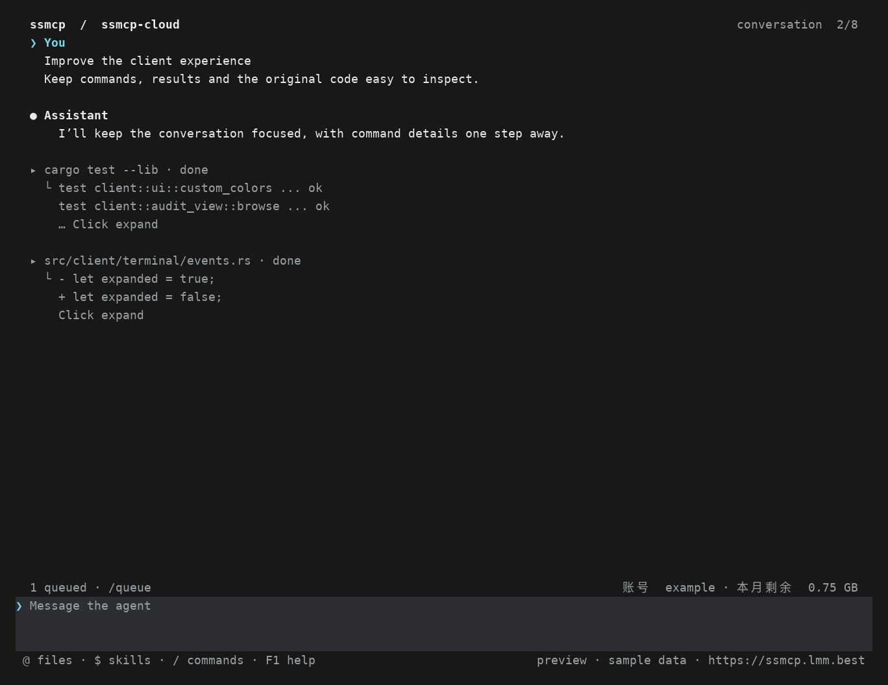
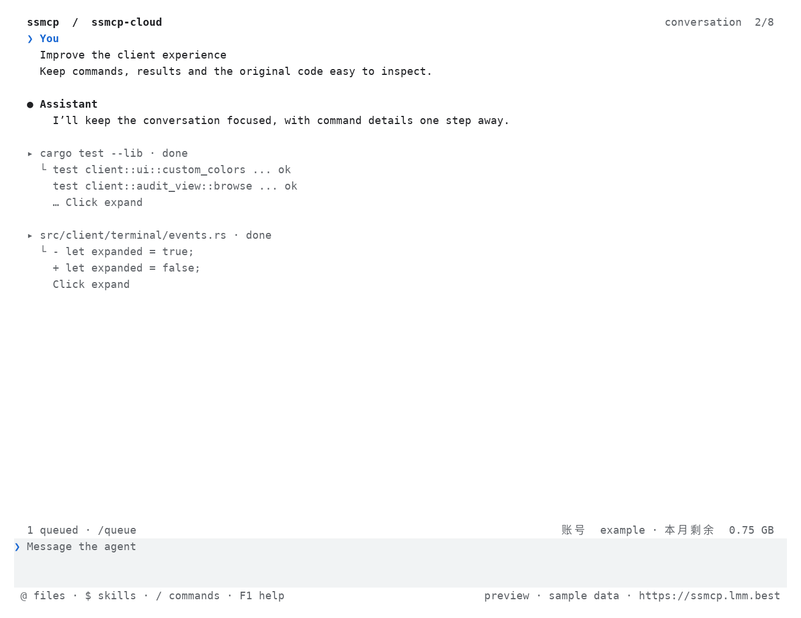
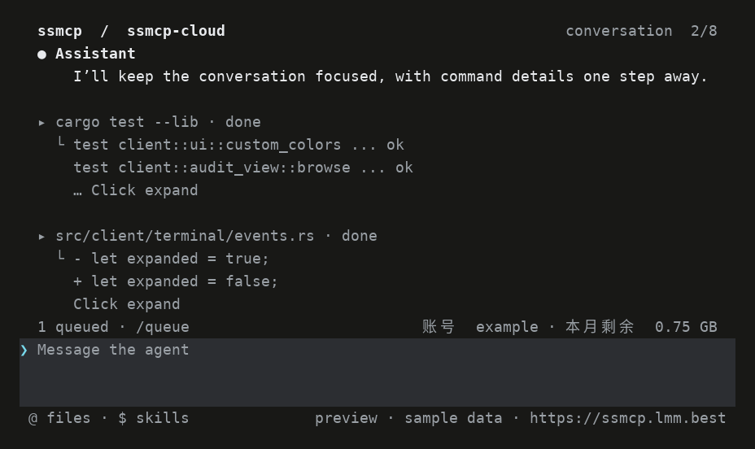
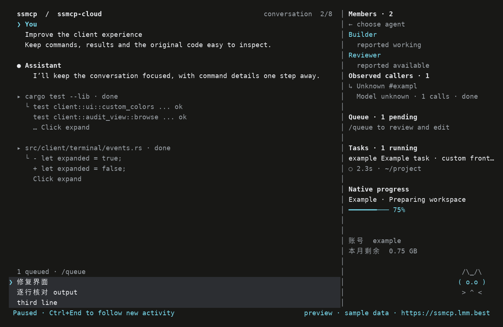

# SSMCP 对话页迭代与合并验收

日期：2026-11-19（Asia/Taipei）

## 目标与结果

本轮根据终端中的追加要求，整合远程 PR，并按提供的终端参考图简化对话页。主要调整是把阅读空间还给用户和助手的正文：默认收起状态侧栏，工具调用保留简短状态与两行结果，底部使用独立的灰色输入区。

代码已通过 [PR #50](https://github.com/LIghtJUNction/ssmcp/pull/50) 合入 `main`，合并提交为 [`c1f64b9`](https://github.com/LIghtJUNction/ssmcp/commit/c1f64b99414670255c3f117b89749a02b4e12ffe)。GitHub 已确认 [#34](https://github.com/LIghtJUNction/ssmcp/pull/34)、[#39](https://github.com/LIghtJUNction/ssmcp/pull/39)、[#40](https://github.com/LIghtJUNction/ssmcp/pull/40)、#50 均为 merged，原有提交历史完整保留。

验证基线为 [`40fe644`](https://github.com/LIghtJUNction/ssmcp/commit/40fe644e224903c0f343f188c634d9e73bffe5ab)，与合并提交的文件树一致。该基线也包含主线 OAuth 断线恢复提交 `aa7c743`。

## 对话页的变化

| 区域 | 当前行为 |
| --- | --- |
| 主区域 | 默认显示完整宽度的对话；用户与助手正文保持展开 |
| 顶部 | 左侧项目名，右侧当前页面与位置；窄窗口使用简短标题 |
| 工具调用 | 命令或路径、真实状态、最多两行已脱敏结果；成功显示 `done` |
| 失败输出 | 保留退出码、取消或超时状态；优先显示末尾错误内容 |
| Diff | 折叠时直接预览两行修改；展开后显示完整保留内容与 hunk 信息 |
| 展开操作 | 点击摘要或 `Click expand`；内容焦点下按 Enter 也可切换 |
| 输入区 | 灰色底、简短占位符，保留多行输入、中文与宽字符处理 |
| 状态 | 侧栏关闭时，账号与本月剩余流量显示在输入区上方；底部保留连接来源和操作提示 |
| 侧栏 | 默认关闭，F3 或 `/sidebar` 切换，F8 保存；已有显式配置继续生效 |
| Logs | `/logs` 或右键打开；Esc 或再次右键返回原页，保留草稿、收件人与阅读位置 |

两行预览来自已经脱敏的展示记录。普通助手消息的显示副本也经过既有脱敏规则，避免原始结构化消息绕过日志脱敏；原始消息对象保持不变。展开仅展示本地仍保留的正文，长输出继续通过任务游标或归档读取。

## 实际画面

以下图片由生产终端合成器输出，经 VT 单元格解码后生成；使用独立预览夹具中的虚构账号和示例事件。图片不包含用户提供的终端截图或真实账号配置。

### 深色默认布局



### 浅色主题



### 80 列窄窗口



### 中文多行输入与按需打开的侧栏



截图脚本增加了可选字体回退：默认等宽字体负责常规字符，缺失的中文字形由指定字体补足；布局仍来自原始 VT 单元格。

## 验证记录

| 验证 | 结果 | 证据 |
| --- | --- | --- |
| `ssmcp`、`ssmcpd`、`vt_snapshot` 构建 | 通过，Rust 1.100.0 | 本轮实际编译 |
| `cargo fmt --all -- --check` | 通过 | 本地与 GitHub 检查 |
| `cargo clippy --workspace --locked --all-targets -- -D warnings` | 通过 | 本地实际执行 |
| 对话页预览模式 PTY 验收 | 56 项通过 | [ui-smoke.json](ui-smoke.json) |
| Canvas / Logs / Tasks 预览模式 PTY 验收 | 67 项通过 | [canvas.json](canvas.json) |
| 发布脚本测试 | 70 项通过 | `scripts/test_release.py` |
| ztty 启动器测试 | 8 项通过 | `scripts/test_ztty_launcher.py` |
| 服务配置脚本测试 | 10 项通过 | `scripts/test_setup_server.py` |
| 备用环境 workspace 单元测试 | 1,261 通过、12 原有忽略、5 因环境限制过滤 | 本地最终运行 |
| GitHub Linux 完整 workspace 单元测试 | 1,266 通过、0 失败、12 原有忽略、0 过滤 | [验证工作流](https://github.com/LIghtJUNction/ssmcp/actions/runs/44470943053) |
| Linux / macOS / Windows 原生会话生命周期 | 三个平台均通过 | 同上 |

123 项预览模式 PTY 检查覆盖了默认侧栏、账号状态、工具与 Diff 的预览及展开隔离、真实鼠标命中、日志往返、队列页面、草稿与收件人保留、中文粘贴、窗口缩放、终端模式恢复和正常退出。各测试套件的计数独立列出，不把重跑次数或未执行的交互算作新增通过项。

远程 CI 修复了会话工作流未初始化子模块的问题，并加入 Linux 完整 workspace 单元测试。依赖按仓库固定版本初始化，既有原生会话检查继续运行。

## 环境限制与开发机状态

SSMCP 连接在执行期间返回 `UNAUTHORIZED`，明确要求重新认证。因此后续工作在独立克隆中完成，并持续通过 GitHub 提交保存。开发机上的主工作区拉取、安装新二进制和重新加载当前客户端尚未完成，需要恢复 SSMCP 连接后执行。

备用环境禁止创建 Unix socket。SSH composer 和 AgentPanel 流程在服务端开始监听前被 `EPERM` 阻断，未进入实际输入或队列验收。账户 relay 流程通过了 12 项 HTTP、WebSocket 与 OAuth 鉴权检查，随后在 bubblewrap 创建 `NETLINK_ROUTE` socket 时被环境阻断，尚未进入队列编辑与重新执行。相关流程保留失败结果，没有通过跳过断言或放宽运行权限来改成成功。

本地完整单元测试中受 Unix socket 限制的 5 项，交由 GitHub Linux 的未过滤测试运行验证。公开报告保留通过的预览证据与明确的执行边界，不把示例画面等同于开发机已经升级。

## 复现主要检查

```sh
git submodule update --init --recursive
cargo fmt --all -- --check
cargo clippy --workspace --locked --all-targets -- -D warnings
cargo test --workspace --locked --lib -- --test-threads=4
cargo build --locked --bin ssmcp --bin ssmcpd --example vt_snapshot
python3 scripts/e2e_client_ui.py --bin-dir target/debug --out target/ui-review
python3 scripts/e2e_canvas_logs.py --bin-dir target/debug --out target/canvas-review --report target/canvas-review.json
```

完整服务与输入流程需在允许 Unix socket、子进程和所需 sandbox 能力的主机上执行。显示配置与使用方式见 [客户端 UI 文档](../../client-ui.md)。
