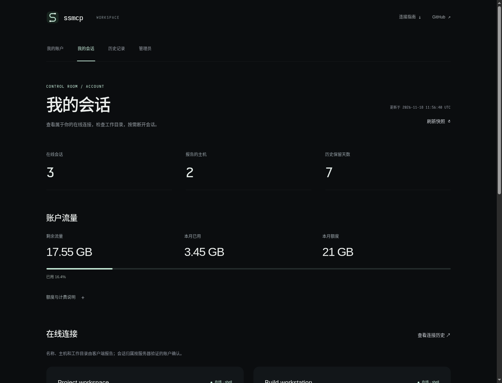
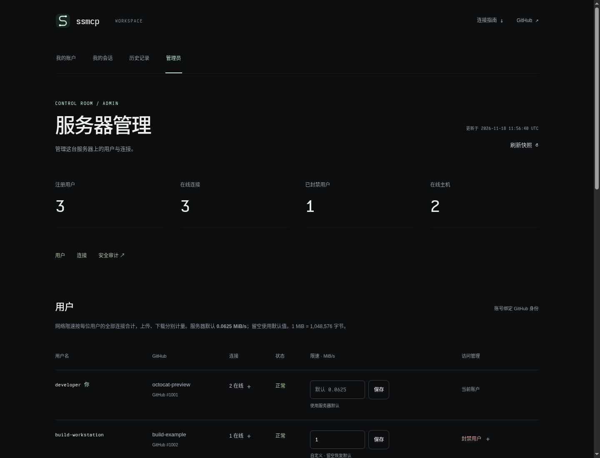
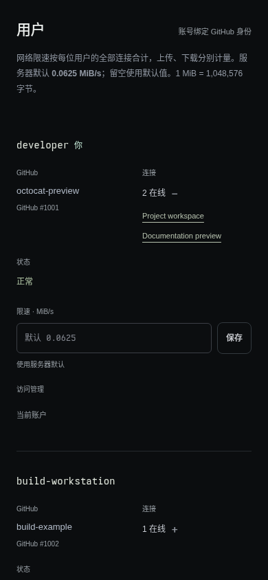

# ssmcp 前端与滚动渲染更新

日期：2026-11-19（Asia/Taipei）  
源码审阅：[ssmcp PR #42](https://github.com/LIghtJUNction/ssmcp/pull/42) · [ztty PR #13](https://github.com/LIghtJUNction/ztty/pull/13)

## 当前结果

**前端与终端修复已合并，开发机的 ssmcp 和 ztty 修复版已安装并校验；网站本轮上线尚未完成。首次生产切换因公网样式文件不匹配而自动回滚，原服务已验证恢复。**

| 项目 | 已核实状态 | 证据 |
|---|---|---|
| ssmcp 前端与整帧输出 | PR #42 已合并；运行源码冻结于 `3c51ad96e4ed6e0edffb932e42414bf009e22f98` | [构建产物](artifacts.json) |
| 开发机 ssmcp 客户端 | 03:13 安装并核对 SHA；46 个观察到的进程保持运行 | [安装回执](client-install.json) |
| ztty 修复 | PR #13 已合并；03:19 安装 0.3.1-2，9 个包文件完整性检查通过 | [ztty 安装回执](https://github.com/LIghtJUNction/ztty/blob/main/docs/measurements/atomic-frame-2026-11-19/installation-0.3.1.json) |
| 生产网站 | 03:25 首次发布回滚；04:16 独立公网检查健康端点返回 200 | [部署回执](deployment.json) · [公网资源检查](public-asset-check.json) |
| 剩余工作 | 恢复 ssmcp 管理连接，修正静态资源覆盖，再次发布与验收 | 见下文接续步骤 |

时间均为 Asia/Taipei。安装状态记录的是上述实际核验时刻；服务器切换后 ssmcp 工具读取持续超时，后续无法重新读取开发机状态。公网检查通过独立 HTTP GET 完成。

## 界面改动

账号首页采用近黑背景、浅薄荷色强调、宽边距与清楚的标题层级。账号信息、连接操作、流量和安装指南分别组织，低频说明放入可展开区域。

会话、历史记录、管理员和流量订单页面使用同一套排版。增加区块间距，减少卡片边框，放大会话标题与关键数字；手机端保持单列阅读和完整操作区。流量购买确认框固定为 18×18 CSS 像素，避免继承普通输入框的全宽样式。

原有登录、退出、会话管理、管理员限速与封禁、POST/CSRF 表单、复制回退和无 JavaScript 阅读路径继续保留。视觉变更没有引入新的前端框架或依赖。

以下截图展示本轮候选页面，使用真实 Rust 页面渲染器与合成账户数据；它们不代表已经更新的生产站点。

## 滚动时为什么出现波浪

本轮复现了两条会暴露半帧的路径。

ssmcp 原来把行差异和图像命令分段写入终端，缺少整帧边界。现在一次完整更新由 DEC 2026 同步输出标记包住，包含首次清屏、文本、旧图像删除和新图像位置；退出时结束同步，避免输出失败后界面停留在同步状态。

ztty 原来在绘制过程中分次把不连续行复制到窗口，搜索和滚动提示也会再次提交。这样一帧尚未画完，屏幕已经显示其中一部分，便可能出现新旧内容交替推进的视觉效果。修复后先完成离屏画面，最后统一显示合并的变化区域。

同一组三个不相邻行的更新，冻结旧版实测发生 **3 次**窗口区域复制，修复版为 **1 次**；单行更新仍只复制一行。完整调用、像素和输入验证见 [ztty 更新记录](https://github.com/LIghtJUNction/ztty/tree/main/docs/measurements/atomic-frame-2026-11-19)。

ztty 修复已在最新 0.3.1 主线基础上重新构建。实际合并提交为 `cabeba6a7d74b36497e861febe5b7bb04d01c8ba`，其 Git tree 与本机测试源码完全一致；本机包版本为 0.3.1-2。

### 现有窗口的生效范围

安装时保留了三个旧 ztty 进程，没有关闭工作窗口。安装后只读核验确认：旧 0.1.2 窗口使用独立窗口实现，默认新版 broker 当时没有监听，因此下一次默认启动会由已安装的新二进制创建 broker。旧窗口继续执行旧代码。

新版通常会复用已有 broker，连接没有版本握手；若以后已有旧 broker，需要使用未占用的 `ZTTY_SOCKET` 启动独立 broker，或在保留工作后重启相应 broker。此次没有强制关闭任何现有终端。ssmcp 客户端的整帧输出修复同样需要新启动的客户端进程。

这些检查验证了已复现的软件半帧路径。ztty 现有同步超时仍为 150 ms；物理显示器扫描、合成器垂直同步和超大图像的长时间传输不在本次测量范围内。

## 验证结果

| 范围 | 结果 | 证据 |
|---|---:|---|
| 完整 portal 模块测试 | 73 通过，0 失败 | [portal-tests.log](portal-tests.log) |
| 终端绘制模块测试 | 29 通过，0 失败 | [terminal-tests.log](terminal-tests.log) |
| 管理页面响应式布局 | 12 / 12 | [browser-qa.json](browser-qa.json) |
| 交互、表单、空态与长金额 | 55 / 55 | [browser-qa.json](browser-qa.json) |
| 页面溢出、脚本异常、资源错误 | 0 | [browser-qa.json](browser-qa.json) |
| ssmcp / ssmcpd 优化构建 | 成功 | [artifacts.json](artifacts.json) |
| ztty 真实 X11 重绘检查 | 11 / 11 | [整合验证](https://github.com/LIghtJUNction/ztty/blob/main/docs/measurements/atomic-frame-2026-11-19/integrated-0.3.1.json) |
| ztty 输入 GUI | 12 项检查、59 个输入向量通过 | 同上 |
| 隔离部署验证 | 健康、资源哈希、权限拒绝、OAuth 与 DCR 重启持久性均通过 | [部署回执](deployment.json) |
| 首次生产发布 | 公网 CSS 哈希失败；自动回滚已验证 | [部署回执](deployment.json) |

响应式检查覆盖会话、历史、管理员、流量四类页面，视口宽度分别为 1440、390 和 320 CSS 像素。交互检查包括导航、断开提示展开、账号连接展开、封禁确认、管理员限速输入、购买确认框和长金额。

浏览器检查没有提交真实支付或修改生产账户。测试前后页面源码哈希一致。首页的 32 组状态与视口、17 项交互和 5 项无 JavaScript 证据见[账号页记录](../portal-air-20261119/README.md)。

## 上线阻塞：公网仍在提供旧静态资源

候选 daemon 在隔离环境中返回了正确的 CSS 和 favicon。正式切换后，公网 CSS 不匹配，部署任务立即执行回滚；回执记录 `status=rolled_back`、`rollback_verified=true`。

独立公网检查发现：

| 路径 | 公网内容 | 与候选一致 |
|---|---|---|
| `/portal-refresh.css` | 2540 字节，SHA 起始 `073c2cbc` | 否，候选起始 `b48923a8` |
| `/traffic-meter.js` | 2088 字节，SHA 起始 `ea5c2a14` | 否，候选起始 `52dfb3a5` |
| `/client-install-copy.js` | 681 字节，SHA 起始 `4d9f2ee4` | 是，但也带静态文件响应头 |
| `/portal.css` | 应用返回，带 `charset=utf-8` 和 `no-store` | 正常应用路由 |
| `/healthz` | HTTP 200，`ok\n` | 原服务健康 |

公网 CSS 与 [v0.9.2 引入时的源文件](https://github.com/LIghtJUNction/ssmcp/blob/f3a502a482b31ed49f16faf4a38d4ddd1b08c091/src/portal/portal-refresh.css) 逐字节相同。CSS 和两个 JavaScript 响应包含 `Last-Modified`、按文件时间/大小形成的 ETag，缺少应用统一设置的 `Cache-Control: no-store`。

这些证据强烈指向生产入口的额外静态资源覆盖。仓库的标准 Nginx/Caddy 模板只有代理转发，没有相应静态文件配置；**实际生产配置和磁盘路径尚未读取，不能根据模板假定。**

私有回滚材料已保留并校验，本轮远端临时上传文件已清理。首次回滚没有恢复二进制文件的动作，因为原文件始终保留；回执中的 `rollback_runtime_restored=false` 不表示回滚失败。

## 恢复连接后的接续步骤

1. 重新连接 `@ssmcp`，恢复已授权的开发机与服务器管理通道。
2. 将有效反向代理配置保存在私有备份中，定位三个资源路径的 `location`、`alias/root/try_files`、缓存或重写规则。
3. 让三个资源使用与当前正常 `/portal.css` 相同的应用上游。原位修改实际覆盖规则；将修改的配置文件纳入哈希校验与失败回滚，配置检查通过后再重载。
4. 在原冻结候选上重新部署；增加 CSS、Traffic JS、Copy JS 与 favicon 的内容哈希验收，同时核对实际运行 daemon 的 SHA。
5. 第二次发布使用新的固定回执文件，例如 `3c51ad96e4ed-retry1.json`。保留首次失败回执，避免触发 publisher 对不同已有内容的保护。
6. 检查实际生产页面与桌面、手机显示，更新本报告的最终上线状态。

当前阻塞来自服务器切换后 ssmcp 连接未恢复，工具读取持续超时；修正生产覆盖规则仍需要恢复该管理通道。

## 候选页面截图

### 桌面会话页

### 桌面管理页

### 手机端

| 历史记录 | 管理员 | 流量与订单 |
|---|---|---|
|  |  |  |

截图中的账户、配额、价格与订单均为合成测试数据。
