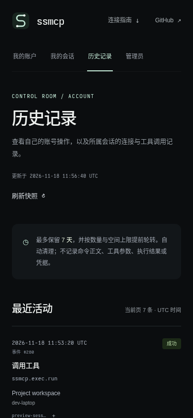
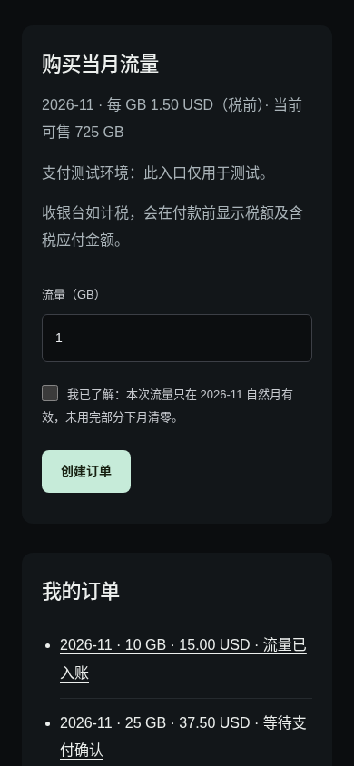

# ssmcp 前端与滚动渲染更新

日期：2026-11-19（Asia/Taipei）  
运行代码：`3c51ad96e4ed6e0edffb932e42414bf009e22f98`  
审阅：[ssmcp PR #42](https://github.com/LIghtJUNction/ssmcp/pull/42) · [ztty PR #13](https://github.com/LIghtJUNction/ztty/pull/13)

部署状态：发布产物已完成本机验证，生产切换待执行。正式运行检查由本目录的 `deployment.json` 记录。

## 界面

账号首页采用近黑背景、浅薄荷色强调、宽边距与更清楚的标题层级。账号信息、连接操作、流量和安装指南分别组织，低频说明放入可展开区域。

会话、历史记录、管理员和流量订单页面使用同一套排版。增加区块间距，减少卡片边框，放大会话标题与关键数字；手机端保持单列阅读和完整操作区。流量购买确认框固定为 18×18 CSS 像素，避免继承普通输入框的全宽样式。

原有登录、退出、会话管理、管理员限速与封禁、POST/CSRF 表单、复制回退和无 JavaScript 阅读路径继续保留。视觉变更没有引入新的前端框架或依赖。

## 滚动时的波浪

本轮定位到两条会暴露半帧的路径。

ssmcp 原来把行差异和图像命令分段写入终端，缺少整帧边界。现在一次完整更新由 DEC 2026 同步输出标记包住，包含首次清屏、文本、旧图像删除和新图像位置；退出时结束同步，避免输出失败后界面停留在同步状态。

ztty 原来在绘制过程中分次把不连续行复制到窗口，搜索和滚动提示也会再次提交。修复后先完成离屏画面，最后统一显示合并的变化区域。冻结旧版的一帧更新实测发生 3 次区域复制，修复候选为 1 次；单行更新仍保持局部复制。完整证据见 [ztty 更新记录](https://github.com/LIghtJUNction/ztty/tree/fix/atomic-scroll-20261119/docs/measurements/atomic-frame-2026-11-19)。

## 验证

| 范围 | 结果 | 证据 |
|---|---:|---|
| 完整 portal 模块测试 | 73 通过，0 失败 | [portal-tests.log](portal-tests.log) |
| 终端绘制模块测试 | 29 通过，0 失败 | [terminal-tests.log](terminal-tests.log) |
| 管理页面响应式布局 | 12 / 12 | [browser-qa.json](browser-qa.json) |
| 交互、表单、空态与长金额 | 55 / 55 | [browser-qa.json](browser-qa.json) |
| 页面溢出、脚本异常、资源错误 | 0 | [browser-qa.json](browser-qa.json) |
| ssmcp / ssmcpd 优化构建 | 成功 | [artifacts.json](artifacts.json) |

响应式检查覆盖会话、历史、管理员、流量四类页面，视口宽度分别为 1440、390 和 320 CSS 像素。交互检查包括导航、断开提示展开、账号连接展开、封禁确认、管理员限速输入、购买确认框和长金额。

截图与浏览器检查使用真实 Rust 页面渲染器和合成账户数据。没有提交真实支付或修改生产账户。测试前后页面源码哈希一致。首页原有的 32 组状态与视口、17 项交互和 5 项无 JavaScript 证据见[账号页记录](../portal-air-20261119/README.md)。

这些检查验证了已复现的软件半帧路径。ztty 现有同步超时仍为 150 ms；物理显示器扫描与超大图像的长时间传输不在这组测量范围内。

## 截图

### 桌面会话页

### 桌面管理页

### 手机端

| 历史记录 | 管理员 | 流量与订单 |
|---|---|---|
|  |  |  |

截图中的账户、配额、价格与订单都是合成测试数据。

## 证据对应

| 结论 | 依据 | 状态 |
|---|---|---|
| 管理页面在三个目标宽度可用 | 实际浏览器尺寸、布局与交互检查 | 已验证 |
| 既有账户与权限路径继续通过 | portal 的授权、账户、额度与订单边界测试 | 已验证 |
| ssmcp 对完整画面提供同步边界 | 首帧、滚动短写和 WouldBlock 回归 | 已验证 |
| ztty 一次完成行与覆盖层的显示 | X11 实际复制调用与窗口像素回归 | 已验证 |
| 生产运行本轮产物 | 独立发布回执与线上资源检查 | 待部署回执 |

自检：改动对应用户要求；每项技术结论有测试或调用证据；页面数据明确标为合成；渲染修复的测量范围明确；上线状态与代码验证分开记录。
