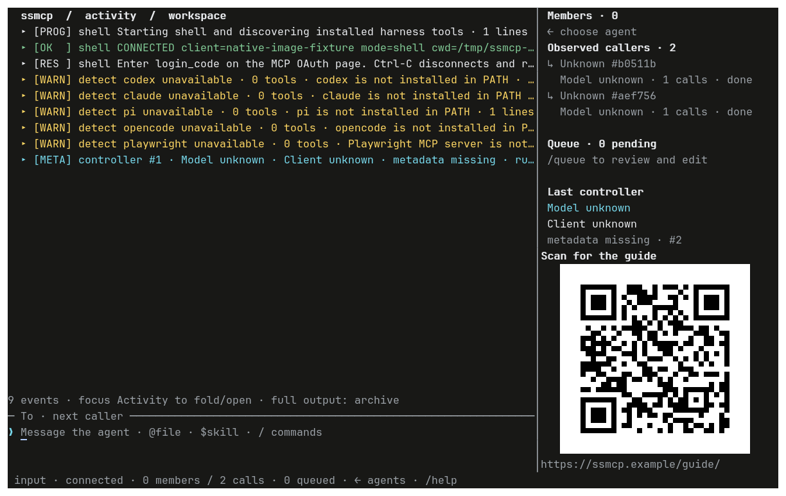

# 2026-11-18：0.9 验收与公网指南恢复

## 已交付的检查点

`aa8b95d66655adfd4d97ac8191e2b935bcd57c44` 已完成完整本机验收，并安装为优化版 0.9.0。公网指南原先的 404 已修复；英文、中文和样式资源经过真实 HTTPS 验证。之后新增的 Windows 依赖安装和其它 harness 按需加载要求正在继续实现，本记录不把这些新增工作计入已完成范围。[验收清单](ssmcp-iteration-20261118-validation.json)

## 公网指南

- [中文版](https://ssmcp.lmm.best/guide/zh)
- [英文版](https://ssmcp.lmm.best/guide/en)
- [默认入口](https://ssmcp.lmm.best/guide/)

修复在现有 Nginx 站点中增加四条精确的静态路由：`/guide/`、`/guide/en`、`/guide/zh`、`/guide/style.css`。带结尾斜线的指南与原有裸 `/guide` 是两个不同入口；后者仍保留原来的账户认证行为。页面采用静态 HTML/CSS，没有脚本，也没有在二维码里放入登录码或会话凭据。[部署证据](ssmcp-iteration-20261118/guide-deployment.json)

配置先通过 `nginx -t`，随后平滑 reload。两次修改前后的 Nginx 主进程和当次 ssmcpd 进程集合均相同。没有重启或升级生产 relay。原始配置已在开发机备份并校验；生产端保留实际运行的四个资产和必要状态记录，没有另存历史配置副本。[部署证据](ssmcp-iteration-20261118/guide-deployment.json)

### 实际验收

| 项目 | 结果 |
|---|---|
| 四条指南资源 | HTTP 200，正文 SHA 与发布资产逐字一致 |
| HTML 与 CSS 类型 | HTML/CSS 均包含正确 UTF-8 响应头 |
| 页面响应头 | CSP、no-store、nosniff 正确，没有设置 cookie |
| 裸 `/guide` | 保持 401 和认证挑战，没有重定向 |
| 原主页 | 保持 200 |
| 公开 HTTPS 总验收 | 6 个 URL、44 项检查通过 |
| 浏览器布局 | 英文、中文 × 桌面、手机四组检查通过，无横向溢出、无控制台或页面错误 |

完整 HTTP 记录保留了网络重试；首轮 CSS 缺少 charset 的不通过记录也保留。最终修改仅在 CSS 精确路由增加 `charset_types text/css;`，没有改页面正文。[最终 HTTP 记录](ssmcp-iteration-20261118/guide-public-validation.json) · [首轮差异记录](ssmcp-iteration-20261118/guide-before-css-fix.json)

以下是最终公网首屏的原始截图，使用临时 profile 的独立 headless Chromium，未连接用户浏览器或操作用户桌面。根端已查看桌面和手机首屏；完整页面另有浏览器布局及资源检查。

### 版本边界

指南描述客户端 0.9.0，不代表生产网关已经升级。核对时公开 GitHub latest 仍为 v0.6.3，网关 `/client/release.json` 尚未提供发布清单；安装脚本可以返回 200，并不能证明同源二进制就是 0.9.0。页面已写明这些条件，新的邀请安装和服务端辅助能力以网关实际支持为准。

## R14 的本机验证

本节全部对应固定源码 `aa8b95d`，不会把较早和较晚的测试相加成一次“最终全覆盖”。

| 验证 | 结果 |
|---|---:|
| 默认 Rust workspace 测试 | 1142 通过，0 失败，26 默认跳过 |
| 显式 code_mode 测试，含 ignored | 29 通过 |
| JavaScript helper 检查 | 62 通过 |
| Python 安装引导 | 7 通过 |
| Python 发布逻辑 | 58 通过 |
| fmt、strict Clippy | 通过 |
| workspace 打包检查 | 通过 |
| release 双二进制构建 | 通过 |

显式 code_mode 测试与默认测试有重叠，不作为额外的独立用例总数。普通打包检查使用 `--no-verify`；完整编译、测试和 Clippy 已在同一固定源码上单独执行。[R14 记录](ssmcp-iteration-20261118/r14-gates.json)

同一源码的 R7 实机界面验收包括 client UI 45 项、原生图片 50 项、指南 34 项，共 129 项断言。它们采用真实 PTY、独立 Xvfb 和实际 ztty 0.2.1。二维码已从真实终端截图被 zbar 精确解码；小终端显示完整文字链接，没有残留裁切图。[界面](ssmcp-iteration-20261118/r7-client-ui.json) · [图片](ssmcp-iteration-20261118/r7-native-images.json) · [指南](ssmcp-iteration-20261118/r7-guide.json)

## 已安装的优化版

| 二进制 | 大小 | SHA-256 |
|---|---:|---|
| ssmcp | 9,837,544 字节 | `96982543f6cb430306e6b0fdffc141d0de17b4bb87ec2c08398bb085c6155d04` |
| ssmcpd | 5,547,872 字节 | `4eb7610f71768fed716397da9e0cbfcb282307c9b2536a31764a71f4f99519c4` |

系统包为 `ssmcp-git 0.9.0.r364.gaa8b95d-1`。系统与用户启动路径逐个核对了版本和 SHA；打包使用 `!strip`，保留已验证 release 文件的原始字节。实际前台进程也核对了可执行文件 SHA。安装 ssmcp 并不会替换已经运行的终端程序；ztty 0.1.2 窗口仍不具备已在 0.2.1 上验证的原生图片能力。[机器可读记录](ssmcp-iteration-20261118-validation.json)

## Project Z 性能记录

`ztui-core` 是注册包名，Rust 库名仍为 `ztui`。库使用 no_std、不允许 unsafe，没有第三方依赖；缓冲区由调用者提供。三次固定二进制、每次 200,000 轮的测量中，21/21 输出字节等价检查通过。下面的数字是每次新/旧耗时比值的中位数，低于 1 表示这一场景更快。[测量数据](ssmcp-iteration-20261118/ztui-performance.json)

| 场景 | 新/旧耗时比值中位数 |
|---|---:|
| 首次绘制 | 1.0910 |
| 帧未改变 | 1.0909 |
| 单行变化 | 0.9039 |
| 全部行变化 | 0.8765 |
| 缩放 | 1.1775 |
| 仅光标变化 | 0.5439 |
| 仅模式变化 | 0.5515 |

结果有快有慢，缩放仍存在回退。首轮较短测量的缩放比值 3.3873 也已保留，未以“噪声”名义丢弃。这些数字只覆盖复用缓冲区的差分计算和编码，不包含终端或 GPU I/O；不能据此宣称整个 UI 在所有场景都更快。

## 后续新增要求

本记录之后继续处理两项已确认需求：

1. Windows 安装默认准备 Node.js、Playwright 和 Chromium，并确认新开终端后原生工具仍能发现这些依赖。
2. 其它 harness 默认不加载，只有明确使用时才加载；基础连接、执行、文件、浏览器和电脑控制优先走内置原生工具。

这两项将另有固定源码和验证记录，完成后写入本轮最终报告。
