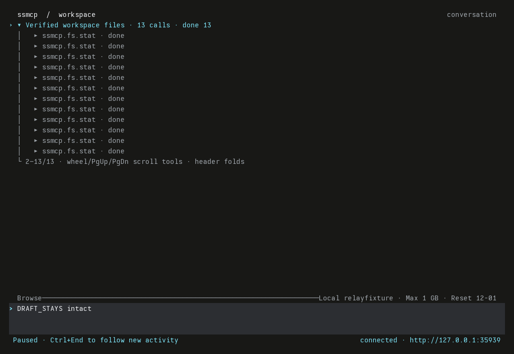
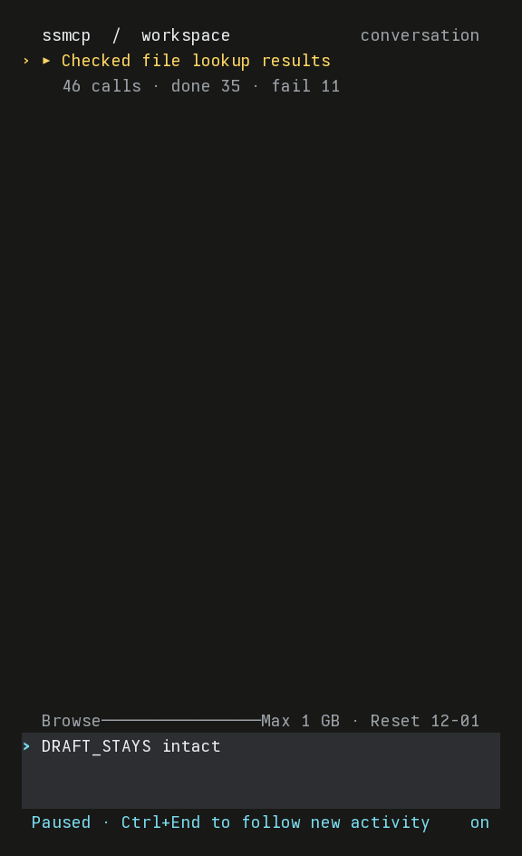

# ssmcp 工具组摘要：实现与验收

日期：2026-11-20（Asia/Taipei）

验证源码：`911bfe905e6df1b54bcc46be2f88c87813cb031c`

功能入口：[PR #119](https://github.com/LIghtJUNction/ssmcp/pull/119)

本轮完成了连续工具组的可更新摘要，以及超过 10 次真实调用后的总结提醒。本文记录同一份冻结源码、对应构建产物和真实终端的验收结果。最终候选同时包含提醒交付修复、输入响应优化和主线的 zharness 0.6.0 依赖更新。

## 1. 用户能看到的变化

Agent 可以为一组连续工具调用写一句用途说明，例如“核对工作区文件，并检查缺失路径”。这句话显示在折叠标题和展开窗口顶部；调用总数、成功、失败和运行状态仍由实际执行事件决定。

更新摘要只替换组说明，不新增聊天消息。展开状态、内部滚动、外层滚动、选中项、输入草稿和光标保持原状。宽屏将标题与计数放在同一行；窄屏将状态移到下一行。单次调用没有摘要时仍使用普通卡片。

完整契约见[工具组总结说明](../../tool-group-summaries.md)。关键实现为[原生接口](https://github.com/LIghtJUNction/ssmcp/blob/911bfe905e6df1b54bcc46be2f88c87813cb031c/src/client/interface/tool_summary.rs)、[组状态与授权](https://github.com/LIghtJUNction/ssmcp/blob/911bfe905e6df1b54bcc46be2f88c87813cb031c/src/client/terminal/events/tool_summaries.rs)和[工具窗口渲染](https://github.com/LIghtJUNction/ssmcp/blob/911bfe905e6df1b54bcc46be2f88c87813cb031c/src/client/terminal/events/tool_activity.rs)。

## 2. Agent 如何更新摘要

原生工具名称为 `ssmcp.ui.tool_summary`。调用方先发现当前客户端注册的真实 schema，再使用以下操作：

| 操作 | 参数与结果 |
| --- | --- |
| `list` | 列出当前授权范围内最近最多 32 个可更新工具组；返回稳定的组 ID、摘要、revision 和计数。 |
| `set` | 以准确的 `group_id` 设置或更新 `summary`；可携带 `expected_revision`，防止覆盖别人刚完成的更新。 |

`summary` 必须是非空单行纯文本，最多 120 个 Unicode 字符、512 个 UTF-8 字节，并经过既有脱敏处理。

```javascript
// clientId 来自实际连接；groupId 和 revision 来自刚读取的原生列表。
return await call(clientId, "ssmcp.ui.tool_summary", {
  action: "set",
  group_id: groupId,
  expected_revision: revision,
  summary: "核对工作区文件，并检查缺失路径"
});
```

修改权限核对原始会话所有权、连接、真实账号，以及已有的 Agent 和线程绑定。显示名称不决定权限。未绑定 Agent 时，同一授权范围内可以跨 code_mode 运行更新自己的组；绑定后必须匹配原 Agent 和线程。重载保留有界的摘要显示，但恢复的历史组只读。

## 3. 第 11 次调用如何触发提醒

一次工具请求可以产生开始、输出、结束等多个事件，这些事件都属于同一次调用。系统按实际发出的原生请求计数，不按界面刷新的次数计数。Agent 主动发起的新 status、read、wait 请求各算一次；摘要原语和内部观察请求不增加工作计数。

| 状态 | 行为 |
| --- | --- |
| 同组累计 10 次调用 | 不提醒。 |
| 同组累计 11 次调用 | 提醒 Agent 调用摘要工具，并携带准确的组 ID。 |
| 成功更新摘要 | 将当前调用数记为已覆盖数量。 |
| 此后再新增 11 次调用 | 再提醒更新摘要。 |

同一组、同一摘要 revision 的提醒去重。提醒从真实原生回执进入 relay，再由 relay 加到外层响应；JavaScript 自造的返回字段不能触发这条链路。

本轮同时补齐了两个交付场景：首次使用已知工具、尚未读取工具目录时，可通过一次授权内的只读回执确认总结能力；原生结果被 4 MiB 帧限制拦截时，只释放原请求、原调用范围和原 revision 的提醒预约，后续观察可以恢复提醒，不重放已完成的业务操作。[PR #131](https://github.com/LIghtJUNction/ssmcp/pull/131)

最终状态复核有时间预算。复核失败或超时时，已捕获提醒可能仍包含旧 revision；Agent 应重新 list，并在 set 时携带 expected_revision。该机制不提供跨轮持久待发送队列。

## 4. 精确候选的验证结果

所有下列检查都针对 `911bfe905e6df1b54bcc46be2f88c87813cb031c`。源码与子模块在运行前后保持干净；构建采用锁定依赖、离线模式和单编译任务。没有把其他版本的二进制结果算作本候选的验收。

| 构建检查 | 结果 |
| --- | --- |
| `cargo fmt --all -- --check` | 通过 |
| `cargo test --lib --no-run --locked --offline` | 通过，生成本候选的测试可执行文件 |
| `cargo clippy --workspace --all-targets --locked --offline -- -D warnings` | 通过 |
| `cargo build --bins --example vt_snapshot --locked --offline` | 通过 |

### 针对性 Rust 回归

| 范围 | 通过 | 失败 |
| --- | ---: | ---: |
| 工具组摘要、计数、授权与提醒 | 26 | 0 |
| 终端事件、分组与显示归属 | 93 | 0 |
| Broker 原生交付 | 19 | 0 |
| Runtime 执行 | 10 | 0 |
| 原生 UI 工具目录 | 1 | 0 |
| 历史所有权 | 5 | 0 |
| 待发送撤回 | 1 | 0 |
| 跨会话重试与编辑 | 1 | 0 |
| 消息确认与修订号 | 1 | 0 |
| 投递与撤回竞争 | 1 | 0 |
| 历史归档 | 6 | 0 |
| 会话重载 | 5 | 0 |
| 会话切换后的晚到帧 | 1 | 0 |

这些是各筛选范围的实际执行结果，部分用例会被不同筛选范围重复选中，因此不将它们相加为唯一测试总数。本轮没有声称运行了整个仓库的所有测试。

### 真实终端与原生链路

使用实际账号路由器代码、原生工具、code_mode、WebSocket 和独立 PTY，通过 **68 项检查**，生成 **6 张截图**。账号和内容均为隔离夹具；没有启动外部模型，没有重载已有客户端，也没有更改现有服务。

验收覆盖首轮 10／11 次边界、更新后再 11 次提醒、同一运行内主动更新后撤销旧提醒、旧 revision 拒绝、不同 Agent 拒绝、JavaScript 伪造元数据拒绝，以及真实工具报错后的连续性。最终同一组包含 **46 次调用**，其中 11 次是刻意构造的缺失文件错误；第 **5** 版摘要覆盖到第 **46** 次调用。

120 列与 48 列均检查了精确草稿文本和 UTF-8 光标。展开阶段实际填满并超过 12 行窗口，随后执行内部滚动，再更新摘要，确认折叠、滚动与历史条数保持。最终折叠截图也完整生成。

源码、命令结果、测试数量、二进制和脚本 SHA-256、字体与截图 SHA-256 均收录在 [report.json](report.json)。

## 5. 实际界面

以下截图来自本候选的实际 PTY 字节，经 VT 解码后渲染，没有手工重画界面。

| 阶段 | 120 列 | 48 列 |
| --- | --- | --- |
| 首次摘要、折叠 | [查看](tool-summary-first-folded-120.png) | [查看](tool-summary-first-folded-48.png) |
| 更新摘要、展开并滚动 | [查看](tool-summary-updated-expanded-120.png) | [查看](tool-summary-updated-expanded-48.png) |
| 最终摘要、折叠 | [查看](tool-summary-final-folded-120.png) | [查看](tool-summary-final-folded-48.png) |

### 展开窗口



### 窄屏最终状态



## 6. 这轮发现并修复的问题

- list 输入必须严格校验允许的字段，避免未知参数被静默忽略。
- 外层工具窗口的连续性处理保留原来的文件读取分组边界。
- 原错误显示路径丢失调用来源，会在版本冲突或拒绝后拆出新组；现改为显式携带原调用身份，原错误结果保持不变。
- 同 revision 下晚到的旧列表不能清掉更新的提醒；同一运行内已经完成的摘要更新仍会清理旧提醒。
- 首次能力确认和超大回执的预约恢复纳入真实 Session／Frame 与生产帧限制回归。
- 并行输入优化合入后，将测试专用 HistoryStore 导入限制在测试构建，并保留交互脚本原有的可执行权限。

夹具修正也单独留痕：11 行不足以产生 12 行窗口的滚动，因此先增加真实调用形成溢出；完整事件投影超过 8 KiB 时，改为只读取工具组元数据和需要的标量状态。产品限制与原状态断言均保留。前序失败记录没有改写为成功；它们与最终通过记录按不同源码和尝试编号分开保存。

输入响应优化的历史归属、撤回编辑、归档、重载及晚到会话帧已在本候选补查；性能补丁原有计时与本轮功能验收分别记录，见[输入响应优化报告](../ui-input-performance-20261120/iteration-report.md)。

## 7. 仓库整理

旧 [PR #109](https://github.com/LIghtJUNction/ssmcp/pull/109)、[PR #111](https://github.com/LIghtJUNction/ssmcp/pull/111)、[PR #112](https://github.com/LIghtJUNction/ssmcp/pull/112) 的代码此前已进入主线。本轮核对差异后补齐合并关系和 GitHub 合并状态，整合节点为 [4ae22ea](https://github.com/LIghtJUNction/ssmcp/commit/4ae22ea828ee2647b44c275f79679963ba7e88a9)。

已删除 **23 个远程分支、21 个本地分支**。远程删除核对了准确 SHA 并读取结果确认；本地使用正常的已合并分支删除方式。活跃工作树和仍被使用的分支保留。具体名称及原 SHA 见 [branch-cleanup.json](branch-cleanup.json)。

## 8. 项目状态与后续范围

| 项目 | 当前代码状态 |
| --- | --- |
| Agents／Sessions 页面 | 已有注册参与者、观察到的活动和会话导航。 |
| 待发送队列 | 已有排队、撤回编辑、取消和接收确认状态。 |
| 连续工具调用窗口 | 已有分组、折叠和内部滚动；本轮补齐摘要与提醒。 |
| 审计页 | 已有按执行轮次查看源码、调用和结果的入口，保留容量有限。 |
| 聊天框到后端工具循环 | P1 输入、路由、确认与回传链路已实现；独立协议库、动态模型／推理选项、持久化会话上下文仍属后续工作。 |

本次交付是源码与本地验收完成，尚未将这个候选部署到现有客户端或 relay。完整体验需要两端同时支持新协议处理；本报告不将本地验收等同于生产上线或全部平台发布验收。
