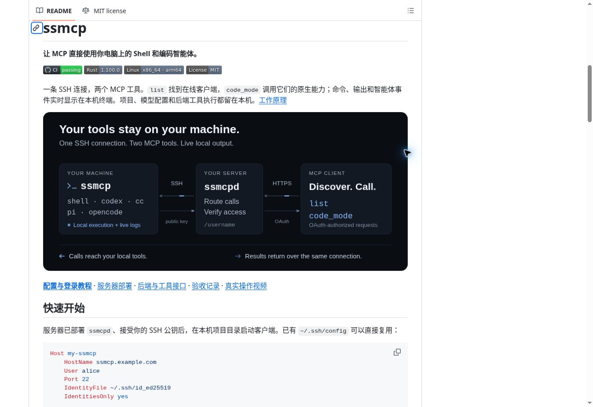

# ssmcp 0.3.1 验收报告

0.3.1 可以直接使用 `~/.ssh/config` 中的 Host 别名，复用 OpenSSH 解析的用户名、地址、端口与密钥。配置教程补全首次公钥登记、受限账户换钥、OAuth 登录和失效恢复；README 增加 CI、Rust、Linux、许可证徽章，以及连接架构和登录流程两张 SVG 动图。私有桥接协议仍为 v4，可与已有 0.3.0 服务端配合使用。[客户端实现](../src/client.rs) · [配置教程](configuration.md) · [README](../README.md)

## 版本与验证依据

截至 **2026-11-16（UTC+8）**，0.3.1 源码提交 [`bda87e3`](https://github.com/LIghtJUNction/ssmcp/commit/bda87e3ee368a2aabaf4d62ab810c7a306632ea8) 已通过 Linux x86_64 和 arm64 两个架构的完整 CI。[运行记录 43755971591](https://github.com/LIghtJUNction/ssmcp/actions/runs/43755971591)

| 检查 | [x86_64](https://github.com/LIghtJUNction/ssmcp/actions/runs/43755971591/job/132940024253) | [arm64](https://github.com/LIghtJUNction/ssmcp/actions/runs/43755971591/job/132940024002) |
| --- | --- | --- |
| 格式与 Clippy 零警告 | 通过 | 通过 |
| 默认 Rust 测试 | 97 通过，8 显式忽略 | 97 通过，8 显式忽略 |
| Node.js 与 bubblewrap 运行时集合 | 8 通过，无忽略项 | 8 通过，无忽略项 |
| 两工具 MCP HTTP 集成集合 | 3 通过，无忽略项 | 3 通过，无忽略项 |
| systemd 服务限制下的运行时探针 | 通过 | 通过 |
| 真实 SSH、OAuth、HTTP、PTY 与多客户端 | 134 项通过 | 134 项通过 |
| 五种后端完整 SSH/OAuth 链路 | 189 项通过 | 189 项通过 |
| Release 构建与暂存安装 | 通过 | 通过 |

默认 Rust 测试中的 8 项忽略包括 4 个需要单独安装与配置原生 CLI 的探针，以及 4 个需要真实系统隔离的测试。后 4 项由 CI 专用命令执行并通过。部分运行时集合重复执行默认测试，表格各行不应简单相加。[CI 定义](../.github/workflows/ci.yml)

本机也完成格式检查、Clippy、97 项默认 Rust 测试，以及 0.3.1 两个二进制的构建和版本输出检查。真实 SSH 与命名空间隔离由上述两个 CI 环境完成；当前编辑环境的监听器创建受到系统限制。测试使用临时 SSH 密钥与独立 sshd，未修改现有用户 SSH 配置。

## 本轮行为验证

| 行为 | 验证方式 |
| --- | --- |
| 裸 Host 别名原样交给 OpenSSH，不由客户端猜测用户名 | 客户端参数测试与 SSH 命令构建检查 |
| Host 配置的 User、HostName、Port、IdentityFile 与主机信任设置用于真实连接 | `scripts/e2e.py` 使用临时配置、密钥和 sshd 连接 `ssmcp-e2e` |
| 既有 `user@host`、`-F`、`-i`、`-p` 写法继续可用 | 命令构建与真实 SSH 后续连接 |
| 选项注入、控制字符和 shell 分隔符形式被拒绝 | 目标地址校验回归测试 |
| OAuth 仍绑定签发连接，重连产生新 ID 和新授权 | OAuth 集成测试与 SSH 断线、重连、刷新及重放检查 |
| 默认工具表只有 `list` 与 `code_mode` | 两工具集成测试与五后端链路检查 |

对应入口：[客户端测试](../src/client.rs)、[真实 SSH 脚本](../scripts/e2e.py)、[OAuth 测试](../tests/oauth_security.rs)、[五模式链路](../scripts/e2e_agents.py)。

## 公钥教程与文档验证

公钥追加示例在临时目录中使用一次性 Ed25519 密钥验证：保留已有条目；相同公钥已有带限制选项的有效条目时不重复追加；注释中的旧公钥不阻止添加；重复执行保持幂等；多公钥输入及无效 home 被拒绝；目录和文件权限分别为 `0700`、`0600`。真实用户的密钥与授权文件未参与测试。[公钥教程](configuration.md#public-keys)

四份使用文档共检查 **96 个相对文件及章节链接、24 个 shell 代码块**。两个 SVG 通过 XML 解析，未包含脚本、外部素材或 `foreignObject`，并提供 `prefers-reduced-motion` 静态回退。暂存安装检查确认配置教程、SVG 和预览图片随文档安装。

## README 实际预览

已在 GitHub 的实际 README 页面检查四个徽章和两个 SVG，六张图均加载成功；连接图的流动标记可见。两张 SVG 的 700 像素宽度静态渲染也已检查，文字没有溢出或裁切。[README 页面](https://github.com/LIghtJUNction/ssmcp#ssmcp)

## 验收范围

真实 SSH 链路测试覆盖公钥认证、OAuth、MCP 调用和终端进程。五种 Agent 的端到端测试使用确定性协议 fixture，不发起模型推理。实际用户机器的原生 Agent、模型账户、生产 DNS、TLS 与服务器部署需要在对应环境中验证；本轮交付为已推送源码、配置文档与 README 更新。

0.3.0 的架构与验收记录保存在[此前版本报告](https://github.com/LIghtJUNction/ssmcp/blob/34ac941d5d1589f00f77684a275fd3d60d6d563c/docs/validation.md)。
