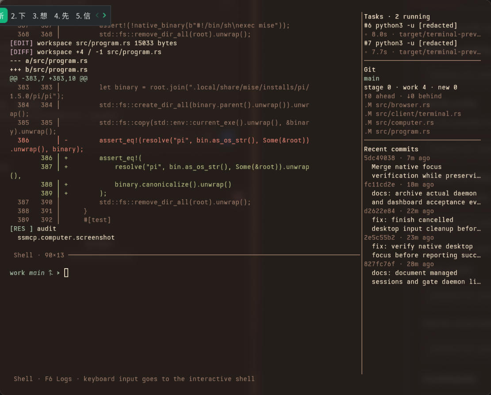

# ssmcp 0.6.0 验收记录

记录日期：2026-11-16，最新证据更新于 16:38 UTC。目标版本：0.6.0。本文按证据来源区分实现、协议测试、实机操作、发布与部署，不把其中一项的成功代替其他项。

**当前是交付过程中的证据快照，尚未签署统一 Harness 架构全部完成。** 最新五组本地端到端证据绑定 `62e40b04e1d50238630cb3b283174c4c29a465e3`；r4/r5 与两轮发布预检分别保留自己的身份。第三轮 CI 仍待修复后验证，尚未发布部署。 代码已回到 `main`：PR #7 的合并提交为 `07e2bccead43f682d1937f6da9d780489411f0ff`，新增 Git 历史侧栏的提交为 [`dd252ff91547776fc52dafe8d2134152e12040c4`](https://github.com/LIghtJUNction/ssmcp/commit/dd252ff91547776fc52dafe8d2134152e12040c4)。当时原工作区也已快进到该提交；它是 Git 历史功能的先前身份，不是本轮 daemon 的源码。历史 Rust 全目标结果、后续定向门禁、73 项与 76 项 Linux 终端运行分别保留自己的源码或二进制身份。CI、安装、发布与生产部署仍需独立结论；版本号和 main 合并不能代替这些证据。0.5.1 的已发布结论保留在[历史记录](validation-0.5.1.md)。

[最终门禁与交付记录](reports/final-0.6.0-gates.json) 保存每项检查的状态、命令、源码身份、结果与证据位置。`passed` 只适用于该项记录的源码快照；`pending` 表示尚未形成相应证据，不等于测试失败；`partial` 表示该组合场景已有实测，但表中仍列有未覆盖的部分。未执行项目的次数、退出码和耗时保持空值，不预填 0。

2026-11-16 13:46 UTC 的 GitHub 插件查询曾记录 [PR #7](https://github.com/LIghtJUNction/ssmcp/pull/7) 为 open、`draft:false`、`mergeable:true`，当时头提交为 `7d3bd590…`；这条历史观察保留在机器记录中。PR 随后已合并，当时的候选提交为上述 `dd252ff9…`。[CI 运行 43889879804](https://github.com/LIghtJUNction/ssmcp/actions/runs/43889879804)绑定该 SHA，首轮已因测试可移植性问题失败：Windows 的 cwd 断言遇到普通路径与 canonical verbatim 路径的表示差异，macOS 的两处 `openpty` 测试调用存在 const/mut 参数签名差异。这些测试修正已随 `a0430ba10b2cfdc360ec770c4066769a7f1ffc7a` 入库，后续两轮发布预检的最终结果见下节；这份记录不据此推断生产功能故障，也不将总验收标为完成。

## 后续固定镜像与发布预检

[r5 门禁摘要](reports/daemon-gates-20261116-r5.json)绑定干净源码 `d2622e841a4b2240675b5d7949c8b00c407aa3b5`：格式、computer 清理定向测试、clippy、包文件清单检查和构建均 exit 0；定向测试为 10 passed、0 failed、1 ignored。[Daemon 报告](reports/daemon-20261116-r5-report.json)145 项断言通过，30.206 秒，最终清理成功；[dashboard 报告](reports/dashboard-daemon-20261116-r5-report.json)76 项通过，15.396 秒。这是 r5 的独立结果，没有把 r4 全目标测试重记为新一轮运行。

随后使用 `62e40b04e1d50238630cb3b283174c4c29a465e3` 的固定镜像完成了[五组本地端到端](reports/platform-repair-e2e-62e40b-20261116.json)：

| 组别 | 实际断言 | 退出码 | 运行器耗时 |
| --- | ---: | ---: | ---: |
| 原生 Harness 协议 fixture | 349 | 0 | 17.560 秒 |
| 统一执行与审计 | 114 | 0 | 19.807 秒 |
| 已安装 Chromium headless 与原生控制 | 45 | 0 | 8.283 秒 |
| 真实 PTY 面板 | 76 | 0 | 17.706 秒 |
| 真实 systemd 用户会话 | 145 | 0 | 32.430 秒 |

各组包含重叠的认证与初始化断言，不相加为互不重复的测试数量。三个固定二进制在测试结束后再次核验摘要，未被并行构建替换。公开摘要仅将三处绝对二进制路径改为项目相对路径，并保留原始报告的字节数和 SHA-256；它有自己的公开副本摘要。这些 Linux 运行不能替代其他平台的实际会话生命周期或生产部署。

| 发布预检 | 固定源码 | 最终结果 |
| --- | --- | --- |
| [43904831705](https://github.com/LIghtJUNction/ssmcp/actions/runs/43904831705) · [报告](reports/release-preflight-43904831705-status.json) | `5dc490388bca8519fdd6171f09b49699564afcbd` | 六个平台构建成功，六组检查失败，发布 skipped |
| [43908296313](https://github.com/LIghtJUNction/ssmcp/actions/runs/43908296313) · [报告](reports/release-preflight-43908296313-20261116T163837Z.json) | `bf160c8f0e22669f8f4ef63fcdcb79c0e67ff2d5` | 六个平台构建成功；Linux x64、macOS Intel、Windows x64 检查通过，三个 ARM 检查失败，发布 skipped |

第二轮失败分别涉及 guardian 退出的瞬时断言、OpenCode attach 前 OutputStore 初始化的 ENOENT，以及 Windows ARM 的 browser reason 断言和并发审计 busy 返回。已知事实与尚待验证的原因保留在报告中；不能由构建成功推断全部检查通过，也不能由这些断言直接宣称生产资源泄漏。**第三轮 CI 仍待修复后验证，0.6.0 尚未发布或部署。**

[工作区清理摘要](reports/workspace-cleanup-20261116-summary.json)记录移除一个干净且已合并的旧 worktree，并清理另外两个 worktree 的 Cargo 缓存；父目录源码和本地证据保留。两个缓存清理前共分配 3,941,148 KiB，约 3.76 GiB，这是目录占用合计而非文件系统可用空间的独立实测增量。其余七个 worktree、原工作区九个已记录哈希的未提交文件及当前构建和证据受到保护。



图片来自 2026-11-16 16:19:03.898 UTC 的实际物理窗口，绑定 r5 `5798d181…` 镜像，原样保留输入法叠层。[精简来源记录](reports/terminal-sidebar-r5-20261116.json)区分初始 TTY 尺寸采样与截图中的子窗格尺寸。此预览省略 metadata title 以连接旧 Broker，不代表完整 title daemon 线上验收或最终发布镜像。后续须在 Broker 升级后保留完整参数复验。

## 已核实证据

[机器可读摘要](reports/unified-0.6.0-evidence.json) 保存本节日志摘要、SHA-256 和完整原生工具描述。原始日志位于开发机：

```text
/home/lightjunction/Documents/GITHUB/ssmcp/target/ssmcp-unified-task/
```

| 项目 | 实际结果 | 范围与边界 |
| --- | --- | --- |
| 恢复合并后的 `cargo check --all-targets` | 成功；`resume-check.log` | 编译检查，不代表所有运行测试或后续修改通过 |
| `release_client` | 4 passed、0 failed；`resume-release-client.log` | 原生 argv/env/cwd、独立 stdout/stderr、退出码、取消、文件/技能/规则契约 |
| 原生适配器与进程定向测试 | 汇总中 fmt/check/process/shell/opencode/rpc/pi/program 均 exit 0；`resume-native-results.json` | 其中进程 7 passed、RPC 7 passed、OpenCode 14 passed；真实 OpenCode 端点测试未运行，不能记为实机接入 |
| 发布与部署脚本 | 开发机完整测试 46 passed（协调执行任务 6）；新增部署测试在 Cloud 另有 6 passed | stage/apply 逻辑使用临时目录与 mock 系统服务，覆盖版本闸与回滚；未修改任何服务器，完整开发机日志待归档 |
| Codex 真实 MCP 工具 | 历史实机 1 passed、0 failed；`codex-real-mcp-smoke-4.log` | 同一次测试实际发现工具 Schema，并通过原生调用接口得到非错误结果；最终提交需复验 |
| 部署前服务器清单 | Arch Linux x86_64，`ssmcpd 0.4.1` | `resume-deploy-inventory.json`；这是升级前状态，不是 0.6.0 部署成功证据 |

### Daemon、watchdog 与同镜像终端复验

最新本地门禁绑定干净源码 [`c3d83ee87706b26db6ed77afb8bb1d5e67b67e13`](https://github.com/LIghtJUNction/ssmcp/commit/c3d83ee87706b26db6ed77afb8bb1d5e67b67e13)。[门禁摘要](reports/daemon-gates-20261116-r4.json)记录了源码、二进制、日志摘要和下列结果；它不代表后续提交、全平台 CI 或生产部署已经通过。

| 检查 | 本次实际结果 | 范围 |
| --- | --- | --- |
| 格式、全目标 Rust、code_mode、clippy、构建 | 五步均 exit 0 | Rust 的 17 个 suite 合计 418 passed、0 failed、19 ignored；其中库测试 336 passed、5 ignored |
| code_mode 单独复跑 | 16 passed、0 failed、0 ignored | 包含该组的 ignored；与全目标测试有重叠，不将两次计数相加，也不称其覆盖了全部 19 项 ignored |
| Linux daemon 真实端到端 | 145 项断言全部通过，exit 0，26.848 秒 | 已存在的 systemd 用户管理器、隔离的真实 OpenSSH 公钥认证、OAuth PKCE 与 MCP；没有安装或调用 Harness 模型 |
| 同一二进制的真实终端复验 | 76 项断言全部通过，exit 0，16.221 秒 | 真实 PTY、窗口缩放、并行活动、Git 历史与退出恢复；旧 73 项和旧 76 项报告保持不变 |

[Daemon 原始结构化报告](reports/daemon-20261116-r4-report.json)按场景列出实际断言。145 是执行断言数，包含重连后的重复认证检查，不能称为 145 个独立功能场景。测试将连接重试设为 2 秒以验证时间关系：观察到 SSH 重新连接用时 2.056 秒，其中明确的等待为 2.011 秒；原生服务进程崩溃后的恢复为 3.626 秒。两个手动停止观察窗口均为 2.75 秒，分别取得 20 和 19 次状态样本，窗口内没有复活。CLI 默认值仍是 5 秒，不能把测试参数写成产品默认值。

| 场景 | 实际验证 | 状态 |
| --- | --- | --- |
| 参数与默认前台行为 | 无效组合报错；普通前台仍有真实 PTY，且不创建后台会话 | Linux 通过 |
| 后台启动与授权 | manager 状态与 connection 状态分列；显式 auth 取得私有登录码，经真实 OAuth 后调用工具 | Linux 通过 |
| SSH 延时重连 | 终止本测试拥有的 SSH 后，同一服务进程按延时建立新连接；旧客户端 ID、授权与任务不可沿用 | Linux 通过 |
| 原生进程崩溃恢复 | 终止本测试拥有的服务 PID 后，systemd 创建新进程；恢复等待期间不显示旧 connected | Linux 通过 |
| 手动停止与重试中停止 | stop、重复 stop、重试期间 stop 均保持 inactive；不影响另一测试会话 | Linux 通过 |
| 并发与连接清理 | 两个独立命令和一个 PTY 任务真实重叠；断线清理其子进程；另一会话不能读取其任务 | Linux 通过 |
| 管理命令与可执行快照 | list、start、reload、restart、active remove；删除临时源二进制后已保存的快照继续工作 | Linux 通过 |
| 私有状态与日志 | 状态目录、文件和二进制权限正确；journal 含真实 stdout；普通输出、状态与日志不含测试登录码或 OAuth 凭据 | Linux 通过 |
| 管理器不可用 | 先证明原生命令不可达，再验证不留下半创建会话；测试结束清理确认成功 | Linux 通过 |
| macOS / Windows 原生管理器 | 本轮未执行 launchd / Task Scheduler 的实际生命周期 | pending；编译或单元测试不能代替实机操作 |

Linux journal 核验读取到 87 条实际 runner 记录，并检查 JSONL、无终端控制序列和真实命令输出。`sessions logs` 的 Linux journal 与明确降级的 lifecycle、其他平台 lifecycle-only 范围见[会话管理](session-control.md)和[日志说明](logging.md)。此轮不覆盖 GitHub 身份提供方的实际登录、退出系统或重启机器；后台会话也不使连接任务持久化。

两份实机报告使用相同客户端 SHA-256 `fd7133489a257a4c152f27ee959172200fcffc8c6edb459abc6241e98e7d88d2` 和 Broker SHA-256 `72b986e7dce3dcfbd27c44308063b99831c011b933ca3ed724ea25ad34b5fca8`。[同镜像终端报告](reports/dashboard-daemon-20261116-r4-report.json)单独保存，不能覆盖先前报告的身份或把三轮断言相加。

首轮 daemon 测试的 127 项断言通过后，管理器不可用的负例失败：当时只修改 D-Bus 地址，并未阻断 systemd 的本地连接。[修正说明与来源清单](reports/daemon-first-20261116-provenance.json)保留原报告 SHA、实际二进制和清理结果。[四组只读探测](reports/daemon-manager-transport-20261116.json)证明正常环境与仅改 D-Bus 都返回 0，使用空的短路径运行目录后才返回 1。修正只涉及测试夹具；原报告中的 a0430ba 是基础提交，附带的 tracked Diff 又未包括当时未跟踪的两个新文件，因此不把它误称为精确源码身份。

### 先前的 Rust 全目标门禁

本轮任务 `4f753a35d9e2f723431a9a34fb8d945f-e` 的最终退出码为 0，耗时 69.368 秒；已直接核对 `target/acceptance/rust-gates.json` 和同一连接的完整 stdout。8 个步骤均通过：

| 步骤 | 结果 | 耗时 |
| --- | --- | --- |
| `cargo fmt --all -- --check` | exit 0 | 0.465 秒 |
| 全目标 clippy，`-D warnings` | exit 0 | 7.729 秒 |
| 全目标 Rust 测试 | 376 passed、0 failed、18 ignored；16 个 suite 输出 | 54.441 秒 |
| Node 与隔离执行器，包含 ignored | 11 passed、0 failed | 2.520 秒 |
| 两个公开 MCP 工具，包含 ignored | 7 passed、0 failed | 1.117 秒 |
| Workspace bridge 的 ignored 检查 | 3 passed、0 failed | 2.570 秒 |
| Context helpers 的 ignored 检查 | 2 passed、0 failed | 0.315 秒 |
| 客户端与 Broker 构建 | exit 0 | 0.115 秒 |

全目标结果中，库测试为 294 passed、0 failed、4 ignored，其余 suite 合计 82 passed、0 failed、14 ignored。后续定向检查与这次运行有重叠，因此不把各次 passed 相加为唯一测试数量。未执行项的具体原因和最终覆盖范围仍需在最终记录中逐项保留。

该运行的源码身份为 base `7d3bd590c38f972e83b56d98dfe6015bac352c1c`，工作区 Diff SHA-256 为 `a64be6692edb6e11e6ddf81493e76796de17bd546bbb94e59f5177e95dc939da`。报告文件 SHA-256 为 `4b7ec9ae89fdced0b8af0143c979d1c2ec72e682a341fcddb0f31fe264344551`。这条身份记录不证明后续改动或 GitHub CI 已通过。

原始输出已在同一连接内归档，并校验字节数与摘要，位置均相对隔离工作区：

| 文件 | 字节数 | SHA-256 |
| --- | ---: | --- |
| `target/acceptance/rust-gates-4f753a35-e-stdout.log` | 3,906 | `e8611370e1301d91c20df1cb927717967e09fd568fa5bb89db6eceb2346fe3d7` |
| `target/acceptance/rust-gates-4f753a35-e-stderr.log` | 315,107 | `68eb23bd5bda3292a2c4d4789638b66d791a0b962401a192e56cb573b760090c` |

stderr 对应完整 artifact `68aa1acc8b0d21e2c68bb9fe2d764122`，共 3,997 行，`complete:true`。归档文件权限为 0600；私钥头、Bearer、GitHub/AWS 凭据形状和敏感赋值的初步模式检查均为 0 个匹配，这不证明任意秘密都已排除。公开仓库与 Drive 只保存脱敏摘要、校验值和必要证据；原始日志留在受控目录。

日志焦点的同批次切换与极矮窗口恢复已追加修复；下述 Linux 真实 PTY 检查通过了这两个操作场景。独立 Rust 定向结果仍应按对应日志记录，旧界面的端到端检查数量不能沿用为新面板的实机验收。

### Git 历史侧栏的增量门禁

[`dd252ff9…`](https://github.com/LIghtJUNction/ssmcp/commit/dd252ff91547776fc52dafe8d2134152e12040c4)将任务、工作区与最近提交顺排，移除 Git 上方的固定空窗。提交来自本地实际 HEAD，最多五条，按可用高度显示短 SHA、相对时间与最多两行标题。HEAD 变化、空仓库和过期状态都有明确显示。[操作说明](logging.md#固定状态区与窗口尺寸)

[本轮定向门禁报告](reports/git-history-gates-20261116.json)的五步均 exit 0：

| 步骤 | 实际结果 | 门禁步骤耗时 |
| --- | --- | --- |
| 格式检查 | exit 0 | 0.902 秒 |
| Git 历史观察测试 | 7 passed、0 failed、0 ignored | 4.700 秒 |
| 侧栏测试 | 9 passed、0 failed、0 ignored | 0.300 秒 |
| clippy | exit 0 | 6.067 秒 |
| 构建 | exit 0 | 8.053 秒 |

测试时的基础提交为 `07e2bccead43f682d1937f6da9d780489411f0ff`，工作区 Diff SHA-256 为 `289619134ab2b0fefef8b6a8f3b72f4dc01f912ef6cf86797838b99558ce6b46`；随后四个改动文件提交为 `dd252ff9…`。门禁报告 SHA-256 为 `f55946e9ce92ac6d752a4b408bc1dfbcc81566586bf63bd2be7dc5aaf6dcc86f`。这是增量定向测试，不能称为重新执行了上节全部测试；最终全平台 CI 仍以对应运行的结论为准。

部署版本测试具体覆盖：必填稳定版本号；拒绝错误或重复的包身份字段；暂存二进制版本不符时不启动服务；成功 stage 绑定版本、提交和包摘要；拒绝旧版本、不同提交、不同包或过期 receipt；安装后版本不符时恢复旧包与 checkpoint。它们在 [`scripts/test_release.py`](../scripts/test_release.py) 中，随现有发布脚本检查运行。

复核日志内容时需先区分原生错误和桥接错误。旧 Codex 日志中部分用户配置的 MCP Server 缺少凭据、登录或可执行入口，原生层明确报告 unavailable；成功调用另一服务器不应隐藏这些诊断，也不证明所有已配置服务器可用。

### 本轮在线原生目录与只读调用

2026-11-16 13:55:06.998 UTC 的[在线验证摘要](reports/native-validation-20261116-summary.json)记录了运行中的 0.6.0 客户端。运行二进制 SHA-256 为 `f4f64248fa447e1cb40e8e76636a6467a0a24d4d28cae5422e999d80ad6b8e4d`；它包含第一批 UI 与目录缓存修复，尚不包含右侧面板。以下结果适用于这个运行镜像，最终发布镜像仍需绑定对应证据。

| 检查 | 实际结果 |
| --- | --- |
| 完整目录分页 | 23 页、1,416 个互不重复的路由名称，其中 Codex MCP 工具 1,154 个；同一快照完整读取 |
| 原生 Schema 保真 | 发现的 `codex.mcp.linux-computer-use.doctor` 描述与原生描述比较一致，仅路由名称不同；完整样本含 `inputSchema`、`outputSchema` 与 `$defs` |
| 原生 MCP 状态长输出 | 409,879 字节，13 页完整读取，SHA-256 核对一致，`complete:true` |
| 原生工具真实调用 | 只读 `doctor` 调用 2.542 秒；返回 `isError:false`，保留 `content` 和对象类型的 `structuredContent` |
| 审批与模型请求 | 该只读工具无需审批；调用前后未决审批均为 0，未发送审批回复，未触发模型请求 |

原生状态输出的 SHA-256 为 `2f44a840e928ef50c955166a29cd2241ec1dd73bb6b892f6fec1edd653c4e8e2`。这次样本不覆盖需要审批的真实工具，也不证明截图或输入权限已可用。[完整工具描述](reports/native-tool-sample-20261116.json)只包含原生接口说明；[证据完整性清单](reports/native-validation-20261116-integrity.json)列出私有记录的字节数与摘要，不包含原始返回值。

同次运行中，Codex `0.169.0` 与 Claude Code `2.1.325` 经发现后分别报告 ready；Pi `1.5.2` 与 OpenCode `2.3.0` 已安装但未配置安全的既有原生入口，报告 unavailable。这是实际支持范围，不能改写成四类均成功接入。完整目录、用户环境具体值和原始服务结果未上传公开仓库。

### 真实工具枚举与调用样本

历史实机日志发现的工具名称为 `codex.mcp.linux-computer-use.doctor`。它是此次发现的样本，不能硬编码进自动路由。其原生参数 Schema 为：

```json
{"properties":{},"type":"object"}
```

工具描述同时包含完整 `outputSchema` 与 `$defs`；[证据摘要](reports/unified-0.6.0-evidence.json) 原样保留这个描述。日志随后出现 `mcpServer/tool/call` 请求和成功响应，返回保留 `content`、`structuredContent`、`isError:false`。只读诊断明确标记截图捕获尚未验证，这个结果不证明截图授权或完整桌面控制可用。

公开摘要只保留明确标注的响应摘录，不提交运行时环境和私人路径的完整内容。原始结果保存在受控日志内；摘要中的 SHA-256 可用于核对其来源。该调用没有覆盖原生交互审批分支；审批传播仍需用相应测试及实际可观察的权限路径验证。

## 十二项验收账本

以下“待最终签署”表示需要把证据绑定最终提交并完成该项的实际运行范围，不表示已经观察到失败。提供者被安全地标记 unavailable 是正确诊断，但不能改写成成功接入。

| 验收项 | 已有证据或实现 | 最终需补的证据 |
| --- | --- | --- |
| 不安装 Harness 仍可连接并执行 Shell | Shell 为独立基础能力；启动与 SSH fixture | 最终二进制在无 Harness 环境的 SSH、命令和退出记录 |
| 仅注册真实安装且实际可用的工具 | 二进制、版本、握手、目录检查；不可用诊断 | 实机目录与安装清单对照，确认没有过期路由 |
| 四类 Harness 独立发现、单故障隔离 | 并行发现；Pi/OpenCode 只连安全既有入口 | 每类真实接入结果或具体 unavailable 原因，及单提供者失效后的其他调用 |
| `list` / `code_mode` 目录一致且 Schema 保真 | 同一注册表、分页快照与命名空间 | 同一在线连接的两条目录路径与原生 Schema 样本 |
| Codex MCP 内部工具动态枚举并真实调用 | 历史实机目录加成功调用 | 最终提交复验；目录增删、断连与审批传播的对应记录 |
| 至少两项 Shell 命令独立并发 | 独立进程、分离输出与任务 ID | 同时存活的任务状态、交错事件、各自最终退出码 |
| 后台 stdout/stderr 实时且不重复 | 实时增量事件；read/wait 不重复展示 | wait 前已经出现输出的终端记录及无重复检查 |
| 文件、Diff、技能审计准确 | 成功提交点事件，三态快照；发现与读取分离 | 真实读写 Diff、失败写入无伪成功、技能发现/读取终端样本 |
| 超时、取消、断线、reload 清理 | 连接拥有任务的生命周期与注册表失效 | 进程后代清理、旧 ID/目录不可路由、重连后的资源检查 |
| 长输出完整保存、分页、SHA、过期 | 共用 OutputStore 与原有阈值/配额 | 各输出路径的完整分页和摘要核对、自动清理及不完整错误样本 |
| 原生审批与客户端授权不被绕过 | 原生请求/响应转发、连接访问和输出归属检查 | SSH/OAuth/客户端隔离、拒绝/待审批状态及跨连接读取拒绝 |
| Rust、SSH/OAuth/PTY E2E 与 CI 全通过 | 已有部分定向测试与编译记录 | 最终提交全目标测试、clippy、原生平台 CI、端到端运行 URL/日志 |

Pi 和 OpenCode 的原生接口范围见[发现说明](backends.md)。当前没有证据证明用户的真实 Pi socket 或 OpenCode 服务已经接入；不能用 fixture 的成功代替这两项实机结论。发现阶段不得安装依赖、触发模型或通过禁用审批扩展来制造可用状态。

## 发布、安装与部署记录要求

发布记录需包含最终源码 SHA、PR、CI 运行 URL、固定 `v0.6.0` 标签和公开制品摘要。GitHub Release 与 crates.io 是独立渠道，分别记录成功或失败；标签、仓库版本号或草稿 Release 不能代表附件已可下载。[发布流程](releases.md)

客户端安装需记录下载制品、SHA-256、实际入口与 `ssmcp --version`。正在运行的旧客户端不会因磁盘文件替换自动更新；reload 先确认接收，然后必须观察新连接、重新发现目录并核验实际版本。新连接不继承旧连接的输出读取权。[重载与输出](session-control.md)

部署前实机状态已读取：SSH 目标 `archczy`，服务单元位于 `/usr/lib/systemd/system`，执行入口为 `/usr/bin/ssmcpd`，已安装 `ssmcp-git 0.4.1.r70.g655342c-1`；门户为独立服务。0.6.0 候选 Arch 包只可从通过 CI 的固定提交构建，保留包摘要与可恢复旧包。[部署助手](../scripts/deploy_server.py)

stage/apply 使用同一 `--expected-version 0.6.0`、提交和候选包摘要。最终材料应保留两个 JSON 报告，包含 staged/installed/running 版本、生产租约、DCR 重启恢复、门户、本地及公网健康、未授权拒绝、回滚 checkpoint 和最终二进制摘要。实际 apply 由独立 SSH/systemd 作业持有；升级期间管理用 MCP 连接中断不能使回滚驱动一起消失。[部署命令](deployment.md#日志和受控升级)

## 最终交付门禁

以下表格用于补齐最终提交后的结果，完整字段在 [JSON 记录](reports/final-0.6.0-gates.json) 中。每项结果都需要命令或操作、源码身份、环境、退出状态和可核对的日志或 URL。

| 项目 | 当前记录 | 仍需形成的交付证据 |
| --- | --- | --- |
| Rust 格式、clippy、全目标测试、构建 | c3d83ee 的本地五步门禁通过；418 passed、19 ignored，另有 code_mode 16 项通过 | 后续最终发布提交及全平台 CI 绑定；各组 ignored 的范围保持独立 |
| 发布与部署脚本 | 既有开发机 46 项通过 | 与最终提交绑定的日志 |
| SSH / OAuth / PTY 与统一执行审计 | 有前序协议与端到端结果 | 最终版本的对应日志，不能替代新前端的实机交互 |
| Codex 真实目录与调用 | 有历史真实样本 | 最终二进制同一次发现、Schema 与调用结果 |
| Pi / OpenCode 真实外部服务 | pending | 实际端点接入，或保留具体不可用原因与支持范围 |
| 新面板真实终端交互 | 先前 73 / 76 项报告保留；c3d83ee 同镜像再次 76 项通过，16.221 秒 | 三份报告分别绑定运行二进制；下表仍保留未覆盖的组合场景，其他平台待实际记录 |
| Daemon 与 watchdog | Linux 实际用户管理器 145 项断言通过，26.848 秒；最终清理成功 | macOS / Windows 原生生命周期、登录或系统重启未在本轮验证 |
| 六平台 CI | 历史失败与两轮发布预检结果分别保留；第二轮六个构建成功、三组检查通过、三个 ARM 检查失败 | 第三轮修复后的不可变提交仍需验证；不能把构建成功写成全部检查通过 |
| GitHub Release / crates.io | pending | 分别记录公开版本、制品清单与摘要 |
| 客户端安装与 reload | pending | 安装入口、版本、二进制摘要及新连接 |
| 服务端 stage/apply 与线上复验 | pending | 同一版本、提交和包摘要；运行版本、授权、健康及恢复记录 |
| Google Drive 同步 | pending | 本轮摘要文件清单、具体目录与报告 URL |

### 真实终端交互验收

[首轮 Linux 实机报告（73 项）](reports/dashboard-20261116-report.json)来自开发机上的受控前台 PTY，使用独立 OpenSSH 公钥认证、OAuth 和 VT 屏幕解码器检查实际进程与终端行为。73 项断言全部通过，耗时 14.173 秒；其中包含不同前端模式重复运行的登录检查，不能称为 73 个互不重复的 UI 场景。本次没有调用已安装 Harness 的模型。

运行客户端 SHA-256 为 `6d114b685c644a510c674118d612156ebd5e2ee9f7b53717758a2272bc0f9821`，Broker 为 `e81a099e690c06e57ef21c8dd85af88a020081af167fcd9a38a0ac93fb2137ae`；报告 SHA-256 为 `e589ecb15ece149a64f28cfd1f401373a9f8864e3ed5b2214c2ce18fbbf8e8ab`。记录覆盖 106、80、160 列与极矮窗口，原始显示捕获为 85,432 字节，完整摘要保存在报告中。原始 PTY 内容未随公共报告上传。

新增 Git 历史后，又执行了同一真实终端流程。[新的 76 项报告](reports/dashboard-git-history-20261116-report.json)全部通过，耗时 20.389 秒，运行器最终退出码为 0，stderr 为空。新增三项检查从测试拥有的真实 Git 仓库读取期望值：短 SHA 与标题对应实际 HEAD；未提交文件修改不改变提交历史；创建一个测试提交后，新 HEAD 显示在其父提交之前。没有使用 main 仓库的固定 SHA，也没有向主仓库写测试提交。

这次客户端 SHA-256 为 `2b062b123f37bd791616db4161c912de4e8566960b64c967b2ec7f31b1b61bc4`，Broker 为 `fa9b36549e02de97957529b031974642f00e08817238cb6bd254190f584f083f`；脚本 SHA-256 为 `d88f63ac0e25f93561ed3bcffb42f50aecc4c0a257a5b3e37e95784493079d62`，报告 SHA-256 为 `0d4e985d39477aad61e023ca4e0ff345baf8291e08fcad9118acc9fdd75c9cfd`。新旧报告各自保留，既不覆盖旧身份，也不把 73 与 76 相加为独立测试数量。

| 编号 | 场景与判定 | 状态 |
| --- | --- | --- |
| U01 | 106×58 下左区 77 列、右区 28 列，日志、Shell 与侧栏互不覆盖 | Linux 通过 |
| U02 | 106→80→160→106 列缩放和实际子 PTY 尺寸已验证；80 列下单独的 F6 操作尚未列入报告 | 部分覆盖 |
| U03 | 日志焦点缩至 4 行后返回 Shell 焦点和可见光标；恢复高度后尺寸正确 | Linux 通过 |
| U04 | F6、PgUp、Home/End、Esc 与真实历史输出已验证；PgDn 尚待对应记录 | 部分覆盖 |
| U05 | 同一批次 F6→PgUp→普通字符，输入进入 PTY，日志回到最新输出 | Linux 通过 |
| U06 | 宽字符、组合字符、普通输入和后台输出隔离已验证；持续输出时的退格与括号粘贴未单列 | 部分覆盖 |
| U07 | 两个独立任务及超过 6 秒的静默计时已验证，无伪百分比；真实 total 和跨来源同号的实测未纳入本报告 | 部分覆盖 |
| U08 | stdout/stderr 在执行中各显示一次，read/wait 不重放，也不覆盖手工 Shell | Linux 通过 |
| U09 | 成功的实际文件写入显示审计和 Diff；技能状态、失败写入及完整 Diff 查询的证据另列 | 部分覆盖 |
| U10 | 真实仓库状态、修改刷新、HEAD 短 SHA/标题、未提交修改保持历史及新提交排序均已验证；冲突、过期与不可用状态未在此实机流程注入 | 部分覆盖 |
| U11 | NO_COLOR、关闭面板、JSONL、非 TTY 与内层 clear/alternate screen 隔离已验证；敏感字段注入的证据另列 | 部分覆盖 |
| U12 | Ctrl-C 正常退出恢复屏幕、光标、输入模式和原始 termios；受控失败与任务清理另行记录 | 部分覆盖 |

Windows 与 macOS 的真实交互结果必须单独记录，构建成功不能代替键盘、缩放和退出恢复。渲染 fixture 可以证明确定的输出排版，但不能替代真实终端输入。本次 UI 审阅发现的两个焦点边界已经修复，并分别通过了 U03、U05 对应的真实操作检查。上表的部分覆盖不改变已通过断言的结论，也不把未覆盖部分记为通过。

### PR 讨论与自动审阅状态

2026-11-16 13:46 UTC 的只读查询返回 6 条 PR 时间线消息，没有返回带文件行号的修改建议。Sourcery 因改动超过其 150,000 字符限制未完成审阅；Codex Security Review 在 `31c3323` 上报告 failed，配套消息说明付费账户已达到用量限制。自动审阅因此没有形成完成结论，也不能被记为安全检查通过。摘要中的 unresolved 标记没有附带可核查的具体 finding；保留原状态和原因，未发送评论、重试审阅或触发模型。[审阅摘要](https://github.com/LIghtJUNction/ssmcp/pull/7#issuecomment-6912712325) · [额度说明](https://github.com/LIghtJUNction/ssmcp/pull/7#issuecomment-6916701956) · [大小限制](https://github.com/LIghtJUNction/ssmcp/pull/7#issuecomment-6916700732)

## 材料归档

Git 保存实现、项目技能、测试、文档和上述脱敏摘要；原始运行日志、候选包与回滚材料按权限保存，不把 OAuth 凭据、私钥、环境变量或敏感文件正文提交到公开仓库。Google Drive 同步应记录具体文件夹路径、报告 URL、上传文件清单与校验值；上传失败时如实保留未同步状态。

已有 [Google Drive 验收目录](https://drive.google.com/drive/folders/1_ks6zQwTGMTcm3X3vkmfp1wqXwiZxWZ7)。最终材料包和其余证据的上传清单与结果仍为 pending，已上传的独立文件列于下文；最终公开 Release 和部署后版本也尚待填入实际证据。

已有 Drive 独立文件包括 [r4 daemon 报告](https://drive.google.com/file/d/1uMstAGCrPk1bu8vYg41HAVRPjKXGNiTw/view)、[首轮发布预检](https://drive.google.com/file/d/1syWcd7krmViORiZK7U5-W3Z3LirCIAUJ/view)和[实际 r5 截图](https://drive.google.com/file/d/1qJbCngBRlV6JTnYPvREHUnt72BHrK9Z4/view)，已上传并核对元数据。最终合并材料包及其余证据仍待同步，不重复创建这些同名独立文件。
