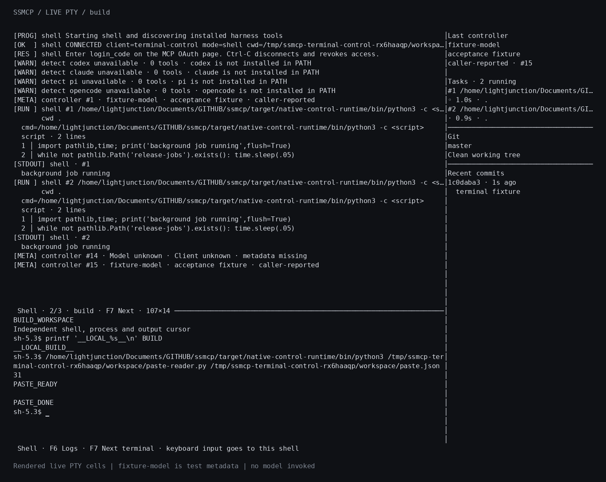

# CUA、并行任务与多终端验收

本轮改动为 `code_mode` 增加原生 `cua` 入口，按真实进程生命周期限制 `exec.parallel` 的并发数量，为后台命令补齐标准输入，并将单个交互 shell 扩展为多个独立 PTY。控制者信息随每次调用传递，界面分别显示当前活动身份与上次身份，并明确标记模型名称的来源。用法与边界见[终端控制指南](terminal-control.md)。

## 验证范围

验证于 2026-11-16 在 Linux 开发机的隔离工作树完成，使用 Rust 1.100.0 和本机构建的 `ssmcp`、`ssmcpd`。复用开发机已有依赖，不调用任何外部模型，也不重启在线客户端或服务。本轮证据不覆盖 Windows/macOS 真机，也不证明某个 Codex 安装实际公开了内部 CUA 接口。

## 功能改动的自动检查

| 检查 | 结果 | 说明 |
| --- | --- | --- |
| Rust 库与二进制单元测试 | 386 通过，7 忽略 | 381 个库测试及 5 个服务端二进制测试 |
| Rust 集成测试 | 81 通过，14 忽略 | 包括真实 subprocess、PTY、SSH、协议兼容与 Codex 协议桩 |
| JavaScript worker 测试 | 10 通过 | 5 个 CUA 测试与 5 个执行 helper 测试 |
| rustfmt | 通过 | `cargo fmt --all -- --check` |
| Clippy | 通过 | `cargo clippy --locked --all-targets -- -D warnings` |
| 构建 | 通过 | `cargo build --locked --bins --example vt_snapshot` |
| 补丁空白检查 | 通过 | `git diff --check` |

Rust 测试合计 467 通过、21 忽略。第一次全量命令在客户端启动测试中发现一处仍固定断言协议 v4 的旧用例；改为引用当前协议版本后，重新执行该集成测试及剩余全部集成目标，全部通过。表格合并已通过的目标，不将中断的第一次全量命令记为成功。被忽略的测试保留项目原有条件，本轮没有启动外部模型来替代这些条件。

验证覆盖并发槽位直到真实进程退出才释放、观察失败后不继续占用新槽位、输入管道部分写入与 EOF、取消时唤醒等待写入、终端工作目录和输出隔离、终端关闭与容量限制、F7 与文本的先后顺序、括号粘贴、设备回复的目标，以及被选中 shell 退出后的本机输入恢复。协议测试同时覆盖 v4 客户端兼容、v5 控制者元数据、并发请求倒序结束和未提供身份时的显示。

复现命令：

```sh
node --test scripts/test_cua_facade.mjs scripts/test_execution_helpers.mjs
cargo test --locked -- --test-threads=4
cargo fmt --all -- --check
cargo clippy --locked --all-targets -- -D warnings
cargo build --locked --bins --example vt_snapshot
```

## 真实终端与 CUA

真实端到端脚本位于 `scripts/e2e_terminal_control.py`。它启动本轮拥有的临时服务端、SSH/MCP 连接和客户端，在独立 PTY 中发送输入并读取最终 VT 画面。PNG 根据真实 VT 单元格绘制，不是设计稿。脚本结束时关闭自己创建的服务、连接、终端和浏览器。

最终终端与 CUA 场景通过 **50 项检查，耗时 9.243 秒**。测试覆盖三个独立 shell、两个同时运行的后台进程、F7 与粘贴输入、后台终端设备查询、未声明模型时的显示、关闭选中终端、已退出 PTY 的输入恢复，以及断线后的终端模式还原。完整检查与二进制、脚本、图片哈希见[运行记录](reports/terminal-control-2026-11-16/terminal-control.json)。

CUA 使用隔离 Chromium 打开本地提供的验收页面，经公共 code_mode 端点调用截图并由 image() 返回真实 MCP 图片块。结果为一张 960 × 513 的 JPEG，17,024 字节；尺寸与 MIME 同独立 metadata 一致，Base64 未进入文本日志。测试随后关闭自己拥有的浏览器。此证据验证原生 CUA 图片链路，不代表调用过 Codex 模型或未经公开的内部接口。



画面中的 fixture-model 是测试输入，侧栏和页脚明确标注来源与“未调用模型”。其余画面见 [logs](reports/terminal-control-2026-11-16/terminal-logs.png)、[main](reports/terminal-control-2026-11-16/terminal-main.png)；[真实 CUA 截图](reports/terminal-control-2026-11-16/cua-browser.jpg)独立保留。

既有基础端到端脚本另通过 **143 项检查，耗时 8.319 秒**，覆盖真实 OpenSSH、HTTP、PTY、工具目录精确匹配和断线进程清理。[基础运行记录](reports/terminal-control-2026-11-16/base-e2e.json)与[清理检查](reports/terminal-control-2026-11-16/base-e2e-cleanup.json)均已保存。原脚本的目录集合已补齐新增四个终端管理工具和 exec.write；Omarchy 工具保持完整。

复现真实端到端验收：

```sh
python3 scripts/e2e.py --bin-dir target/debug --report target/base-e2e.json
python3 scripts/e2e_terminal_control.py --bin-dir target/debug \
  --report target/terminal-control-acceptance/terminal-control.json \
  --snapshot-dir target/terminal-control-acceptance \
  --preview-dir target/terminal-control-acceptance
```


## 合并 main 后的回归

在功能与画面验收通过后，合并了 main 的 `663b2cdf`，保留期间新增的 OAuth 文档和首次连接向导。Cargo.toml、README.md、src/client.rs 及工具目录夹具完成三方合并，没有覆盖其他工作的内容；基础 e2e 脚本的可执行权限保持原样。

合并后重新构建，并通过 client_startup 的 **9 个测试**及首次连接向导的 **5 个端到端场景**。后者包括初次连接失败后的 Ctrl-C、交互式禁用向导、非交互失败、终止信号清理，以及真实约 30 秒注册期限后的 SSH/ProxyCommand 清理。对应场景使用隔离配置和本地测试门户，没有打开真实浏览器或改变用户 SSH 配置。最后再次通过格式检查和 Clippy 全目标零警告检查。

[合并后检查记录](reports/terminal-control-2026-11-16/merge-gates.json)保存命令与退出状态；[首次连接运行记录](reports/terminal-control-2026-11-16/onboarding-merge.json)保存五个场景、清理观察和实际二进制哈希。这些回归验证新增向导与本轮终端生命周期的交界，不重复计入前面的 467 项 Rust 统计。

## 同步命令日志改进后的最终复验

main 随后更新至 `ae8c9c3f`，新增可读脚本预览与命令输出关联。本轮再次三方合并，保留控制者显示、按 terminal_id 分流和原生 exec/PTY 的直接分发路径；日志关联上下文只进入 harness 调用，不为原生并行任务引入共用串行锁。

合并后重新构建，通过 **50 个渲染相关测试**和 **2 个并行调用关联测试**，并再次通过格式与 Clippy 全目标零警告检查。终端/CUA 端到端重新通过 **50 项检查，耗时 9.243 秒**。本文链接的三张终端画面、原生 CUA 记录与二进制哈希均已替换为这次最终组合的实际产物。脚本预览、任务活动计数、控制者栏与各 PTY 分隔保持可读。

[最终合并检查记录](reports/terminal-control-2026-11-16/logging-merge-gates.json)保存这轮命令、退出码和耗时；早期功能验证及首次连接回归记录继续保留，分别对应其运行时的二进制哈希。

## 兼容与交付边界

旧的 `terminal.read/write/status/resize` 调用未提供 `terminal_id` 时仍指向 `main`，不受本机 F7 选择影响。后台任务属于客户端连接，连接断开或重载会停止其拥有的进程；它们不是跨断线持久服务。外层 `code_mode` 超时不会自动取消已经提交的任务，可根据 `job_id` 继续查询。

模型名称是调用方声明，不是从终端自动识别出的事实。服务端为来源设置 `caller-reported` 或 MCP clientInfo 标记，未收到模型名称时显示未知。协议 v5 承载该元数据；新版服务端兼容 v4 客户端，但完整界面需要更新客户端。

代码、测试和说明在 GitHub 保存；本轮不发布版本，也不替换在线 `ssmcpd` 或客户端进程。在线旧版本只有它实际注册的能力，新接口以更新后的服务端与客户端为准。
